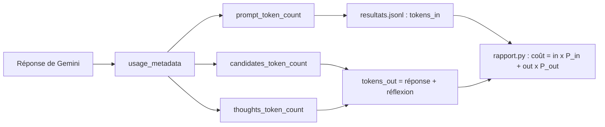

# Suivre et prévoir les coûts

> [!NOTE]
> Dans cette leçon, vous allez enregistrer les jetons consommés par chaque lot, en déduire le coût réel d'un traitement, et **prévoir** le coût de 100 000 documents à partir d'un essai sur 200. Code : [classer.py](../files/classer.py), [rapport.py](../files/rapport.py).

## Ce qui est facturé

Les modèles Gemini sont facturés au **jeton** (*token*), un morceau de mot : en ordre de grandeur, un mot français fait un à deux jetons. On paie séparément :

- les **jetons d'entrée** : instruction système + prompt (ici, les avis) ;
- les **jetons de sortie** : la réponse, **plus** les **jetons de réflexion** (*thinking*) des modèles qui réfléchissent avant de répondre.

Les prix (en dollars par million de jetons) dépendent du modèle et du mode : la page Tarifs indique notamment que le mode lot coûte **la moitié** du tarif standard.



## Enregistrer les jetons avec chaque lot

```python title="files/classer.py"
u = r.usage_metadata
return {"resultats": valider(avis, r.text), "tokens_in": u.prompt_token_count or 0,
        "tokens_out": (u.candidates_token_count or 0) + (u.thoughts_token_count or 0)}
```

Les jetons sont écrits **dans la même ligne** que les résultats du lot : le point de reprise est aussi le registre des coûts. Un lot refait après une coupure n'est compté qu'une fois dans le fichier... mais il a été **payé deux fois** chez le fournisseur ; c'est le coût d'une coupure, borné par la concurrence.

> [!WARNING]
> Oublier `thoughts_token_count` sous-estime la facture. Sur le test Vertex AI de la leçon 3.2, une requête avait 467 jetons de réponse et **1 106** jetons de réflexion : la sortie réellement facturée était plus du triple de ce qu'on lisait.

## Calculer le coût

```python title="files/rapport.py"
prix_in = float(os.environ.get("PRICE_IN_PER_M", "0.10"))
prix_out = float(os.environ.get("PRICE_OUT_PER_M", "0.40"))
cout = t_in / 1e6 * prix_in + t_out / 1e6 * prix_out
```

Les prix viennent de l'environnement (fichier [.env.example](../files/.env.example)) : les valeurs par défaut sont des **exemples**. Recopiez celles de la page Tarifs pour votre modèle, le jour où vous faites le calcul : les prix changent.

$$\text{coût} = \frac{\text{jetons entrée} \times P_{in} + \text{jetons sortie} \times P_{out}}{10^6}$$

## Prévoir : extrapoler depuis un échantillon

On ne lance pas 100 000 documents « pour voir ». On mesure sur un petit lot représentatif, puis on extrapole :

| Mesure sur 200 avis (2026-10-15) | Valeur |
| --- | --- |
| jetons d'entrée | 6 884, soit environ 34 par avis |
| jetons de sortie (réflexion comprise) | 9 468, soit environ 47 par avis |
| requêtes | 20 (lots de 10) |

Pour 100 000 avis semblables : environ 3,4 millions de jetons d'entrée et 4,7 millions de sortie. Avec les prix d'exemple du `.env.example` (0,10 $ et 0,40 $ par million) : $3{,}4 \times 0{,}10 + 4{,}7 \times 0{,}40 \approx 2{,}2$ $ en synchrone, environ la moitié en mode lot. Refaites ce calcul avec les **vrais** prix de votre modèle.

| Levier | Effet sur le coût |
| --- | --- |
| mode lot (Batch API, Vertex AI batch) | environ moitié prix, si le délai est acceptable |
| modèle plus léger (variante *lite*) | souvent bien moins cher : à valider sur la qualité (leçon 4.2) |
| regrouper par lots | instruction système payée une fois par lot |
| limiter la réflexion (`types.ThinkingConfig`) | moins de jetons de sortie sur une tâche simple de classement |
| sortie courte et structurée | pas de phrases inutiles dans la réponse |

```quiz
question: "Sur un essai de 200 documents, vous mesurez 9 468 jetons de sortie. Combien en prévoir pour 50 000 documents semblables ?"
options:
  - "Environ 9 468"
  - "Environ 2,4 millions (9 468 / 200 x 50 000)"
  - "Impossible à estimer"
answer: 1
explanation: "On ramène à un coût par document (environ 47 jetons), puis on multiplie. C'est une estimation : elle n'est valable que si l'échantillon ressemble au reste (longueur, langue)."
```

```quiz
question: "Quels éléments font partie des jetons de sortie facturés ? (plusieurs réponses)"
options:
  - "Le texte JSON de la réponse"
  - "Les jetons de réflexion du modèle"
  - "L'instruction système"
  - "Les avis envoyés dans le prompt"
answer: [0, 1]
explanation: "La réponse et la réflexion sont de la sortie. L'instruction système et le prompt sont de l'entrée, facturée à un autre prix."
```

> [!TIP]
> Pour un suivi au fil de l'eau, affichez aussi le coût cumulé dans la boucle (`stats`) et arrêtez le traitement s'il dépasse un budget fixé : `if cout_cumule > BUDGET: raise SystemExit("budget atteint")`. Grâce à la reprise, on relancera là où on s'est arrêté.

## Exercice : un garde-fou de budget

Ajoutez à `traiter()` un paramètre `budget_jetons` : dès que la somme des jetons (entrée + sortie) des lots terminés le dépasse, plus aucun nouveau lot ne démarre.

<details>
<summary>Voir la solution</summary>

```python title="classer.py"
async def traiter(client, avis, sortie, taille_lot=10, concurrence=4, rpm=60,
                  traiter_lot=classer_lot, budget_jetons=None) -> dict:
    ...
    stats = {"lots_ok": 0, "lots_echec": 0, "avis_ok": 0, "jetons": 0}

    async def un_lot(lot):
        async with sem:
            if budget_jetons and stats["jetons"] >= budget_jetons:
                return                                   # budget atteint : on ne démarre plus rien
            await debit.attendre()
            res = await avec_reessais(lambda: traiter_lot(client, lot))
            ecrire_lot(sortie, {"lot": [a["id"] for a in lot], "modele": MODEL, **res})
            stats["jetons"] += res["tokens_in"] + res["tokens_out"]
            ...
```

Le test se vérifie à l'entrée du sémaphore : les lots déjà en vol se terminent (au plus `concurrence` lots au-delà du budget). Les lots non démarrés n'ont pas de ligne dans le point de reprise : ils seront traités à la prochaine exécution, avec un nouveau budget.

</details>

## Résultat obtenu

Sortie réelle de `rapport.py` sur les 200 avis classés le 2026-10-15 (`gemini-3.5-flash-lite`, prix d'exemple du `.env.example`) :

```text
Jetons : 6884 en entrée, 9468 en sortie ; coût estimé au tarif standard 0.0045 $ (au tarif Batch, moitié prix : 0.0022 $)
```

Le même jour, le lot de 20 avis sur Vertex AI (`gemini-2.5-flash`) a consommé 822 jetons d'entrée et **3 066** de sortie, soit environ 153 jetons de sortie par avis contre environ 47 ici : la différence vient surtout de la réflexion du modèle.

## Je sais faire

- [ ] Lire `usage_metadata` et compter aussi les jetons de réflexion
- [ ] Enregistrer les jetons avec chaque lot dans le point de reprise
- [ ] Calculer un coût à partir de prix configurables, sans les coder en dur
- [ ] Extrapoler un coût depuis un échantillon et poser un garde-fou de budget
