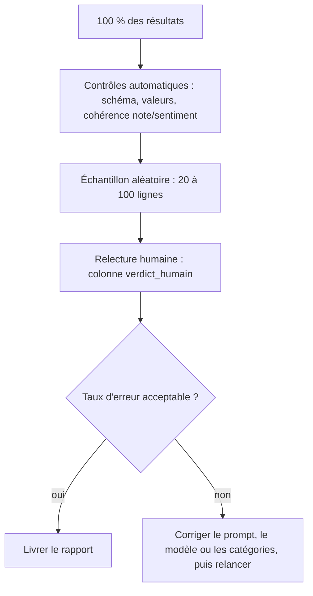

# Contrôle qualité par échantillonnage

> [!NOTE]
> Dans cette leçon, vous allez vérifier la qualité de milliers de réponses **sans tout relire** : des contrôles automatiques gratuits sur 100 % des résultats, puis un **échantillon aléatoire** relu par un humain, et une lecture honnête de ce que cet échantillon prouve (ou pas). Code : [rapport.py](../files/rapport.py).

## Personne ne relit 10 000 réponses

Un modèle qui classe 96 % des avis correctement en commet quand même 400 sur 10 000. Il faut savoir **combien** et **lesquels**, sans y passer la semaine. Trois niveaux, du moins cher au plus cher :



## Niveau 1 : les contrôles automatiques

La validation (leçon 2.2) a déjà garanti la **forme**. On peut aussi croiser la réponse avec une donnée indépendante : la **note en étoiles** laissée par le client.

```python title="files/rapport.py"
def incoherent(note: int, sentiment: str) -> bool:
    """Contrôle automatique gratuit : une note de 1-2 étoiles classée positive (ou 5 classée négative)."""
    return (note <= 2 and sentiment == "positif") or (note >= 5 and sentiment == "negatif")
```

Ces lignes sont les premières à faire relire : elles concentrent les erreurs probables (ou les clients ironiques).

## Niveau 2 : l'échantillon aléatoire

```python title="files/rapport.py"
ech = random.Random(0).sample(s["lignes"], min(a.echantillon, len(s["lignes"])))
```

- **Aléatoire** : choisir « les 20 premiers » donnerait un échantillon biaisé (par exemple, tous issus du même jour ou du même produit).
- **Graine fixe** (`Random(0)`) : le même échantillon à chaque exécution, donc reproductible et auditable.
- Le fichier `echantillon_controle.csv` a une colonne `verdict_humain` vide, à remplir par la personne qui relit (`ok` ou la bonne valeur).

```text title="echantillon_controle.csv (début)"
id,produit,note,texte,sentiment,categorie,a_recontacter,verdict_humain
A0099,clavier Orion,5,"Mon clavier Orion avait un défaut, le service client l'a remplacé en deux jours. Bravo.",positif,service_client,False,
A0195,moulin à café Moka+,2,"Trois e-mails au service client à propos du moulin à café Moka+, aucune réponse. Je veux être remboursé.",negatif,service_client,True,
```

## Ce que prouve (et ne prouve pas) un échantillon

Si 20 lignes relues sur 20 sont correctes, le taux d'erreur n'est **pas** prouvé nul. Une règle simple, dite **règle de trois** : avec 0 erreur observée sur $n$ lignes, le taux d'erreur réel est, avec une confiance d'environ 95 %, inférieur à $3/n$.

| Taille de l'échantillon | 0 erreur observée : taux d'erreur probablement inférieur à |
| --- | --- |
| 20 | 15 % |
| 100 | 3 % |
| 300 | 1 % |

> [!WARNING]
> Pour affirmer « moins de 1 % d'erreurs », il faut relire environ 300 lignes sans en trouver une seule. Un échantillon de 20 sert à repérer les erreurs **fréquentes** et les problèmes de consigne, pas à certifier une précision.

```quiz
question: "Vous relisez 50 réponses tirées au hasard et n'en trouvez aucune fausse. Que pouvez-vous dire ?"
options:
  - "Le modèle ne se trompe jamais"
  - "Le taux d'erreur est probablement inférieur à environ 6 % (3/50)"
  - "Le taux d'erreur est exactement de 2 %"
answer: 1
explanation: "La règle de trois donne une borne supérieure approximative : 3/50 = 6 %. Pour une borne plus serrée, il faut un échantillon plus grand."
```

## Niveau 3 (dans ce lab) : une vérité terrain

Les avis du lab sont **fictifs** et générés à partir de modèles de phrases dont on connaît la bonne réponse (`sentiment_attendu`, `categorie_attendue`). On peut donc mesurer l'accord sur **tout** le jeu, et voir ce qu'un échantillon aurait raté. Dans la vraie vie, on construit cette vérité terrain en faisant étiqueter quelques centaines de documents par des humains, une fois, puis on la réutilise à chaque changement de prompt ou de modèle.

```quiz
question: "Pourquoi tirer l'échantillon au hasard plutôt que de prendre les 20 premières lignes ? (plusieurs réponses)"
options:
  - "Les premières lignes peuvent ne pas être représentatives (même période, même produit)"
  - "Le hasard rend le calcul du coût plus précis"
  - "Un tirage aléatoire permet d'extrapoler l'observation à l'ensemble"
  - "Le modèle se trompe davantage sur les premières lignes"
answer: [0, 2]
explanation: "Le tirage aléatoire évite le biais de sélection et rend l'extrapolation légitime. Il n'a pas d'effet sur le coût, et rien n'indique que les premières lignes soient plus difficiles."
```

> [!TIP]
> Relisez à part les **cas limites** : avis mitigés, ironie, avis très courts. Ici, ce sont précisément eux qui concentrent les écarts (voir le résultat ci-dessous).

## Exercice : exploiter le verdict humain

Une collègue a rempli `verdict_humain` (`ok` ou la bonne valeur de sentiment). Écrivez les lignes qui calculent le taux d'erreur observé et la borne de la règle de trois quand il n'y a aucune erreur.

<details>
<summary>Voir la solution</summary>

```python
import csv

with open("echantillon_controle.csv", encoding="utf-8") as f:
    lignes = [l for l in csv.DictReader(f) if l["verdict_humain"]]
erreurs = [l for l in lignes if l["verdict_humain"] not in ("ok", l["sentiment"])]
n = len(lignes)
print(f"{len(erreurs)} erreur(s) sur {n} relues : {len(erreurs) / n:.0%}")
if not erreurs:
    print(f"taux d'erreur probablement inférieur à {3 / n:.0%} (règle de trois)")
for l in erreurs:
    print(l["id"], l["texte"][:60], "->", l["sentiment"], "au lieu de", l["verdict_humain"])
```

Ne comptez que les lignes réellement relues (`verdict_humain` non vide). Listez les erreurs : leur **nature** (ironie, avis mitigé) dit quoi corriger dans la consigne.

</details>

## Résultat obtenu

Sortie réelle de `rapport.py` sur les 200 avis, le 2026-10-15 :

```text
Incohérences note/sentiment : 0 []
Accord avec les réponses attendues : sentiment 96%, catégorie 100% ; sur l'échantillon de 20 : 100%
```

L'échantillon de 20 n'a trouvé **aucune** erreur, alors que le jeu complet en contient **7** (3,5 %, affiché arrondi à 96 % d'accord) : exactement la limite décrite plus haut. Les 7 écarts réels :

```text
A0013 Le grille-pain Nimbus est très bien fait, mais le prix est franchement élevé. -> negatif attendu neutre
A0154 grille-pain Nimbus conforme à la description. Rien de particulier à signaler. -> positif attendu neutre
... (3 autres avis « bien fait, mais le prix est élevé » et 2 autres « conforme à la description »)
```

Ce sont des **cas limites** de consigne, pas des erreurs grossières : faut-il classer « bien fait mais cher » en neutre ou en négatif ? La correction se fait dans l'instruction système (définir le sentiment mitigé), pas dans le code.

## Je sais faire

- [ ] Mettre en place des contrôles automatiques gratuits sur 100 % des résultats
- [ ] Tirer un échantillon aléatoire reproductible pour relecture humaine
- [ ] Interpréter un échantillon sans erreur avec la règle de trois
- [ ] Utiliser une vérité terrain pour mesurer l'accord et repérer les cas limites
