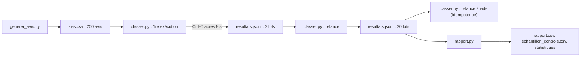

# Projet final : 200 avis, une panne, un rapport

> [!NOTE]
> Dans ce projet, vous enchaînez tout le pipeline : générer 200 avis fictifs, les classer en parallèle maîtrisé, **provoquer une interruption** en plein travail, reprendre, vérifier l'idempotence, puis produire le rapport CSV, les statistiques, le coût et l'échantillon de contrôle. Tout le code est dans [files/](../files/) ; comptez une heure.

## Le cahier des charges

Le service client veut, chaque lundi, le tableau des avis de la semaine : sentiment, catégorie, et la liste des clients à recontacter.

| Exigence | Où c'est fait |
| --- | --- |
| classer chaque avis (sentiment, catégorie, à recontacter) | `classer_lot` + `SCHEMA` ([classer.py](../files/classer.py)) |
| ne pas saturer le quota | `Semaphore` + `Debit` + réessais exponentiels |
| survivre à une coupure sans repayer | `resultats.jsonl` (reprise) + ids stables |
| un rapport exploitable dans un tableur | `rapport.csv` ([rapport.py](../files/rapport.py)) |
| connaître le coût et la qualité | jetons enregistrés, contrôles, échantillon |
| pouvoir passer en mode lot moins cher | [batch_api.py](../files/batch_api.py) |



## Étape 1 : préparer

```bash title="terminal"
cd files
pip install -r requirements.txt pytest
cp .env.example .env               # mettez votre clé, et les prix réels du modèle
pytest -q                          # 9 tests sans clé : réessais, reprise, concurrence, rapport, JSONL
python generer_avis.py             # 200 avis écrits dans avis.csv
```

Les avis sont produits par des modèles de phrases avec une graine fixe : tout le monde obtient les mêmes 200 avis, y compris les cas difficiles (ironie, avis mitigés).

## Étape 2 : classer, et couper en plein travail

```bash title="terminal"
timeout -s INT 8 python classer.py --rpm 30     # équivalent d'un Ctrl-C au bout de 8 s
wc -l resultats.jsonl                            # quelques lots déjà enregistrés
python classer.py --rpm 30                       # reprise
python classer.py --rpm 30                       # rien à faire : idempotent
```

`timeout -s INT 8` envoie le même signal qu'un Ctrl-C au bout de 8 secondes : c'est une vraie interruption, pas une simulation dans le code.

```quiz
question: "Après la coupure, resultats.jsonl contient 3 lignes. Combien d'avis la relance va-t-elle traiter ?"
options:
  - "200"
  - "170 (les 30 avis des 3 lots écrits sont ignorés)"
  - "3"
answer: 1
explanation: "Chaque ligne est un lot de 10 avis terminé : 30 avis sont déjà faits, il en reste 170, soit 17 lots."
```

## Étape 3 : le rapport

```bash title="terminal"
python rapport.py
```

Le rapport produit [rapport.csv](../files/rapport.csv) (une ligne par avis classé), `echantillon_controle.csv` (20 lignes au hasard à relire) et affiche les statistiques.

## Étape 4 (facultative) : le mode lot

```bash title="terminal"
python batch_api.py gemini --n 20                # Batch API, clé d'API
python rapport.py --resultats resultats_batch.jsonl
```

Et sur Google Cloud, avec un bucket à votre nom : voir la leçon 3.2, **sans oublier le nettoyage** (bucket et job).

```quiz
question: "Le lundi suivant, 1 000 nouveaux avis arrivent. Que faut-il changer pour éviter de reclasser ceux de la semaine précédente ? (plusieurs réponses)"
options:
  - "Rien dans le code, si les nouveaux avis gardent des ids stables et qu'on garde le même resultats.jsonl"
  - "Supprimer resultats.jsonl avant chaque exécution"
  - "Ou bien utiliser un fichier de sortie par semaine, si l'on veut des rapports séparés"
  - "Passer la concurrence à 1000"
answer: [0, 2]
explanation: "La reprise filtre déjà les ids connus. Supprimer le point de reprise ferait tout repayer ; une concurrence de 1000 provoquerait des 429."
```

## Exercice : la liste à recontacter

Le service client veut un fichier `a_recontacter.csv` avec seulement les avis à recontacter, les plus négatifs en premier (note croissante). Écrivez-le en quelques lignes à partir de `rapport.csv`.

<details>
<summary>Voir la solution</summary>

```python title="a_recontacter.py"
import csv

with open("rapport.csv", newline="", encoding="utf-8") as f:
    lignes = [l for l in csv.DictReader(f) if l["a_recontacter"] == "True"]
lignes.sort(key=lambda l: (int(l["note"]), l["id"]))

with open("a_recontacter.csv", "w", newline="", encoding="utf-8") as f:
    w = csv.DictWriter(f, fieldnames=["id", "produit", "note", "categorie", "texte"], extrasaction="ignore")
    w.writeheader()
    w.writerows(lignes)
print(len(lignes), "avis à recontacter")
```

Le CSV stocke les booléens en texte : on compare à `"True"`. Le tri sur `(note, id)` donne un ordre stable d'une exécution à l'autre.

</details>

> [!TIP]
> Pour l'industrialiser : planifiez le script (Cloud Scheduler + Cloud Run job, ou un simple cron), écrivez le point de reprise dans un stockage durable (Cloud Storage, BigQuery) plutôt que sur le disque d'une machine éphémère, et passez en Batch API dès que le délai le permet.

## Résultat obtenu

Exécution complète du 2026-10-15 (`gemini-3.5-flash-lite`, clé d'API, prix d'exemple) :

```text
$ python generer_avis.py
200 avis écrits dans avis.csv
=== 1re exécution, interrompue (Ctrl-C) après 8 s
0 avis déjà traités, 200 à faire en 20 lots
  lot A0001..A0010 : 10/10 avis
  lot A0011..A0020 : 10/10 avis
  lot A0021..A0030 : 10/10 avis
Interrompu : relancez la même commande pour reprendre là où vous en étiez.
3 resultats.jsonl
=== relance
30 avis déjà traités, 170 à faire en 17 lots
  lot A0031..A0040 : 10/10 avis
  ...
=== relance à nouveau (idempotence)
200 avis déjà traités, 0 à faire en 0 lots
Terminé en 0.2 s : {'lots_ok': 0, 'lots_echec': 0, 'avis_ok': 0}
=== rapport
Avis classés : 200/200  (manquants : 0 [])
Sentiments  : {'negatif': 112, 'positif': 43, 'neutre': 45}
Catégories  : {'livraison': 44, 'qualite_produit': 58, 'site_web': 36, 'service_client': 27, 'prix': 35}
À recontacter : 83
Incohérences note/sentiment : 0 []
Accord avec les réponses attendues : sentiment 96%, catégorie 100% ; sur l'échantillon de 20 : 100%
Jetons : 6884 en entrée, 9468 en sortie ; coût estimé au tarif standard 0.0045 $ (au tarif Batch, moitié prix : 0.0022 $)
Fichiers : rapport.csv, echantillon_controle.csv
```

Le premier essai d'interruption avait aussi affiché une trace d'erreur `Event loop is closed` : les connexions HTTP n'étaient pas fermées avant l'arrêt. Ouvrir le client avec `async with genai.Client().aio as client` a réglé le problème, comme le montre la sortie ci-dessus.

## Je sais faire

- [ ] Lancer le pipeline complet : génération, classement, rapport
- [ ] Interrompre un traitement et le reprendre sans perte ni double paiement
- [ ] Lire les statistiques, le coût et le résultat du contrôle qualité
- [ ] Choisir quand basculer en mode lot (Batch API ou Vertex AI)
