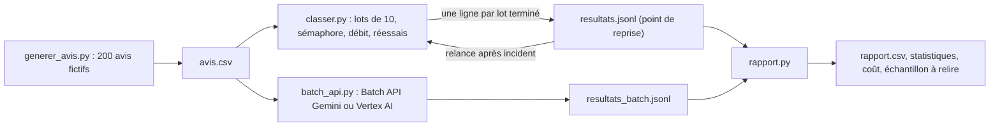

Appeler Gemini sur un document, c'est une ligne de code. Sur **10 000** documents, tout change : les quotas renvoient des erreurs 429, une coupure réseau à 80 % fait tout perdre si l'on n'a rien sauvegardé, les coûts deviennent visibles, et personne ne peut relire 10 000 réponses pour vérifier la qualité.

Fil rouge : une boutique en ligne veut classer ses **avis clients** (sentiment, catégorie, faut-il recontacter le client ?). Le lab génère **200 avis fictifs**, les classe en parallèle maîtrisé, est **interrompu en plein travail** puis **reprend** sans refaire ce qui est fait, et produit un **rapport CSV** avec statistiques, coût et contrôle qualité. Le même classement est ensuite lancé en mode lot asynchrone, sur l'**API Gemini** et sur **Vertex AI**. Tout a été exécuté pour de vrai le 2026-10-15.

## Pour qui ?

- Développeurs ou data analysts Python qui ont déjà appelé l'API Gemini.
- Aucune connaissance préalable d'`asyncio` n'est nécessaire : la leçon 1.1 l'explique.
- Pour le module 3, partie Vertex AI : un projet Google Cloud (facultatif).

## Ce que l'on construit

## Objectifs

À la fin, vous saurez :

1. lancer des centaines d'appels **en parallèle borné** avec `asyncio` et un **sémaphore**, sous un **plafond de débit** ;
2. **réessayer** les erreurs temporaires avec une attente **exponentielle et aléatoire** ;
3. rendre un traitement **idempotent** et **reprenable** grâce à un point de reprise (*checkpoint*) ;
4. regrouper plusieurs documents par requête et **valider** chaque réponse ;
5. utiliser la **Batch API** de Gemini (fichier JSONL) et la **prédiction par lot** de Vertex AI, et savoir quand les préférer ;
6. **mesurer le coût** à partir des jetons et **contrôler la qualité** par échantillonnage.

## Programme

| Module | Leçons | Durée indicative |
| --- | --- | --- |
| 1. Passer à l'échelle | Concurrence maîtrisée avec asyncio ; limites de débit et réessais | 1h15 |
| 2. Robustesse | Idempotence et reprise ; lots et validation des réponses | 1h15 |
| 3. Le mode lot des fournisseurs | Batch API de Gemini ; Vertex AI batch prediction | 1h |
| 4. Mesurer et livrer | Coûts ; contrôle qualité ; projet final avec reprise sur incident | 1h30 |

## En local ou sur Google Cloud ?

| | En local (clé d'API) | Sur Google Cloud (Vertex AI) |
| --- | --- | --- |
| Traitement synchrone parallèle | `classer.py` avec `GOOGLE_API_KEY` | `classer.py` avec `GOOGLE_GENAI_USE_VERTEXAI=TRUE` |
| Mode lot asynchrone | `batch_api.py gemini` (fichier JSONL envoyé à l'API) | `batch_api.py vertex` (fichier JSONL dans Cloud Storage) |
| Identité | la clé | vos identifiants ADC, aucune clé |
| À nettoyer | le job de lot | le bucket et le job de lot |

## Les fichiers du lab

| Fichier | Rôle |
| --- | --- |
| [generer_avis.py](files/generer_avis.py) | génère les 200 avis fictifs (reproductible, avec réponses attendues) |
| [avis.csv](files/avis.csv) | les avis générés |
| [classer.py](files/classer.py) | le traitement parallèle, robuste et reprenable |
| [batch_api.py](files/batch_api.py) | Batch API Gemini et Vertex AI batch prediction |
| [rapport.py](files/rapport.py) | rapport CSV, statistiques, coût, échantillon de contrôle |
| [rapport.csv](files/rapport.csv) | le rapport produit le 2026-10-15 |
| [test_lot.py](files/test_lot.py) | 9 tests sans clé : réessais, reprise, concurrence, rapport, format JSONL |
| [.env.example](files/.env.example), [requirements.txt](files/requirements.txt) | configuration et dépendances |
