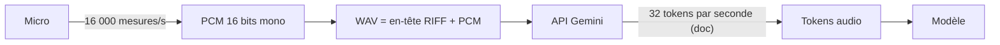

# Le son en données, et quels modèles pour quoi

> [!NOTE]
> Dans cette leçon, vous allez comprendre ce qu'est un fichier audio pour un programme (et pour un modèle), distinguer les trois familles de modèles vocaux et lister ceux que votre clé d'API peut réellement utiliser.

## Un son, c'est une suite de nombres

Un micro mesure la pression de l'air des milliers de fois par seconde. Chaque mesure est un **échantillon** (un nombre entier). Trois réglages décrivent un flux audio :

| Terme | Définition | Valeur typique ici |
| --- | --- | --- |
| **Fréquence d'échantillonnage** | nombre de mesures par seconde, en hertz (Hz) | 24 000 Hz en sortie des modèles Gemini, 16 000 Hz en entrée de la Live API |
| **Profondeur** | taille de chaque mesure | 16 bits (2 octets), un entier entre -32 768 et 32 767 |
| **Canaux** | mono (1) ou stéréo (2) | mono |

Ces nombres bruts, posés les uns après les autres, s'appellent du **PCM** (*Pulse Code Modulation*). Un fichier **WAV** est simplement du PCM précédé d'un en-tête de 44 octets qui commence par les lettres `RIFF` et indique la fréquence, la profondeur et le nombre de canaux.

Faites le calcul pour une seconde de voix en sortie : 24 000 échantillons × 2 octets = **48 000 octets**. Une minute pèse donc environ 2,9 Mo en WAV. C'est pour cela que l'on compresse (MP3, Opus) dès qu'on stocke ou qu'on transporte beaucoup d'audio.



Pour un modèle, l'audio est découpé en **tokens audio**, comme le texte est découpé en tokens de texte. La documentation de l'API indique 32 tokens par seconde d'audio en entrée (une minute ≈ 1 920 tokens) et jusqu'à 9,5 heures d'audio par requête. La facturation suit ces tokens : un appel de 10 minutes coûte donc l'équivalent de quelque 19 000 tokens d'entrée, avant même votre consigne.

```quiz
question: "Combien d'octets fait une seconde d'audio PCM 16 bits mono à 24 000 Hz ?"
options:
  - "24 000"
  - "48 000"
  - "96 000"
answer: 1
explanation: "24 000 échantillons par seconde × 2 octets par échantillon (16 bits) × 1 canal = 48 000 octets. En stéréo, ce serait 96 000."
```

## Trois familles de modèles vocaux

| Famille | Entrée → sortie | Mode d'appel | Quand l'utiliser |
| --- | --- | --- | --- |
| **STT** (*Speech-To-Text*, transcription) | audio → texte | requête classique (`generate_content`) | comptes rendus, sous-titres, recherche dans des appels |
| **TTS** (*Text-To-Speech*, synthèse vocale) | texte → audio | requête classique | messages vocaux, lecture d'écran, serveur vocal |
| **Live** (voix à voix, temps réel) | flux audio ↔ flux audio | **WebSocket** ouvert en continu | agent vocal qui converse, avec interruptions |

Un modèle généraliste comme `gemini-3.5-flash` comprend aussi l'audio : vous pouvez lui donner un fichier et une consigne (« résume cet appel »). La différence avec un modèle de transcription dédié est la leçon suivante.

> [!TIP]
> Ne devinez jamais un nom de modèle. Listez-les avec l'API : le champ `supported_actions` vous dit **comment** l'appeler. `generateContent` = requête classique ; `bidiGenerateContent` = flux bidirectionnel, donc Live API.

## Lister les modèles audio de votre clé

```python title="lister_modeles.py"
from google import genai

client = genai.Client()  # lit GOOGLE_API_KEY dans l'environnement
for m in client.models.list():
    if any(k in m.name for k in ("tts", "transcribe", "live", "native-audio")):
        print(m.name, m.supported_actions)
```

## Résultat obtenu

Sortie réelle (extrait) du 2026-10-15 avec notre clé d'API :

```text
models/gemini-2.5-flash-preview-tts ['countTokens', 'generateContent']
models/gemini-2.5-pro-preview-tts ['countTokens', 'generateContent', 'batchGenerateContent']
models/gemini-3.5-transcribe ['generateContent', 'countTokens']
models/gemini-3.1-flash-tts-preview ['generateContent', 'countTokens', 'batchGenerateContent']
models/gemini-3.8-flash-tts ['generateContent', 'countTokens', 'batchGenerateContent']
models/gemini-3.8-flash-lite-tts ['generateContent', 'countTokens', 'batchGenerateContent']
models/gemini-3.5-transcribe-live ['bidiGenerateContent']
models/gemini-2.5-flash-native-audio-latest ['countTokens', 'bidiGenerateContent']
models/gemini-3.1-flash-live-preview ['bidiGenerateContent']
models/gemini-3.8-live ['bidiGenerateContent']
models/gemini-3.5-live-translate-preview ['bidiGenerateContent']
```

Nous retenons pour la suite : `gemini-3.8-flash-tts` (TTS), `gemini-3.5-transcribe` (STT), `gemini-3.8-live` (temps réel) et `gemini-3.5-flash` (résumé). Tous sont configurables par variable d'environnement dans [.env.example](../files/.env.example).

```quiz
question: "Un modèle n'annonce que bidiGenerateContent dans supported_actions. Comment l'appelle-t-on ?"
options:
  - "Avec client.models.generate_content, comme les autres"
  - "Avec une session Live (client.aio.live.connect), sur une connexion WebSocket"
  - "Avec l'API Batch, en différé"
answer: 1
explanation: "bidiGenerateContent signifie génération bidirectionnelle en flux : c'est la Live API, qui passe par une connexion WebSocket ouverte. generate_content échouerait sur ce modèle."
```

## Exercice : estimer avant d'appeler

Un centre d'appels veut transcrire 400 appels par jour, d'une durée moyenne de 6 minutes. Estimez (1) le volume de tokens audio par jour, (2) la taille des fichiers si on les garde en WAV 16 kHz mono 16 bits.

<details>
<summary>Voir la solution</summary>

1. 6 min = 360 s ; 360 × 32 = 11 520 tokens par appel ; × 400 = **environ 4,6 millions de tokens audio par jour** (ordre de grandeur, d'après la valeur de la documentation).
2. À 16 kHz, 16 bits, mono : 32 000 octets par seconde ; 360 s ≈ 11,5 Mo par appel ; × 400 ≈ **4,6 Go par jour**. D'où l'intérêt de compresser pour l'archivage et de fixer une durée de conservation (ce sont des données personnelles).

Multipliez ensuite par le tarif en vigueur de votre modèle, publié sur la page de tarification de l'API, pour obtenir un budget.

</details>

## Je sais faire

- [ ] Expliquer PCM, WAV, fréquence d'échantillonnage et profondeur
- [ ] Calculer la taille d'un fichier audio et son nombre approximatif de tokens
- [ ] Distinguer STT, TTS et Live, et savoir lequel s'appelle par WebSocket
- [ ] Lister les modèles audio réellement disponibles pour ma clé
