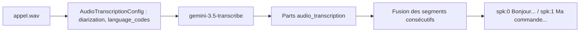

# Transcrire un appel et savoir qui parle

> [!NOTE]
> Dans cette leçon, vous allez transcrire un enregistrement avec un modèle dédié, séparer les locuteurs (diarisation), comparer avec un modèle généraliste et mesurer la qualité avec le WER.

## Deux façons de transcrire

| | Modèle dédié `gemini-3.5-transcribe` | Modèle généraliste `gemini-3.5-flash` + consigne |
| --- | --- | --- |
| Ce qu'on envoie | l'audio seul + une configuration | l'audio + « Transcris cet appel » |
| Ce qu'on reçoit | des segments structurés (`audio_transcription`) avec étiquette de locuteur | du texte libre, mis en forme à la discrétion du modèle |
| Diarisation | option `diarization=True`, étiquettes `spk:0`, `spk:1` | demandée dans la consigne, format variable |
| Risque | erreurs d'écoute (chiffres, noms propres) | idem, plus : reformulation, ajout d'un titre, de noms devinés |
| Usage idéal | archivage, recherche, sous-titres, analyse en aval | résumé direct quand le verbatim importe peu |

La **diarisation** (de l'anglais *diarization*, « tenir le journal ») répond à la question « qui parle quand ? ». Elle ne donne pas de noms : elle attribue la même étiquette aux passages d'une même voix. C'est à vous (ou au LLM en aval) de dire que `spk:0` est l'agent.



## Le code

```python title="files/voix.py"
def transcribe(c, path: str, language: str = "fr-FR") -> list[dict]:
    """Transcription + diarisation (qui parle quand). Renvoie [{"speaker": "spk:0", "text": ...}]."""
    from google.genai import types
    audio = types.Part.from_bytes(data=open(path, "rb").read(), mime_type="audio/wav")
    cfg = types.GenerateContentConfig(audio_transcription_config=types.AudioTranscriptionConfig(
        diarization=True, language_codes=[language]))
    r = with_retry(lambda: c.models.generate_content(model=STT_MODEL, contents=[audio], config=cfg))
    return segments_from_parts(r.candidates[0].content.parts)
```

Trois remarques :

- L'audio part **en ligne** (`Part.from_bytes`) : c'est possible tant que la requête complète reste sous 20 Mo. Au-delà, téléversez-le avec l'API Files (`client.files.upload`).
- `language_codes` est un indice, pas une obligation : sans lui, la langue est détectée automatiquement.
- La réponse n'a **pas** de `response.text` : le SDK prévient « non-text parts in the response ». Il faut lire `part.audio_transcription.text` et `part.audio_transcription.speaker_label`, ce que fait `segments_from_parts` dans [voix.py](../files/voix.py).

> [!WARNING]
> Toutes les options ne se combinent pas. Notre essai réel avec `custom_vocabulary=["Atelier"]` (vocabulaire métier) **et** `diarization=True` a renvoyé `400 INVALID_ARGUMENT : custom_vocabulary is incompatible with diarization`. Choisissez : diarisation, ou vocabulaire métier, ou faites deux passes.

```quiz
question: "La diarisation renvoie spk:0 et spk:1. Que sait-on avec certitude ?"
options:
  - "spk:0 est la personne qui a appelé"
  - "Les passages étiquetés spk:0 viennent d'une même voix, distincte de spk:1"
  - "spk:0 est l'agent, car il parle en premier"
answer: 1
explanation: "La diarisation regroupe les passages par voix, sans identité. Déduire le rôle (agent ou client) est une étape séparée, ici confiée au LLM qui rédige le compte rendu (champ role_agent)."
```

## Mesurer : le WER

Le **WER** (*Word Error Rate*, taux d'erreur sur les mots) compare une transcription à une référence exacte :

$$\text{WER} = \frac{S + D + I}{N}$$

où $S$ = mots substitués, $D$ = mots supprimés, $I$ = mots insérés et $N$ = nombre de mots de la référence. C'est une distance d'édition, calculée mot par mot. Notre fonction `wer()` normalise d'abord la casse et la ponctuation, sinon « Bonjour. » et « bonjour » compteraient comme une erreur.

```python title="files/voix.py"
def wer(reference: str, hypothesis: str) -> float:
    norm = lambda s: "".join(ch.lower() if ch.isalnum() or ch in " '" else " " for ch in s).split()
    r, h = norm(reference), norm(hypothesis)
    d = list(range(len(h) + 1))  # distance d'édition sur les mots, une ligne à la fois
    for i, rw in enumerate(r, 1):
        prev, d[0] = d[0], i
        for j, hw in enumerate(h, 1):
            prev, d[j] = d[j], min(d[j] + 1, d[j - 1] + 1, prev + (rw != hw))
    return d[len(h)] / max(len(r), 1)
```

> [!TIP]
> Un WER faible ne suffit pas. « dix » transcrit « 10 » compte comme une erreur alors que le sens est intact, et « 4521 » transcrit « 451 » ne coûte qu'un mot alors qu'il change tout. Mesurez aussi la justesse des **entités critiques** (numéros, montants, dates).

## Résultat obtenu

Sortie réelle du 2026-10-15 sur un dialogue de 3 répliques synthétisé avec deux voix (environ 11 s, 272 tokens audio comptés par l'API) :

```text
# gemini-3.5-transcribe, diarization=True, language_codes=["fr-FR"]  (1,65 s)
{'text': "Bonjour, service client atelier, Léa à l'appareil.", 'speaker_label': 'spk:0'}
{'text': "Bonjour, ma commande n'est toujours pas arrivée, ça fait 10 jours.", 'speaker_label': 'spk:1'}
{'text': 'Je comprends, je regarde tout de suite.', 'speaker_label': 'spk:0'}

# gemini-3.5-flash + « Transcris cet audio. Indique le locuteur. »  (3,56 s)
Voici la transcription de l'audio :  **Locutrice 1 (Léa) :** Bonjour, service client Atelier,
Léa à l'appareil.  **Locuteur 2 (Client) :** Bonjour, ma commande n'est toujours pas arrivée...
```

Sur l'appel complet du projet final (7 répliques, 41 s), le WER mesuré a été de **2,6 %** sur une exécution et de 3,4 % sur une autre ; lors de cette dernière, « commande 4521 » a été transcrit « commande 451 ». Les autres « erreurs » étaient surtout « dix » → « 10 » et « Atelier » → « atelier ».

```quiz
question: "Sur 38 mots de référence, la transcription a 1 substitution, 0 suppression et 1 insertion. Quel est le WER ?"
options:
  - "Environ 2,6 %"
  - "Environ 5,3 %"
  - "Exactement 2 %"
answer: 1
explanation: "WER = (S + D + I) / N = (1 + 0 + 1) / 38 ≈ 0,053, soit environ 5,3 %."
```

## Exercice : un taux d'erreur sur les entités

Écrivez une fonction `entity_recall(reference, hypothesis)` qui extrait tous les nombres de 3 chiffres ou plus de la référence et renvoie la proportion retrouvée à l'identique dans la transcription.

<details>
<summary>Voir la solution</summary>

```python
import re

def entity_recall(reference: str, hypothesis: str) -> float:
    expected = re.findall(r"\d{3,}", reference)
    found = set(re.findall(r"\d{3,}", hypothesis))
    return sum(e in found for e in expected) / max(len(expected), 1)

assert entity_recall("commande 4521", "la commande 4521 et") == 1.0
assert entity_recall("commande 4521", "la commande 451") == 0.0
```

Sur un vrai jeu d'appels, suivez ce taux à part du WER : c'est lui qui prédit les mauvaises actions.

</details>

## Je sais faire

- [ ] Transcrire un fichier avec `gemini-3.5-transcribe` et lire les segments `audio_transcription`
- [ ] Activer la diarisation et expliquer ce qu'elle garantit (et ce qu'elle ne garantit pas)
- [ ] Calculer un WER et dire pourquoi il ne suffit pas
- [ ] Choisir entre modèle dédié et modèle généraliste pour transcrire
