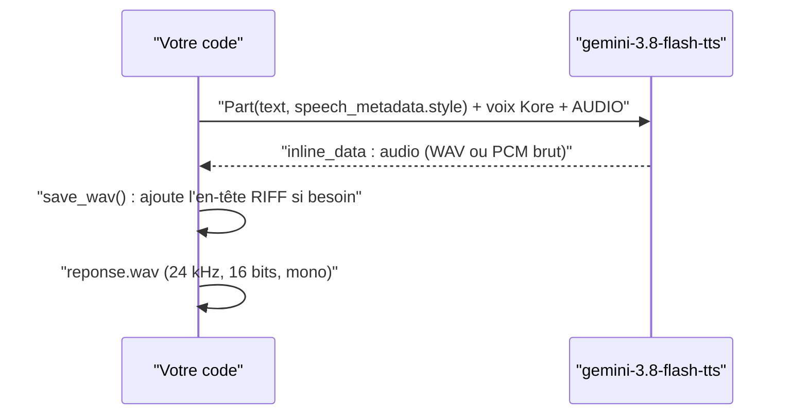

# Synthèse vocale : une voix, un ton, un fichier

> [!NOTE]
> Dans cette leçon, vous allez générer un message vocal avec un modèle TTS Gemini, choisir une voix et un style, et écrire un fichier WAV valide quel que soit le format renvoyé par le modèle.

## Comment fonctionne un TTS Gemini

Un modèle **TTS** (*Text-To-Speech*) reçoit du texte et renvoie de l'audio. Avec Gemini, c'est un appel `generate_content` ordinaire, avec deux réglages en plus :

- `response_modalities=["AUDIO"]` : on veut du son, pas du texte ;
- `speech_config` : quelle voix utiliser. La documentation propose une trentaine de **voix préenregistrées** (*prebuilt voices*) nommées, par exemple `Kore` (ferme) ou `Puck` (enjouée), toutes multilingues.

Le **style** (« chaleureuse, posée », « agacé ») se donne soit dans le texte (« Dis calmement : … »), soit, sur les modèles récents, dans le champ `speech_metadata.style` de la Part, ce qui évite que l'instruction soit lue à voix haute.



## Le code

```python title="files/voix.py"
def tts(c, text: str, path: str, voice: str = "Kore", style: str | None = None) -> float:
    """Une seule voix. Le style (« chaleureux, posé ») passe par speech_metadata."""
    from google.genai import types
    part = types.Part(text=text, speech_metadata=types.SpeechMetadata(style=style) if style else None)
    cfg = types.GenerateContentConfig(
        response_modalities=["AUDIO"], speech_config=types.SpeechConfig(voice_config=_voice(voice)))
    r = with_retry(lambda: c.models.generate_content(model=TTS_MODEL, contents=[part], config=cfg))
    return save_wav(r.candidates[0].content.parts[0].inline_data.data, path)
```

## Le piège du format : WAV ou PCM brut ?

En testant deux modèles avec **le même code**, nous avons obtenu deux formats différents :

| Modèle | `mime_type` renvoyé | Contenu |
| --- | --- | --- |
| `gemini-2.5-flash-preview-tts` | `audio/L16;codec=pcm;rate=24000` | PCM brut, **sans** en-tête |
| `gemini-3.8-flash-tts` | `audio/wav` | WAV complet, en-tête `RIFF` inclus |

Si vous ajoutez systématiquement un en-tête WAV, le fichier du second modèle en aura deux : il se lira peut-être, mais sa durée sera fausse et certains lecteurs refuseront de l'ouvrir. D'où une fonction qui regarde les 4 premiers octets :

```python title="files/voix.py"
def save_wav(data: bytes, path: str, rate: int = RATE) -> float:
    if not data.startswith(b"RIFF"):          # PCM brut : on l'enveloppe
        buf = io.BytesIO()
        with wave.open(buf, "wb") as w:
            w.setnchannels(1); w.setsampwidth(2); w.setframerate(rate)
            w.writeframes(data)
        data = buf.getvalue()
    with open(path, "wb") as f:
        f.write(data)
    return wav_seconds(data)                  # durée réelle, utile pour vérifier
```

> [!TIP]
> Renvoyez toujours la **durée** du fichier produit et vérifiez-la : un message de 40 mots doit durer 10 à 20 secondes. Une durée de 0,2 s ou de 3 minutes signale un texte vide, une boucle ou un mauvais format.

```quiz
question: "Pourquoi save_wav teste-t-il si les données commencent par RIFF ?"
options:
  - "Pour détecter un fichier MP3"
  - "Parce que certains modèles renvoient déjà un WAV complet et d'autres du PCM brut sans en-tête"
  - "Pour vérifier que l'audio est en stéréo"
answer: 1
explanation: "Un WAV commence par l'en-tête RIFF. Si le modèle l'a déjà mis, on écrit les octets tels quels ; sinon, on ajoute un en-tête 24 kHz / 16 bits / mono avec le module standard wave."
```

## Combien ça coûte, combien de temps ça prend

L'audio produit se compte en **tokens de sortie**. Lors de notre test, une phrase d'accueil de 19 tokens de texte a produit **5,0 s** d'audio comptées **125 tokens audio** en sortie, soit environ 25 tokens par seconde produite. La génération a pris 3,6 s : plus rapide que la lecture, mais pas instantanée. Pour un serveur vocal, cela compte (module 3).

> [!WARNING]
> Une voix de synthèse peut être prise pour une vraie personne. Dites-le au client (« Message automatique de la boutique Atelier »), et n'imitez jamais la voix d'une personne réelle sans son accord écrit.

## Résultat obtenu

Sortie réelle du 2026-10-15 (même texte, même voix `Kore`) :

```text
gemini-3.8-flash-tts         audio/wav                       246112 octets  3,60 s  sortie : 125 tokens AUDIO
gemini-2.5-flash-preview-tts audio/L16;codec=pcm;rate=24000  192526 octets  2,94 s  sortie : 100 tokens AUDIO
```

Et le message de rappel produit par le projet final (12,0 s, voix `Kore`, style « chaleureuse, posée ») :


```quiz
question: "Un message vocal de 12 s a été produit. Combien de tokens audio de sortie attendre, d'après notre mesure ?"
options:
  - "Environ 30"
  - "Environ 300"
  - "Environ 3 000"
answer: 1
explanation: "Nous avons mesuré environ 25 tokens audio par seconde produite (125 tokens pour 5 s). 12 s × 25 ≈ 300 tokens. C'est un ordre de grandeur à revérifier avec usage_metadata sur votre modèle."
```

## Exercice : trois tons pour un même message

Avec `voix.tts`, générez le même message (« Votre colis part aujourd'hui en express. ») avec trois styles différents : « neutre », « très enthousiaste », « désolée, à voix basse ». Écoutez, puis vérifiez que le texte prononcé n'inclut pas l'instruction de style.

<details>
<summary>Voir la solution</summary>

```python
import voix

c = voix.client()
for i, style in enumerate(["neutre", "très enthousiaste", "désolée, à voix basse"]):
    d = voix.tts(c, "Votre colis part aujourd'hui en express.", f"ton_{i}.wav", style=style)
    print(style, f"{d:.1f} s")
```

Pour vérifier que le style n'est pas lu, retranscrivez chaque fichier avec `voix.transcribe(c, "ton_0.wav")` : le texte doit être identique au message, sans « neutre » ni « enthousiaste ». C'est l'intérêt de `speech_metadata.style` par rapport à une consigne écrite dans le texte. Notre essai du 2026-10-15 avec le style « très enthousiaste » : 3,4 s d'audio, retranscrit exactement `Votre colis part aujourd'hui en express.`

</details>

## Je sais faire

- [ ] Générer un fichier WAV avec une voix nommée et un style
- [ ] Gérer les deux formats de sortie (WAV complet ou PCM brut)
- [ ] Vérifier la durée produite et estimer les tokens de sortie
- [ ] Signaler au client qu'une voix est synthétique
