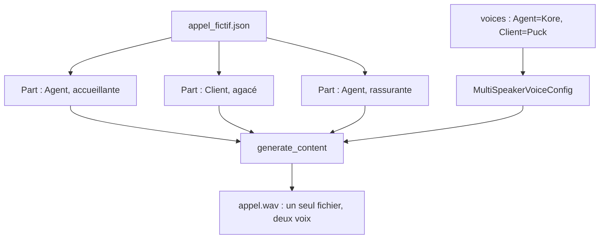

# Dialogue à deux voix, chiffres et accessibilité

> [!NOTE]
> Dans cette leçon, vous allez générer un dialogue complet à deux voix en une seule requête, apprendre à écrire pour l'oreille (chiffres, phrases courtes) et voir ce que le TTS apporte à l'accessibilité.

## Un dialogue en une seule requête

Le TTS multi-locuteurs produit un seul fichier dans lequel deux voix se répondent. La configuration associe chaque **nom de locuteur** à une voix ; le contenu est une liste de Parts, **une par réplique**, chacune étiquetée par son locuteur dans `speech_metadata.speaker`.



```python title="files/voix.py"
def tts_dialogue(c, lines: list[dict], voices: dict[str, str], path: str) -> float:
    """Plusieurs voix (2 maximum) : une Part par réplique, chacune étiquetée avec son locuteur."""
    from google.genai import types
    parts = [types.Part(text=l["text"], speech_metadata=types.SpeechMetadata(
        speaker=l["speaker"], style=l.get("style"))) for l in lines]
    cfg = types.GenerateContentConfig(
        response_modalities=["AUDIO"],
        speech_config=types.SpeechConfig(multi_speaker_voice_config=types.MultiSpeakerVoiceConfig(
            speaker_voice_configs=[types.SpeakerVoiceConfig(speaker=s, voice_config=_voice(v))
                                   for s, v in voices.items()])))
    r = with_retry(lambda: c.models.generate_content(
        model=TTS_MODEL, contents=[types.Content(role="user", parts=parts)], config=cfg))
    return save_wav(r.candidates[0].content.parts[0].inline_data.data, path)
```

Le script de l'appel vit dans un fichier de données, [appel_fictif.json](../files/appel_fictif.json) : changer le scénario ne demande aucune ligne de code.

> [!WARNING]
> Notre premier essai avec `gemini-3.8-flash-tts` envoyait le dialogue comme un seul texte « Agent: … Client: … » (la méthode des anciens exemples). Réponse réelle : `400 INVALID_ARGUMENT : Multi-speaker generation requests must specify speech_metadata.speaker for each text part in the contents.` Sur ce modèle, l'étiquette passe par `speech_metadata`, Part par Part. Lisez l'erreur : elle dit exactement quoi faire.

```quiz
question: "Combien de requêtes faut-il pour produire un appel de 7 répliques à deux voix avec tts_dialogue ?"
options:
  - "7, une par réplique, puis on concatène"
  - "1 seule, avec une Part par réplique"
  - "2, une par voix"
answer: 1
explanation: "Le TTS multi-locuteurs reçoit toutes les répliques dans une seule requête. Le modèle enchaîne les voix et les pauses naturellement, sans montage."
```

## Écrire pour l'oreille

Un texte lu n'est pas un texte écrit. Quelques règles, valables pour le message de rappel comme pour un serveur vocal :

| À l'écrit | À l'oral | Pourquoi |
| --- | --- | --- |
| « Cde n° 4521 » | « la commande 4521 » ou « quarante-cinq vingt et un » | les abréviations sont lues lettre à lettre ou mal |
| liste à puces | phrases courtes reliées par « puis », « ensuite » | une liste ne s'entend pas |
| 3 informations par phrase | 1 information par phrase | la mémoire auditive est courte |
| « cf. e-mail » | « vous recevrez un e-mail ce soir » | pas de renvoi visuel |
| URL complète | « sur notre site, rubrique Commandes » | personne ne retient une URL entendue |

C'est pourquoi la consigne du compte rendu (projet final) demande explicitement un `reponse_vocale` « sans liste, phrases simples faciles à écouter ».

## Accessibilité : la voix comme alternative

Le TTS rend un service lisible par qui ne peut pas lire l'écran : personnes aveugles ou malvoyantes, dyslexiques, ou simplement occupées (au volant). Le W3C (voir les références) rappelle que l'accessibilité consiste à offrir **plusieurs moyens** d'accéder à la même information.

- Proposez **toujours** l'équivalent texte d'un message vocal (et inversement, la transcription d'un appel).
- Laissez le choix de la vitesse et la possibilité de réécouter.
- Ne faites pas de la voix le **seul** canal pour une information importante (un numéro de suivi se lit, il ne s'écoute pas).

> [!TIP]
> La transcription du module 1 et le TTS de ce module forment une paire : sous-titres pour les personnes sourdes ou malentendantes, lecture pour les personnes aveugles. Un même pipeline sert les deux publics.

## Résultat obtenu

Sortie réelle du 2026-10-15 du projet final, étape 1 (7 répliques, voix `Kore` et `Puck`) :

```text
[1] appel.wav : 41.1 s d'audio (gemini-3.8-flash-tts)
Durées (s) : {'1_tts_appel': 13.9, ...}
```

Écoutez le résultat :


Le même script a produit 38,4 s, 38,5 s puis 41,1 s lors de trois exécutions : le rythme varie d'une génération à l'autre.

```quiz
question: "Quelles pratiques améliorent un message vocal de rappel ? (plusieurs réponses)"
options:
  - "Une information par phrase"
  - "Lire l'URL complète de suivi"
  - "Envoyer aussi l'équivalent texte"
  - "Utiliser une liste à puces"
answer: [0, 2]
explanation: "Phrases courtes et équivalent texte aident tout le monde, y compris les personnes en situation de handicap. Une URL ou une liste à puces ne s'entend pas bien : envoyez-les par écrit."
```

## Exercice : un troisième personnage

Votre scénario veut faire intervenir un superviseur en plus de l'agent et du client. Le TTS multi-locuteurs accepte deux voix au maximum. Que faites-vous ?

<details>
<summary>Voir la solution</summary>

Deux options simples :

1. **Découper** l'appel en segments de deux voix au plus (agent + client, puis agent + superviseur), générer chaque segment, puis concaténer les PCM avec le module `wave` (même fréquence, même format) : lire les trames de chaque fichier et les écrire à la suite dans un nouveau WAV.
2. **Générer chaque réplique** avec `voix.tts` et sa voix propre, puis concaténer. Plus de requêtes, moins de naturel dans l'enchaînement, mais aucune limite de personnages.

Dans les deux cas, ajoutez un court silence (par exemple 300 ms de zéros) entre les segments pour éviter un raccord abrupt.

</details>

## Je sais faire

- [ ] Générer un dialogue à deux voix avec `speech_metadata.speaker`
- [ ] Décrire un scénario d'appel dans un fichier de données plutôt que dans le code
- [ ] Réécrire un texte pour qu'il soit compris à l'oreille
- [ ] Citer trois bonnes pratiques d'accessibilité pour un service vocal
