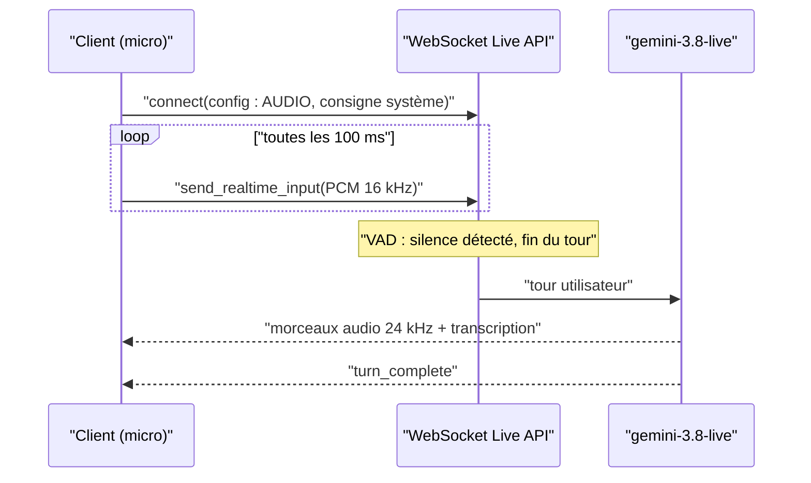

# La Live API : une conversation sur WebSocket

> [!NOTE]
> Dans cette leçon, vous allez comprendre pourquoi une conversation vocale a besoin d'une connexion permanente, comment se déroule une session Live (envoi de l'audio, détection de fin de parole, réponse en flux, interruption) et coder une session courte qui fonctionne.

## Pourquoi pas une simple requête ?

Avec `generate_content`, on envoie tout, on attend, on reçoit tout. Pour une conversation, c'est trop lent : il faudrait attendre la fin de la phrase, téléverser, attendre la réponse complète, la télécharger. La **Live API** ouvre une connexion **WebSocket** : un canal réseau qui reste ouvert et dans lequel les deux côtés peuvent envoyer des messages à tout moment.

- Le client envoie l'audio du micro **par petits morceaux** (ici 100 ms), au fil de l'eau.
- Le serveur détecte tout seul que la personne a fini de parler : c'est la **VAD** (*Voice Activity Detection*, détection d'activité vocale).
- La réponse arrive **en flux** : les premiers morceaux d'audio se jouent pendant que la suite est encore générée.
- Si la personne reprend la parole pendant la réponse, le serveur s'interrompt (*barge-in*) : c'est ce qui rend l'échange naturel.



## Les formats à respecter

| Sens | Format | D'après |
| --- | --- | --- |
| Entrée | PCM 16 bits, **16 kHz**, mono, little-endian (`audio/pcm;rate=16000`) | guide de la Live API |
| Sortie | PCM 16 bits, **24 kHz**, mono | guide de la Live API |
| Texte | possible en entrée (`send_client_content`) comme en sortie (transcriptions) | idem |

Notre question vient d'un TTS (24 kHz) : `to_pcm16k()` la rééchantillonne par interpolation linéaire avec numpy, ce qui suffit pour la voix (la doc précise d'ailleurs que l'API rééchantillonne si besoin).

## Le code

```python title="files/live_demo.py"
cfg = types.LiveConnectConfig(
    response_modalities=["AUDIO"],
    system_instruction=SYSTEM,
    input_audio_transcription=types.AudioTranscriptionConfig(),   # ce que l'API a entendu
    output_audio_transcription=types.AudioTranscriptionConfig(),  # ce qu'elle dit
)
async with c.aio.live.connect(model=LIVE_MODEL, config=cfg) as session:
    async def micro():  # simule un micro : envoi en temps réel
        for i, ch in enumerate(speech + silence):
            if i == len(speech):
                speech_end["t"] = time.time()  # fin de la parole, début du silence
            await session.send_realtime_input(audio=types.Blob(data=ch, mime_type=f"audio/pcm;rate={IN_RATE}"))
            await asyncio.sleep(CHUNK_MS / 1000)

    sender = asyncio.create_task(micro())     # on envoie ET on écoute en même temps
    async for msg in session.receive():
        if msg.data:                            # un morceau d'audio de la réponse
            first = first or time.time(); audio += msg.data
        ...
        if msg.server_content and msg.server_content.turn_complete:
            break
```

Deux détails que nous avons appris en testant :

- Envoyer tout l'audio d'un coup, sans pause, puis attendre : la session est restée muette jusqu'au délai d'expiration. Il faut **cadencer** l'envoi comme un vrai micro (`asyncio.sleep`) et **finir par du silence** pour que la VAD conclue le tour.
- Envoi et réception doivent tourner **en parallèle** (une tâche `asyncio` pour le micro), sinon on ne voit pas la réponse commencer pendant qu'on parle encore.

```quiz
question: "Pourquoi live_demo.py ajoute-t-il une seconde de silence après la question ?"
options:
  - "Pour réduire la taille du fichier"
  - "Pour que la détection d'activité vocale (VAD) comprenne que la personne a fini de parler"
  - "Parce que la Live API refuse les fichiers courts"
answer: 1
explanation: "Avec la VAD automatique, c'est le silence qui marque la fin du tour. Sans lui, le serveur attend la suite de la phrase. Un vrai micro produit ce silence naturellement."
```

## Limites d'une session

| Limite (documentation, à revérifier) | Conséquence |
| --- | --- |
| Session audio seule limitée à environ 15 minutes sans compression du contexte | activer la compression (`context_window_compression`) pour les longs appels |
| Connexion WebSocket d'une durée de vie d'environ 10 minutes | utiliser la reprise de session (*session resumption*) |
| Clé d'API à ne jamais mettre dans un navigateur ou une appli mobile | passer par un serveur, ou par des **jetons éphémères** (*ephemeral tokens*) à courte durée de vie |

> [!WARNING]
> Une application web qui parle directement à la Live API doit utiliser un jeton éphémère généré par **votre** serveur. Une clé d'API dans du JavaScript côté client peut être lue par n'importe qui.

## Résultat obtenu

Sorties réelles du 2026-10-15. D'abord une question **en texte** (`send_client_content`), réponse en audio :

```text
gemini-3.8-live connected 0.61
first audio 0.66 total 6.54 282240 Bonjour, je vais vérifier immédiatement le statut de votre commande 4521 et vous tenir informé.
```

Puis `python live_demo.py` avec une question **en voix** (fichier [exemple_question.wav](../files/exemple_question.wav)) :

```text
WebSocket ouvert en 0.32 s (gemini-3.8-live)
Entendu : Bonjour, ma commande 4521 n'est toujours pas arrivée. Vous pouvez me dire où elle en est ?
Répondu : Bonjour, je vais vérifier l'état de votre commande 4521 et revenir vers vous rapidement. Pourriez-vous me confirmer votre numéro de téléphone ?
Latence fin de parole -> 1er audio : 1.00 s ; réponse de 7.9 s -> sortie/live_reponse.wav
```


```quiz
question: "Où doit vivre la clé d'API dans une application web de conversation vocale ?"
options:
  - "Dans le code JavaScript, minifié pour la cacher"
  - "Sur un serveur, qui fournit au navigateur un jeton éphémère ou relaie le flux"
  - "Dans le localStorage du navigateur"
answer: 1
explanation: "Tout ce qui est envoyé au navigateur est lisible. La clé reste côté serveur ; le navigateur reçoit au mieux un jeton éphémère à courte durée de vie."
```

## Exercice : afficher les sous-titres en direct

Modifiez la boucle de réception pour **afficher** la transcription de sortie au fur et à mesure qu'elle arrive (sous-titres en direct), au lieu de l'afficher à la fin.

<details>
<summary>Voir la solution</summary>

```python
async for msg in session.receive():
    sc = msg.server_content
    if sc and sc.output_transcription and sc.output_transcription.text:
        print(sc.output_transcription.text, end="", flush=True)  # morceau par morceau
    if msg.data:
        audio += msg.data
    if sc and sc.turn_complete:
        print()
        break
```

`flush=True` force l'affichage immédiat. Dans une interface web, on enverrait chaque morceau au navigateur (par exemple via le même WebSocket applicatif) pour l'ajouter au sous-titre.

</details>

## Je sais faire

- [ ] Expliquer ce qu'apporte un WebSocket par rapport à une requête classique
- [ ] Ouvrir une session Live, envoyer de l'audio 16 kHz cadencé et lire la réponse en flux
- [ ] Expliquer le rôle de la VAD et de l'interruption
- [ ] Citer les limites de session et protéger la clé avec un jeton éphémère
