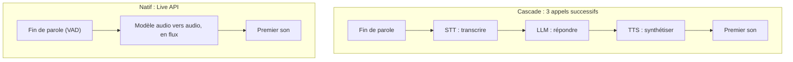

# La latence : mesurer, budgéter, choisir l'architecture

> [!NOTE]
> Dans cette leçon, vous allez décomposer le temps de réponse d'un agent vocal, comparer l'architecture « en cascade » (STT → LLM → TTS) à l'architecture native de la Live API, et mesurer correctement ce qui compte : le temps jusqu'au premier son.

## Ce que l'oreille tolère

Dans une conversation entre humains, les silences entre deux tours de parole sont très courts, de l'ordre de quelques centaines de millisecondes. Au-delà d'une à deux secondes, l'interlocuteur pense que la ligne a coupé et répète, ce qui crée un chevauchement. Pour un agent vocal, l'indicateur clé n'est donc pas la durée totale de la réponse, mais le **temps jusqu'au premier son** (on parle aussi de TTFA, *Time To First Audio*).

## Deux architectures



| | Cascade STT → LLM → TTS | Live API (natif) |
| --- | --- | --- |
| Temps jusqu'au premier son | somme des trois étapes (chacune attend la précédente) | une seule étape, réponse en flux |
| Contrôle | total : on inspecte et on corrige le texte entre chaque étape | moindre : on lit les transcriptions après coup |
| Choix des modèles | libre à chaque étape | un modèle Live |
| Interruption | à coder soi-même | gérée par la VAD du serveur |
| Idéal pour | traitement après l'appel (compte rendu, analyse, rappel) | conversation pendant l'appel |

> [!TIP]
> Ce n'est pas l'un **ou** l'autre. Le projet final utilise la cascade **après** l'appel (latence sans importance, contrôle maximal), et la Live API **pendant** (latence critique).

## Mesurer correctement

Une mesure de latence se lance au bon moment et s'arrête au bon moment :

- **départ** : la fin de la parole de l'utilisateur, pas l'ouverture de la connexion ni le début de l'envoi ;
- **arrivée** : le premier morceau d'audio reçu, pas la fin de la réponse.

```python title="files/live_demo.py"
for i, ch in enumerate(speech + silence):
    if i == len(speech):
        speech_end["t"] = time.time()  # départ : fin de la parole
    ...
async for msg in session.receive():
    if msg.data:
        first = first or time.time()   # arrivée : premier morceau d'audio
...
latency = first - speech_end.get("t", first) if first else None
```

Notre mesure inclut le temps que met la VAD à décider que le silence est une fin de tour. C'est voulu : c'est ce que l'utilisateur perçoit.

```quiz
question: "Quel chronomètre reflète le mieux l'expérience d'un utilisateur au téléphone ?"
options:
  - "De l'ouverture du WebSocket à la fin de la réponse"
  - "De la fin de sa phrase au premier son de la réponse"
  - "Du premier au dernier octet de la réponse"
answer: 1
explanation: "L'utilisateur juge le silence entre sa phrase et la réponse. La durée totale de la réponse importe peu tant qu'elle commence vite et se joue en flux."
```

## Résultat obtenu

Mesures réelles du 2026-10-15 sur notre poste (réseau domestique, une seule exécution par ligne : ce sont des exemples, pas des moyennes) :

```text
# Live API, gemini-3.8-live, question en voix
WebSocket ouvert en 0.32 s
Latence fin de parole -> 1er audio : 1.00 s ; réponse de 7.9 s

# Live API, question en texte
gemini-3.8-live               connected 0.61   first audio 0.66
gemini-3.1-flash-live-preview connected 0.47   first audio 0.50

# Cascade du projet final (deux exécutions)
Durées (s) : {'1_tts_appel': 12.8, '2_transcription': 11.3, '3_compte_rendu': 6.7, '4_tts_reponse': 3.9}
Durées (s) : {'1_tts_appel': 13.9, '2_transcription': 2.4, '3_compte_rendu': 5.7, '4_tts_reponse': 4.2}
```

Deux leçons tirées de ces chiffres :

1. En cascade, transcrire + rédiger + synthétiser une réponse a pris plus de 10 secondes : inacceptable en conversation, très bien pour un compte rendu.
2. La même transcription a pris 2,4 s une fois et 11,3 s une autre : la **variance** compte autant que la moyenne. Mesurez sur des dizaines d'appels et regardez le 95ᵉ centile (la valeur sous laquelle tombent 95 % des mesures).

> [!WARNING]
> Ne comparez pas deux modèles sur un seul essai : la charge du service, le réseau et la longueur de la réponse font varier les chiffres. Répétez, notez la médiane et le 95ᵉ centile, et testez depuis la région où tournera votre service.

```quiz
question: "Vous avez 20 mesures de latence. Laquelle de ces statistiques révèle le mieux les mauvaises expériences ?"
options:
  - "La moyenne"
  - "Le 95e centile"
  - "La valeur minimale"
answer: 1
explanation: "La moyenne cache les pics ; le minimum montre le meilleur cas. Le 95e centile dit combien de temps attendent les utilisateurs les moins chanceux : c'est lui qu'on surveille en production."
```

## Exercice : un budget de latence

Vous concevez un serveur vocal en cascade. Mesures médianes : VAD 0,5 s, STT 0,8 s, LLM jusqu'au premier mot 0,9 s, TTS jusqu'au premier son 0,7 s. Votre objectif est 1,5 s jusqu'au premier son. Le tenez-vous ? Sinon, que changer ?

<details>
<summary>Voir la solution</summary>

0,5 + 0,8 + 0,9 + 0,7 = **2,9 s** : objectif manqué, de près du double.

Pistes, de la plus efficace à la moins efficace :

1. Passer à une architecture **native** (Live API) pour la conversation : une seule étape au lieu de trois.
2. En restant en cascade : **diffuser en flux** à chaque étape (transcription partielle, génération en flux, TTS phrase par phrase dès la première phrase prête) pour que les étapes se chevauchent au lieu de s'additionner.
3. Choisir des modèles plus légers pour le LLM, et un message d'attente court (« Je regarde… ») joué immédiatement.

</details>

## Je sais faire

- [ ] Définir le temps jusqu'au premier son et le mesurer au bon endroit
- [ ] Comparer cascade et architecture native, et choisir selon le moment (pendant ou après l'appel)
- [ ] Interpréter médiane et 95ᵉ centile plutôt qu'une mesure isolée
- [ ] Construire un budget de latence étape par étape
