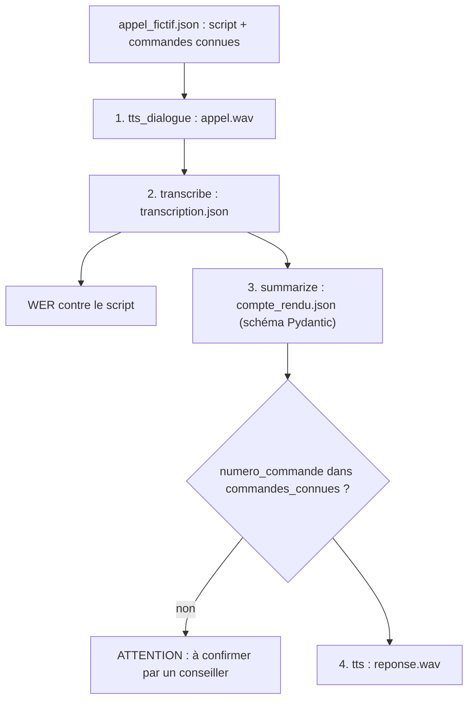

# Le pipeline « compte rendu d'appel »

> [!NOTE]
> Dans cette leçon, vous allez assembler les briques des modules précédents en un pipeline de quatre étapes : fabriquer un faux appel, le transcrire, en tirer un compte rendu structuré, puis produire le message vocal de rappel, avec un garde-fou sur le numéro de commande.

## Le cahier des charges

La boutique fictive Atelier veut qu'à la fin de chaque appel :

1. la transcription soit archivée, locuteurs séparés ;
2. un **compte rendu** structuré alimente le CRM : motif, numéro de commande, sentiment, engagements pris, résumé ;
3. le client reçoive un **message vocal** qui confirme ce qui a été convenu ;
4. rien ne parte si le numéro de commande est douteux.

Pour tester sans vrais clients (et sans données personnelles), l'appel lui-même est **synthétisé** à partir d'un script : on connaît donc le texte exact prononcé, ce qui permet de mesurer le WER.



## Les fichiers

| Fichier | Rôle |
| --- | --- |
| [voix.py](../files/voix.py) | les briques : `tts`, `tts_dialogue`, `transcribe`, `summarize`, `wer`, `save_wav`, `with_retry` |
| [compte_rendu.py](../files/compte_rendu.py) | le pipeline, en 4 étapes chronométrées |
| [appel_fictif.json](../files/appel_fictif.json) | le scénario : voix, répliques, styles, commandes connues |
| [live_demo.py](../files/live_demo.py) | la conversation temps réel (module 3) |
| [test_voix.py](../files/test_voix.py) | 7 tests sans clé ni réseau |
| [.env.example](../files/.env.example) | les variables : clé et noms de modèles |

## Étape 3 : un compte rendu structuré

Le compte rendu doit être lisible par un programme (le CRM). On impose donc un **schéma** avec Pydantic : l'API renvoie un JSON qui le respecte, et `model_validate_json` le vérifie à l'arrivée.

```python title="files/voix.py"
class CompteRendu(BaseModel):
    role_agent: str                 # étiquette de diarisation de l'agent, ex. "spk:0"
    motif: str
    numero_commande: str | None
    sentiment_client: Literal["satisfait", "neutre", "mécontent"]  # une enum dans le schéma JSON
    actions: list[str]              # engagements pris par l'agent
    resume: str                     # 2 à 3 phrases
    reponse_vocale: str             # message de rappel lu au client (TTS), < 60 mots


def summarize(c, segments: list[dict]) -> CompteRendu:
    cfg = {"response_mime_type": "application/json", "response_schema": CompteRendu}
    r = with_retry(lambda: c.models.generate_content(
        model=MODEL, contents=PROMPT.format(transcript=as_text(segments)), config=cfg))
    return CompteRendu.model_validate_json(r.text)
```

> [!TIP]
> Sans `Literal`, notre premier essai a renvoyé `"sentiment_client": "Inquiet puis rassuré"` : juste, mais impossible à filtrer dans un tableau de bord. Une liste fermée de valeurs (une *enum*) rend le champ exploitable.

Le champ `role_agent` règle la question laissée ouverte par la diarisation : c'est le LLM, qui lit le contenu, qui déduit que `spk:0` est l'agent.

```quiz
question: "Pourquoi demander le compte rendu avec un response_schema plutôt qu'en texte libre ?"
options:
  - "Pour que le modèle réponde plus vite"
  - "Pour obtenir un JSON aux champs garantis, directement exploitable par le CRM et vérifiable"
  - "Pour réduire le WER"
answer: 1
explanation: "Le schéma impose les champs et leurs types (y compris la liste fermée du sentiment). Le code peut alors lire numero_commande sans analyser du texte, et Pydantic lève une erreur si la réponse est invalide."
```

## Étapes 3 bis et 4 : le garde-fou, puis la voix

```python title="files/compte_rendu.py"
known = script.get("commandes_connues", [])
to_confirm = cr.numero_commande not in known
if to_confirm:
    print(f"    ATTENTION : commande {cr.numero_commande!r} inconnue du SI -> à confirmer par un conseiller")

dur = voix.tts(c, cr.reponse_vocale, f"{out}/reponse.wav", voice="Kore", style="chaleureuse, posée")
```

Ici, `commandes_connues` simule le SI. En production, ce serait une requête à votre base de commandes, filtrée sur le client qui appelle.

> [!WARNING]
> Dans ce lab, le message vocal est produit même si le numéro est à confirmer, pour que vous puissiez l'écouter. En production, faites l'inverse : `if to_confirm: return` avant l'étape 4, et routez le compte rendu vers une file de validation humaine.

## Résultat obtenu

Exécution réelle du 2026-10-15 (`python compte_rendu.py appel_fictif.json sortie`), compte rendu produit :

```json
{
  "role_agent": "spk:0",
  "motif": "Retard de livraison de la commande de lampe de bureau",
  "numero_commande": "4521",
  "sentiment_client": "satisfait",
  "actions": [
    "Vérification du statut du colis",
    "Expédition d'une nouvelle lampe en livraison express offerte",
    "Envoi du numéro de suivi par email le soir même"
  ],
  "resume": "Le client appelle pour signaler le retard de la commande 4521. L'agent constate que le colis est bloqué à Lyon et propose de réexpédier une nouvelle lampe en livraison express gratuite aujourd'hui même avec suivi par email, afin qu'elle arrive avant vendredi. Le client accepte.",
  "reponse_vocale": "Bonjour Monsieur Martin. Comme convenu, nous vous renvoyons dès aujourd'hui une nouvelle lampe en livraison express et sans frais. Je vous enverrai votre numéro de suivi par email ce soir. Très bonne journée à vous."
}
```

Le fichier est aussi dans [exemple_compte_rendu.json](../files/exemple_compte_rendu.json). Remarquez `"sentiment_client": "satisfait"` : le client était agacé au début et soulagé à la fin. Le modèle a jugé la fin de l'appel. Si vous voulez les deux, demandez deux champs (`sentiment_debut`, `sentiment_fin`).

```quiz
question: "La transcription donne « commande 451 » alors que le SI ne connaît que 4521, 3310 et 7788. Que fait compte_rendu.py ?"
options:
  - "Il corrige automatiquement en 4521"
  - "Il affiche ATTENTION et renvoie a_confirmer = True"
  - "Il plante avec une erreur de validation Pydantic"
answer: 1
explanation: "Le garde-fou compare le numéro au SI et signale le doute sans rien corriger. Le schéma Pydantic, lui, est respecté (451 est une chaîne valide) : la validation de forme ne remplace pas la vérification métier."
```

## Exercice : un champ « à rappeler avant »

Ajoutez au compte rendu un champ `echeance` : la date limite promise au client (« avant vendredi »), ou `null` s'il n'y en a pas. Où le modifiez-vous, et comment le testez-vous sans clé ?

<details>
<summary>Voir la solution</summary>

1. Dans `CompteRendu` ([voix.py](../files/voix.py)) : `echeance: str | None`.
2. Dans `PROMPT`, précisez : « echeance : la date limite promise au client, telle qu'énoncée, ou null ».
3. Dans `FakeModels` de [test_voix.py](../files/test_voix.py), ajoutez `"echeance": "avant vendredi"` au JSON renvoyé, puis une assertion `assert res["compte_rendu"].echeance == "avant vendredi"`.

Sans l'étape 3, le test échoue : Pydantic signale le champ manquant. C'est précisément ce qui garantit que le schéma, la consigne et les tests restent alignés.

</details>

## Je sais faire

- [ ] Enchaîner TTS, STT, LLM et TTS dans un pipeline chronométré
- [ ] Imposer un schéma JSON avec Pydantic, y compris une liste fermée de valeurs
- [ ] Faire déduire les rôles des locuteurs à partir de la diarisation
- [ ] Bloquer une action quand une donnée entendue n'est pas vérifiée
