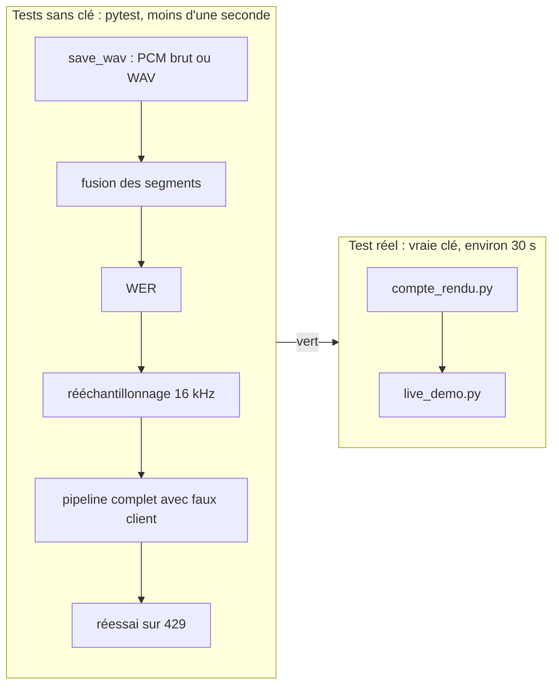

# Tester, évaluer et exploiter le pipeline vocal

> [!NOTE]
> Dans cette leçon, vous allez lancer les tests sans clé, exécuter le pipeline et la démo Live pour de vrai, lire les métriques (WER, entités, durées) et préparer le passage en exploitation, en local ou sur Google Cloud.

## Deux niveaux de tests



Le **faux client** de [test_voix.py](../files/test_voix.py) répond comme l'API : de l'audio pour le modèle TTS, des segments `audio_transcription` pour le modèle STT, un JSON pour le résumé. Il enregistre aussi l'ordre des appels :

```python title="files/test_voix.py"
res = compte_rendu.main(str(script), str(tmp_path / "out"))
assert res["compte_rendu"].numero_commande == "4521"
assert res["a_confirmer"]  # aucune commande connue dans ce script de test
assert fake.models.calls == [voix.TTS_MODEL, voix.STT_MODEL, voix.MODEL, voix.TTS_MODEL]
```

Ces tests vérifient **votre** code (formats, fusion, garde-fou, enchaînement), pas la qualité des modèles. La qualité se mesure avec le test réel.

```quiz
question: "Que prouve le test test_pipeline_with_fake_client ?"
options:
  - "Que gemini-3.5-transcribe comprend bien le français"
  - "Que le pipeline appelle les bons modèles dans le bon ordre et écrit les 4 fichiers attendus"
  - "Que la latence est inférieure à une seconde"
answer: 1
explanation: "Avec un faux client, on teste la logique du code, de façon rapide et reproductible. La qualité de transcription et la latence se mesurent avec les vrais modèles."
```

## Lancer

```bash
cd files
python -m venv .venv && . .venv/bin/activate
pip install -r requirements.txt
cp .env.example .env            # puis mettez votre clé dans .env
python -m pytest -q             # sans réseau
python compte_rendu.py appel_fictif.json sortie
python live_demo.py sortie/question.wav sortie/live_reponse.wav
```

## Résultat obtenu

Tests, le 2026-10-15, sans aucune variable d'environnement (`env -i`) :

```text
.......                                                                  [100%]
7 passed in 0.36s
```

Exécution réelle de `compte_rendu.py` (extrait) :

```text
[1] appel.wav : 41.1 s d'audio (gemini-3.8-flash-tts)
[2] transcription (gemini-3.5-transcribe) : 7 tours de parole
spk:0: Bonjour, service client de la boutique atelier, Léa à l'appareil. Que puis-je faire pour vous ?
spk:1: Bonjour, j'ai commandé une lampe de bureau il y a 10 jours, la commande 4521 et je n'ai toujours rien reçu.
spk:0: Je suis désolée pour ce retard. Je regarde tout de suite. Je vois que le colis est bloqué au dépôt de Lyon depuis lundi.
spk:1: Bloqué ? Mais j'en ai besoin pour vendredi, c'est pour un cadeau.
spk:0: Je comprends. Je vous propose de renvoyer une nouvelle lampe aujourd'hui en livraison express sans frais et je vous envoie le numéro de suivi par email ce soir.
spk:1: D'accord, si elle arrive avant vendredi, ça me va. Merci.
spk:0: C'est noté. Bonne journée monsieur Martin.
    WER (taux d'erreur sur les mots) : 2.6%
[3] compte rendu (gemini-3.5-flash) : ...
[4] reponse.wav : 12.0 s d'audio
Durées (s) : {'1_tts_appel': 13.9, '2_transcription': 2.4, '3_compte_rendu': 5.7, '4_tts_reponse': 4.2}
```

Sur trois exécutions réelles : diarisation correcte à chaque fois (7 tours, alternance agent/client respectée), WER de 2,6 %, 3,4 % et 2,6 %, numéro de commande correct 2 fois sur 3 (une fois « 451 »). Trois essais ne font pas une statistique, mais ils suffisent à montrer pourquoi le garde-fou existe.

Les fichiers audio de cette exécution sont dans `files/` : [exemple_appel.wav](../files/exemple_appel.wav), [exemple_reponse.wav](../files/exemple_reponse.wav), [exemple_question.wav](../files/exemple_question.wav), [exemple_live_reponse.wav](../files/exemple_live_reponse.wav).

## Évaluer sur un vrai jeu

| Métrique | Comment la calculer | Seuil à fixer avec le métier |
| --- | --- | --- |
| WER | `voix.wer(référence, transcription)` sur des appels retranscrits à la main | par exemple < 10 % |
| Rappel des entités | proportion de numéros, montants et dates retrouvés exactement | proche de 100 %, sinon garde-fou |
| Diarisation | proportion de tours attribués au bon rôle | à mesurer sur des appels réels, bruités |
| Fidélité du compte rendu | un humain (ou un LLM-juge) vérifie que chaque action citée a bien été dite | aucune action inventée |
| Durées | médiane et 95ᵉ centile de chaque étape | selon le délai acceptable pour le CRM |

> [!WARNING]
> Des voix de synthèse dans un studio silencieux sont le cas **facile**. Les vrais appels ont du bruit, des accents, des gens qui parlent en même temps et une qualité téléphonique (souvent 8 kHz). Constituez un jeu de test à partir d'appels réels, avec consentement et pseudonymisation, avant de croire vos chiffres.

```quiz
question: "Votre jeu de test n'a que des voix de synthèse et un WER de 3 %. Que pouvez-vous en conclure pour la production ?"
options:
  - "Le WER réel sera d'environ 3 %"
  - "Rien de certain : il faut mesurer sur des appels réels (bruit, accents, qualité téléphonique)"
  - "Le WER réel sera forcément meilleur"
answer: 1
explanation: "Des voix de synthèse dans le silence sont le cas facile. Le chiffre valide le pipeline, pas la qualité en conditions réelles : seul un jeu d'appels réels (avec consentement) le dira."
```

## Exploiter : en local ou sur Google Cloud

| | En local | Sur Google Cloud |
| --- | --- | --- |
| Déclenchement | à la main, ou une tâche planifiée | un fichier déposé dans Cloud Storage déclenche le traitement (Cloud Run) |
| Authentification | `GOOGLE_API_KEY` dans `.env` | Vertex AI avec le compte de service, `GOOGLE_GENAI_USE_VERTEXAI=TRUE` |
| Audio et comptes rendus | dossier `sortie/` | bucket avec règle de suppression automatique de l'audio |
| Temps réel | `live_demo.py` sur le poste | un serveur WebSocket qui relaie le navigateur ou la téléphonie |

Ce lab n'a rien créé sur Google Cloud : il n'y a rien à nettoyer. Si vous le déployez, supprimez le service Cloud Run et le bucket à la fin de vos essais.

## Exercice : rendre le rapport reproductible

Le WER varie d'une exécution à l'autre. Proposez une façon d'obtenir un chiffre fiable sans multiplier les appels coûteux au TTS.

<details>
<summary>Voir la solution</summary>

La variation vient de deux sources : la génération du faux appel (TTS) et la transcription (STT). Pour évaluer **la transcription**, figez l'audio :

1. Générez une fois une dizaine d'appels de test (scripts variés : chiffres, noms propres, débit rapide) et **gardez les WAV** avec leur script de référence.
2. Ne relancez ensuite que l'étape 2 (transcription) sur ces fichiers, plusieurs fois, et rapportez la moyenne et l'écart du WER et du rappel des entités.
3. Rejouez ce même jeu à chaque changement de modèle (`STT_MODEL`) ou de configuration : vous comparez enfin des choses comparables.

</details>

## Je sais faire

- [ ] Lancer les tests sans clé et expliquer ce qu'ils couvrent
- [ ] Exécuter le pipeline et la démo Live, puis lire WER, entités et durées
- [ ] Construire un jeu d'évaluation figé pour comparer des modèles
- [ ] Décrire le passage en exploitation sur Google Cloud et ce qu'il faut nettoyer
