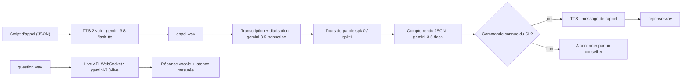

La voix est l'interface la plus naturelle qui soit, et la plus exigeante : un appel client ne se relit pas, une réponse vocale qui arrive avec trois secondes de retard paraît cassée, un numéro de commande mal entendu déclenche la mauvaise action. Cette formation vous apprend les trois briques de la voix avec l'API Gemini (**comprendre**, **parler**, **converser en temps réel**) et la façon de les assembler sans vous faire piéger.

Fil rouge : le **service client d'une boutique fictive, « Atelier »**. Vous fabriquez un faux appel avec deux voix de synthèse, vous le transcrivez en séparant l'agent du client, vous en tirez un compte rendu structuré, puis vous produisez le message vocal de rappel. Enfin, vous parlez à un agent vocal en temps réel et vous mesurez sa latence.

## Pour qui ?

- Développeurs Python à l'aise avec les fonctions, JSON et `pip`, qui ont déjà appelé un LLM par API.
- Équipes support, accessibilité ou outils internes qui veulent savoir ce que la voix change vraiment (et ce qu'elle coûte).
- Aucune connaissance en traitement du signal n'est nécessaire : tout est expliqué depuis zéro.

## Ce que vous allez construire

Tout le code est dans le dossier [files](./files/compte_rendu.py) : [voix.py](./files/voix.py) (les briques), [compte_rendu.py](./files/compte_rendu.py) (le pipeline), [live_demo.py](./files/live_demo.py) (le temps réel), [test_voix.py](./files/test_voix.py) (les tests sans clé), plus les fichiers audio réellement produits le 2026-10-15.

## Prérequis techniques

- Python 3.10 ou plus récent.
- Une clé d'API Gemini (Google AI Studio), exportée dans `GOOGLE_API_KEY` ou copiée dans un fichier `.env` à partir de [.env.example](./files/.env.example).
- `pip install -r requirements.txt` ([requirements.txt](./files/requirements.txt)) : `google-genai`, `pydantic`, `python-dotenv`, `numpy`, `pytest`.
- Un casque ou des haut-parleurs pour écouter les fichiers produits. Pas besoin de micro : la « question » du client est elle-même synthétisée.

## Programme

| Module | Contenu | Durée indicative |
| --- | --- | --- |
| 1. Comprendre l'audio | Le son en données (PCM, échantillonnage, tokens), modèles disponibles, transcription, diarisation, WER | 1h |
| 2. Générer la voix | TTS à une voix, styles, formats de sortie, dialogue à deux voix, chiffres et accessibilité | 50 min |
| 3. Le temps réel | Live API (WebSocket, détection de fin de parole, interruption), budget de latence, cas d'usage et garde-fous | 1h10 |
| 4. Projet final | Pipeline « compte rendu d'appel », tests sans clé, exécution réelle, évaluation et exploitation | 1h |

Chaque leçon contient un schéma, des quiz corrigés, un exercice avec solution, une checklist « Je sais faire » et la **vraie sortie** de nos tests.

## En local ou sur Google Cloud ?

| | En local (cette formation) | Sur Google Cloud |
| --- | --- | --- |
| Accès aux modèles | clé d'API Gemini (AI Studio) | Vertex AI, identifiants du projet (pas de clé dans le code) |
| Où tourne le code | votre poste | Cloud Run (pipeline batch), un serveur WebSocket pour le temps réel |
| Stockage des appels | dossier `sortie/` | Cloud Storage, avec durée de conservation |
| Ce qui change dans le code | rien | `GOOGLE_GENAI_USE_VERTEXAI=TRUE`, et vérifier que chaque modèle audio existe dans votre région |

> [!WARNING]
> Les noms de modèles audio évoluent vite. Ceux de cette formation ont été vérifiés le 2026-10-15 avec la clé d'API (leçon 1). Avant de passer sur Vertex AI, listez les modèles disponibles dans **votre** région : tous les modèles audio n'y sont pas forcément proposés.

## Ce que vous saurez faire

- Choisir entre transcription dédiée, modèle généraliste et Live API selon le besoin.
- Produire une voix (ou un dialogue) avec le bon ton, au bon format, en vérifiant sa durée.
- Mesurer la qualité d'une transcription (WER) et la latence d'un agent vocal.
- Mettre les garde-fous propres à la voix : chiffres confirmés, pas d'invention, consentement, passage à un humain.
