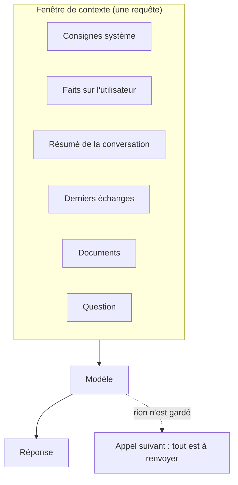

# La fenêtre de contexte, une ressource finie

> [!NOTE]
> Dans cette leçon, vous allez comprendre ce qu'est la fenêtre de contexte, pourquoi « elle fait un million de tokens » ne veut pas dire « mettons-y tout », et comment mesurer ce que coûte chaque morceau de contexte.

## Ce que voit le modèle, et rien d'autre

Un LLM est **sans état** : entre deux appels, il ne garde rien. Tout ce qu'il « sait » de votre utilisateur, de la conversation ou de vos documents, il le lit dans la requête du moment. Cette requête (consignes système, historique, documents, question) s'appelle le **contexte**, et sa taille maximale est la **fenêtre de contexte**, mesurée en **tokens** (des morceaux de mots ; en français, comptez grossièrement 4 caractères par token).



Le *context engineering* consiste à décider, pour **chaque** appel, ce qui entre dans cette fenêtre.

## Pourquoi ne pas tout y mettre ?

`gemini-3.5-flash` accepte 1 048 576 tokens en entrée (valeur lue le 2026-10-15 avec `client.models.get`). C'est énorme, et c'est un piège pour trois raisons :

| Coût | Ce qui se passe | Ordre de grandeur |
| --- | --- | --- |
| **Argent** | chaque token d'entrée est facturé, à **chaque** appel | un historique de 10 000 tokens renvoyé 50 fois = 500 000 tokens facturés |
| **Latence** | le modèle doit lire tout le contexte avant de répondre | plus le contexte est long, plus le premier mot tarde |
| **Qualité** | une information noyée au milieu d'un long contexte est moins bien exploitée | voir « Lost in the Middle » (références) |

L'article *Lost in the Middle* (Liu et al., 2023) a montré, sur les modèles de l'époque, que la performance est souvent meilleure quand l'information utile est **au début ou à la fin** du contexte qu'au milieu. Les modèles récents s'en sortent mieux, mais le principe reste : un contexte encombré est un contexte où l'essentiel se perd.

```quiz
question: "Pourquoi un assistant oublie-t-il votre prénom d'une session à l'autre ?"
options:
  - "Parce que sa fenêtre de contexte est trop petite"
  - "Parce que le modèle est sans état : si le prénom n'est pas renvoyé dans le contexte du nouvel appel, il n'existe pas pour lui"
  - "Parce que le modèle efface volontairement les données personnelles"
answer: 1
explanation: "Le modèle ne garde rien entre deux appels. Se souvenir, c'est la responsabilité de votre application : stocker l'information et la remettre dans le contexte au bon moment."
```

## Mesurer avant d'optimiser

Deux outils :

- `client.models.count_tokens(model=..., contents=...)` : le nombre exact de tokens **avant** d'appeler ;
- `response.usage_metadata` : ce qui a été réellement consommé (`prompt_token_count`, `cached_content_token_count`, `candidates_token_count`).

```python title="files/demo_contexte.py"
doc = catalogue.document()
print(f"Document : {len(doc)} caractères, "
      f"{c.models.count_tokens(model=MODEL, contents=doc).total_tokens} tokens")
```

Dans le projet, `assistant.py` garde aussi `prompt_token_count` de chaque réponse, pour comparer les stratégies de contexte sur les mêmes questions.

> [!TIP]
> Pour les tests et les budgets, une estimation suffit : `len(texte) // 4` (fonction `approx_tokens` de [contexte.py](../files/contexte.py)). Pour la facture, fiez-vous à `usage_metadata`.

## Résultat obtenu

Mesures réelles du 2026-10-15 :

```text
Document : 23042 caractères, 8149 tokens            # catalogue fictif de 160 produits

# Même question « Dans quelle équipe suis-je ? », trois stratégies (moyenne sur 10 questions)
sans_memoire        : tokens d'entrée moyens 95
historique_complet  : tokens d'entrée moyens 591
memoire             : tokens d'entrée moyens 159
```

Recoller toute la première conversation coûte presque 4 fois plus de tokens que rappeler 4 faits ciblés, alors que la conversation n'avait que 10 messages. Avec 200 messages, l'écart se compterait en dizaines de milliers de tokens par question.

```quiz
question: "Un assistant renvoie tout l'historique (8 000 tokens) à chaque message. Un utilisateur envoie 30 messages dans la journée. Combien de tokens d'historique sont facturés ?"
options:
  - "8 000"
  - "Environ 240 000"
  - "Environ 30"
answer: 1
explanation: "L'historique est renvoyé à chaque appel : 30 × 8 000 = 240 000 tokens (et même plus, puisqu'il grossit à chaque message). C'est pour cela qu'on résume, qu'on sélectionne et qu'on met en cache."
```

## Exercice : l'inventaire du contexte

Prenez une application LLM que vous connaissez (ou l'assistant de cette formation). Listez chaque bloc de son contexte, estimez sa taille en tokens, et classez-le : **stable** (identique d'un appel à l'autre), **par utilisateur**, **par message**.

<details>
<summary>Voir la solution</summary>

Pour l'assistant Atelier :

| Bloc | Taille estimée | Nature |
| --- | --- | --- |
| Consignes système | environ 80 tokens | stable |
| Faits rappelés (4 au plus) | environ 60 tokens | par utilisateur et par message |
| Résumé glissant | 0 à 160 tokens | par conversation |
| Derniers échanges (6 au plus) | 100 à 600 tokens | par conversation |
| Question | 10 à 50 tokens | par message |

Ce classement guide la suite : le **stable** va en tête (il peut profiter du cache), le **par message** à la fin, et ce qui grossit sans limite (l'historique) doit être résumé.

</details>

## Je sais faire

- [ ] Expliquer pourquoi un LLM est sans état et ce que cela implique pour la mémoire
- [ ] Citer les trois coûts d'un contexte long (argent, latence, qualité)
- [ ] Compter les tokens avant un appel et lire `usage_metadata` après
- [ ] Faire l'inventaire des blocs d'un contexte et les classer par stabilité
