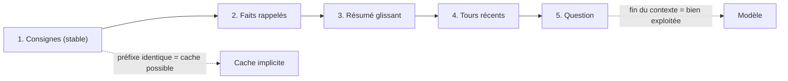

# Ordonner le contexte et tenir un budget

> [!NOTE]
> Dans cette leçon, vous allez écrire la fonction qui assemble le contexte de l'assistant : dans quel ordre placer les blocs, et quoi retirer en premier quand le budget de tokens est dépassé.

## Un ordre qui a des raisons

| Position | Bloc | Pourquoi ici |
| --- | --- | --- |
| 1 | consignes système | stables : elles forment un **préfixe identique** d'un appel à l'autre, ce qui favorise le cache implicite (module 3) |
| 2 | faits sur l'utilisateur | stables pendant la session, et importants : en tête, ils ne se perdent pas au milieu |
| 3 | résumé de la conversation | change lentement |
| 4 | derniers échanges, mot pour mot | changent à chaque tour |
| 5 | la question | **en dernier** : c'est là que le modèle la « voit » le mieux, et ce qui précède sert à y répondre |



## Le code

```python title="files/contexte.py"
def build_context(system, facts, summary, turns, question, budget=6000, count=approx_tokens):
    facts, turns = list(facts), list(turns)

    def render():
        sys = system
        if facts:
            sys += "\n\n## Ce que tu sais de l'utilisateur (mémoire long terme)\n" + "\n".join(f"- {f}" for f in facts)
        if summary:
            sys += "\n\n## Résumé de la conversation jusqu'ici\n" + summary
        contents = [{"role": r, "parts": [{"text": t}]} for r, t in turns]
        contents.append({"role": "user", "parts": [{"text": question}]})
        total = count(sys) + sum(count(t) for _, t in turns) + count(question)
        return sys, contents, total

    sys, contents, total = render()
    while total > budget and (turns or facts):
        if turns:
            turns.pop(0)       # 1. les tours les plus anciens (déjà couverts par le résumé)
        else:
            facts.pop()        # 2. puis les faits les moins pertinents (liste triée par score)
        sys, contents, total = render()
    return sys, contents, total
```

Trois choix à remarquer :

- Faits et résumé vont dans l'**instruction système**, pas dans un faux message utilisateur : le modèle les traite comme du contexte de confiance, pas comme une demande.
- L'ordre de suppression suit la valeur de chaque bloc : un vieux tour déjà résumé vaut moins qu'un fait rappelé.
- Le résumé et la question ne sont jamais coupés. Si même eux dépassent le budget, c'est le résumé qu'il faut raccourcir (leçon suivante), pas le contexte qu'il faut tronquer au hasard.

> [!WARNING]
> Ne tronquez jamais un contexte « par la fin » (`texte[:N]`) : vous couperiez la question. Et ne coupez pas au milieu d'un message : un demi-message est pire que pas de message.

```quiz
question: "Le budget est dépassé. Que retire build_context en premier ?"
options:
  - "La question de l'utilisateur"
  - "Les tours de conversation les plus anciens"
  - "Les consignes système"
answer: 1
explanation: "Les tours les plus anciens sont les moins utiles (et déjà couverts par le résumé glissant). Viennent ensuite les faits les moins pertinents. Consignes, résumé et question restent."
```

## Compresser plutôt que couper

Retirer est la solution de dernier recours. Avant, on **compresse** :

| Technique | Ce qu'on gagne | Ce qu'on risque |
| --- | --- | --- |
| Résumé glissant (module 2) | l'historique cesse de grossir | perdre un détail, garder une information périmée |
| Faits extraits (module 2) | quelques lignes au lieu de pages | une extraction ratée = un oubli |
| Sélection par similarité (RAG) | seuls les passages utiles | rater le bon passage |
| Résultats d'outils raccourcis | un JSON de 5 000 tokens réduit aux 3 champs utiles | supprimer un champ dont le modèle avait besoin |

## Résultat obtenu

Exécution locale (sans appel au modèle) du 2026-10-15, avec 3 faits, un résumé, 2 tours et la question « Dans quelle équipe suis-je ? » :

```text
budget=6000: ~166 tokens, 3 messages, faits gardés=3
budget=120: ~106 tokens, 1 messages, faits gardés=0
```

Avec un budget de 120, tout a été retiré sauf les consignes, le résumé et la question : on voit l'ordre de priorité à l'œuvre (et pourquoi un budget trop serré rend l'assistant amnésique). Le test `test_build_context_order_and_budget` de [test_memoire.py](../files/test_memoire.py) vérifie ces règles à chaque modification.

```quiz
question: "Pourquoi placer les consignes système et les faits stables en tête du contexte ?"
options:
  - "Parce que l'API l'exige"
  - "Parce qu'un préfixe identique d'un appel à l'autre peut être servi par le cache, et que le début du contexte est bien exploité"
  - "Pour que le modèle les lise plus vite"
answer: 1
explanation: "Le cache implicite fonctionne sur les préfixes communs : un début de requête stable augmente les chances de réutilisation. Et comme la fin, le début du contexte est une position où l'information est bien prise en compte."
```

## Exercice : un bloc « documents »

Ajoutez à `build_context` un paramètre `docs: list[str]` (des passages RAG triés par pertinence). Où les placez-vous, et dans quel ordre les retirez-vous en cas de dépassement ?

<details>
<summary>Voir la solution</summary>

Placez-les **après les tours récents et juste avant la question**, dans un message dédié, par exemple « Documents utiles : … ». Ils dépendent de la question, ils changent à chaque appel : aucun intérêt à les mettre dans le préfixe stable, et les avoir près de la question aide le modèle à les relier.

Ordre de retrait proposé : vieux tours, puis **derniers documents** (les moins pertinents), puis faits les moins pertinents. Dans la boucle :

```python
if turns:
    turns.pop(0)
elif docs:
    docs.pop()
else:
    facts.pop()
```

Ajoutez un test : avec un budget serré, le document le moins pertinent disparaît avant le premier.

</details>

## Je sais faire

- [ ] Justifier l'ordre consignes, faits, résumé, tours, question
- [ ] Écrire une fonction d'assemblage qui respecte un budget de tokens
- [ ] Choisir quoi retirer en premier, et ce qu'il ne faut jamais couper
- [ ] Citer quatre façons de compresser un contexte et leurs risques
