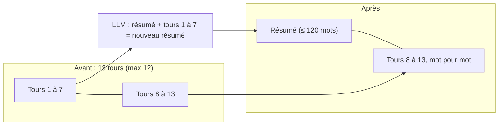

# Le résumé glissant : une conversation qui ne grossit plus

> [!NOTE]
> Dans cette leçon, vous allez coder un résumé glissant (les derniers échanges gardés mot pour mot, les plus anciens résumés par un LLM), le tester sans clé et lire deux résumés réels, dont un défectueux.

## Le principe

Une conversation qui dure finit par dépasser n'importe quel budget. Plutôt que de couper les vieux messages (et perdre ce qu'ils contenaient), on les **résume** :

- les `keep_last` derniers tours restent **mot pour mot** (le modèle en a besoin pour suivre le fil : « et le deuxième ? ») ;
- quand on dépasse `max_turns`, les tours plus anciens sont fondus dans un **résumé** qui, lui, se met à jour à chaque fois.



## Le code

```python title="files/contexte.py"
class RollingSummary:
    def __init__(self, summarize, max_turns: int = 12, keep_last: int = 6):
        self.summarize, self.max_turns, self.keep_last = summarize, max_turns, keep_last
        self.summary, self.turns = "", []   # turns : [(role, texte)], role = "user" | "model"

    def add(self, role: str, text: str):
        self.turns.append((role, text))
        if len(self.turns) > self.max_turns:
            old, self.turns = self.turns[:-self.keep_last], self.turns[-self.keep_last:]
            self.summary = self.summarize(self.summary, old)
```

La fonction `summarize` est **injectée** : un appel LLM en production (`llm_summarizer`), une fonction triviale dans les tests. C'est ce qui permet de tester la logique (quand résumer, quoi garder) sans clé :

```python title="files/test_memoire.py"
def test_rolling_summary_keeps_last_turns():
    calls = []
    conv = contexte.RollingSummary(lambda s, old: calls.append(len(old)) or f"résumé de {len(old)} tours",
                                   max_turns=4, keep_last=2)
    for i in range(5):
        conv.add("user", f"m{i}")
    assert calls == [3] and conv.summary == "résumé de 3 tours"
    assert conv.turns == [("user", "m3"), ("user", "m4")]
```

> [!TIP]
> On résume par **paquets** (ici 6 ou 7 tours d'un coup), pas à chaque message : un appel de résumé tous les 3 échanges environ au lieu d'un par échange, et un résumé qui réécrit moins souvent (donc déforme moins).

```quiz
question: "Avec max_turns=12 et keep_last=6, combien de tours sont envoyés mot pour mot juste après un résumé ?"
options:
  - "12"
  - "6"
  - "0, tout est résumé"
answer: 1
explanation: "Au 13e tour, les 7 plus anciens partent dans le résumé et les 6 derniers restent tels quels. Ensuite, la liste regrossit jusqu'à 12 avant le résumé suivant."
```

## Une consigne de résumé qui compte

```python title="files/contexte.py"
SUMMARY_PROMPT = """Mets à jour le résumé d'une conversation entre un utilisateur et un assistant.
Garde : les décisions, les demandes en cours, les informations données par l'utilisateur.
Supprime : les politesses, les répétitions. Si une information a changé, ne garde que la nouvelle.
120 mots maximum, en français. Réponds uniquement par le texte du résumé, sans titre.
..."""
```

Les deux dernières phrases ont été ajoutées **après** notre premier essai réel (voir le résultat ci-dessous).

## Résultat obtenu

Fin de la session 1 de Camille (10 messages, donc 20 tours), le 2026-10-15. Premier essai, avec la consigne **sans** les deux dernières phrases (`gemini-3.5-flash`) :

```text
résumé glissant en fin de session : "**Nouveau résumé :**\n\nCamille est une nouvelle employée de l'entreprise Atelier à Nantes,
au sein de l'équipe Paiements. Elle utilise principalement le langage Go et effectue ses trajets domicile-trav"
```

Deuxième essai, consigne corrigée, sur Vertex AI (`gemini-2.5-flash`) :

```text
résumé glissant en fin de session : "Camille est une nouvelle collaboratrice chez Atelier, membre de l'équipe Paiements.
Elle a une allergie aux arachides, à considérer pour les propositions (ex: traiteur). Son langage de programmation p"
```

Deux leçons :

1. Le titre parasite « **Nouveau résumé :** » a disparu avec la consigne « sans titre ». Un résumé est réinjecté à chaque appel : chaque mot inutile se paie à chaque fois.
2. « équipe Paiements » est toujours là, et c'est **normal** : le changement d'équipe est le tout dernier message, il fait partie des 6 tours gardés mot pour mot, pas encore résumés. Résumé + tours récents restent cohérents **ensemble**. Mais le résumé, lui, ne survit pas à la session, et c'est pourquoi l'équipe actuelle doit vivre dans la **mémoire long terme** (leçon suivante), qui l'a bien mise à jour.

> [!WARNING]
> Un résumé est une compression **avec perte**, produite par un modèle qui peut se tromper. Ne mettez jamais dans un résumé une donnée qui doit rester exacte (montant, numéro, date d'échéance) sans la garder aussi sous forme structurée.

```quiz
question: "Pourquoi l'équipe Paiements apparaît-elle encore dans le résumé, alors que Camille a annoncé son changement ?"
options:
  - "Parce que le modèle de résumé s'est trompé"
  - "Parce que le message de changement est encore dans les tours récents, non résumés : le contexte complet (résumé + tours) contient bien l'information à jour"
  - "Parce que le résumé est limité à 120 mots"
answer: 1
explanation: "Le résumé ne couvre que les tours sortis de la fenêtre des 6 derniers. Le message sur Logistique en fait partie : au prochain résumé, la consigne demandera de ne garder que la nouvelle équipe."
```

## Exercice : mesurer la compression

Écrivez une fonction qui, pour une conversation donnée, compare le nombre de tokens de l'historique complet à celui de « résumé + tours récents », et dites à partir de combien de messages le résumé devient rentable compte tenu de son propre coût d'appel.

<details>
<summary>Voir la solution</summary>

```python
from contexte import approx_tokens

def compression(conv, all_turns):
    full = sum(approx_tokens(t) for _, t in all_turns)
    kept = approx_tokens(conv.summary) + sum(approx_tokens(t) for _, t in conv.turns)
    return full, kept
```

Le résumé coûte un appel qui **lit** les tours anciens (environ leur taille) et **écrit** 120 mots (environ 160 tokens). Il est rentable dès que l'économie cumulée sur les appels suivants dépasse ce coût : si chaque appel suivant économise $E$ tokens, il suffit de $\lceil \text{coût} / E \rceil$ appels. Dans une conversation de support de 40 messages, l'économie se compte vite en milliers de tokens ; dans une conversation de 5 messages, le résumé ne se déclenche même pas.

</details>

## Je sais faire

- [ ] Coder un résumé glissant avec un seuil et un nombre de tours gardés
- [ ] Tester sa logique sans clé grâce à une fonction de résumé injectée
- [ ] Écrire une consigne de résumé courte, sans titre, qui remplace les informations périmées
- [ ] Expliquer pourquoi le résumé ne remplace pas la mémoire long terme
