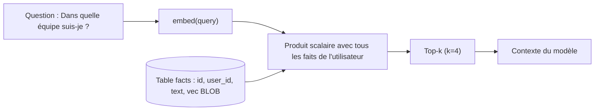

# Stocker dans SQLite et rappeler par similarité

> [!NOTE]
> Dans cette leçon, vous allez stocker les faits avec leur embedding dans une simple table SQLite, rappeler les plus proches d'une question, et découvrir pourquoi un seuil de similarité fixe est une fausse bonne idée.

## Un embedding, c'est quoi déjà ?

Un **embedding** est une liste de nombres (un vecteur) qui représente le sens d'un texte : deux textes de sens proche ont des vecteurs proches. On mesure cette proximité avec la **similarité cosinus** (entre -1 et 1). Si les vecteurs sont normalisés (longueur 1), le cosinus est un simple produit scalaire.



## Une table suffit

```python title="files/memoire.py"
self.db.execute("""CREATE TABLE IF NOT EXISTS facts (
    id INTEGER PRIMARY KEY, user_id TEXT NOT NULL, text TEXT NOT NULL,
    vec BLOB NOT NULL, updated_at REAL NOT NULL)""")

def recall(self, user, query, k=4):
    rows = self.db.execute("SELECT id, text, vec FROM facts WHERE user_id=?", (user,)).fetchall()
    if not rows:
        return []
    m = np.frombuffer(b"".join(r[2] for r in rows), dtype=np.float32).reshape(len(rows), -1)
    scores = m @ self.embed(query, "query")
    best = np.argsort(-scores)[:k]
    return [(float(scores[i]), rows[i][0], rows[i][1]) for i in best]
```

Le vecteur est stocké en binaire (`np.float32(...).tobytes()`, 768 × 4 = 3 072 octets par fait). Le filtre `WHERE user_id=?` est fait **avant** le calcul : les faits de Bob ne sont même pas lus quand Camille pose une question.

> [!TIP]
> Un scan complet en numpy suffit largement pour quelques milliers de faits par utilisateur (c'est le commentaire `Limite connue :` du code). Au-delà, ou si vous cherchez dans **tous** les utilisateurs à la fois, passez à un index vectoriel : sqlite-vec, pgvector, ou Vector Search sur Google Cloud.

## Les pièges de gemini-embedding-2

Trois comportements réels, vérifiés le 2026-10-15, qui changent le code :

| Constat | Conséquence dans le code |
| --- | --- |
| Une **liste** de textes envoyée en un appel renvoie **un seul** vecteur agrégé (API Gemini) | un texte par appel, ou une `types.Content` par texte |
| `task_type="RETRIEVAL_QUERY"` ne change rien aux vecteurs | on préfixe le texte, comme le recommande la documentation : `task: question answering \| query: ...` pour la question, `title: none \| text: ...` pour le fait |
| Sur Vertex AI, 404 en `europe-west1` et un seul contenu par requête | `EMBED_MODEL=gemini-embedding-001` sur Vertex en Europe |

```python title="files/memoire.py"
prompt = f"task: question answering | query: {text}" if kind == "query" else f"title: none | text: {text}"
r = with_retry(lambda: c.models.embed_content(
    model=EMBED_MODEL, contents=prompt, config=types.EmbedContentConfig(output_dimensionality=DIM)))
```

`output_dimensionality=768` réduit le vecteur (3 072 dimensions par défaut) : quatre fois moins de stockage, pour une qualité de classement qui reste suffisante ici.

```quiz
question: "Vous envoyez 6 faits dans une liste à embed_content avec gemini-embedding-2 sur l'API Gemini. Combien de vecteurs recevez-vous ?"
options:
  - "6"
  - "1, qui agrège les 6 textes"
  - "Une erreur"
answer: 1
explanation: "gemini-embedding-2 agrège une liste en un seul embedding. Pour 6 vecteurs, il faut 6 contenus séparés (types.Content) ou 6 appels. Notre premier essai a renvoyé un seul vecteur et cassé l'indexation."
```

## Pourquoi pas de seuil fixe ?

Tentation : « on ne rappelle que les faits avec une similarité supérieure à 0,7 ». Regardez les scores réels de la section suivante (lignes = questions, colonnes = faits, préfixes de tâche appliqués) avant de choisir un seuil.

## Résultat obtenu

Mesure réelle du 2026-10-15, `gemini-embedding-2`, 768 dimensions :

```text
                                        Camille  arachides  Go    Nantes  Paiements  Logistique
Comment je m'appelle ?                  0.74     0.67       0.66  0.67    0.65       0.64
Dans quelle équipe suis-je ?            0.67     0.63       0.64  0.64    0.68       0.70
Quelle est la couleur de ma voiture ?   0.64     0.60       0.62  0.61    0.58       0.59
Dans quel langage écrire l'exemple ?    0.65     0.58       0.72  0.60    0.61       0.58
```

Le **classement** est juste à chaque ligne (le bon fait est premier). Mais les **valeurs** sont serrées : la question sans réponse (« couleur de ma voiture ») obtient 0,64 sur son meilleur fait, à peine moins que les bonnes réponses aux questions « équipe » (0,70) et « langage » (0,72). Aucun seuil ne sépare proprement « pertinent » de « hors sujet ».

D'où le choix du projet : **top-k sans seuil**, et c'est le modèle, guidé par la consigne « si l'information n'est pas dans ta mémoire, dis-le », qui décide d'utiliser ou non un fait. L'évaluation finale le confirme : sur la question de la voiture, l'assistant a répondu « Je ne la connais pas » malgré 4 faits rappelés.

> [!WARNING]
> Notez aussi la ligne « équipe » : Paiements (0,68) et Logistique (0,70) sont presque à égalité. Sans la **mise à jour** de la leçon précédente, les deux faits seraient rappelés ensemble et le modèle devrait deviner lequel est le bon.

```quiz
question: "Pourquoi le projet rappelle-t-il toujours les k meilleurs faits au lieu d'appliquer un seuil de similarité ?"
options:
  - "Parce que les scores mesurés sont trop serrés pour qu'un seuil sépare le pertinent du hors sujet"
  - "Parce que SQLite ne sait pas filtrer sur un nombre"
  - "Parce qu'un seuil coûterait plus de tokens"
answer: 0
explanation: "Les mesures montrent des scores entre 0,58 et 0,74 pour tous les couples. Le classement est fiable, les valeurs absolues ne le sont pas. Avec un k petit (4), le coût reste faible et le modèle trie."
```

## Exercice : la dimension

Proposez une expérience pour choisir entre 768 et 3 072 dimensions, sans vous fier à l'intuition.

<details>
<summary>Voir la solution</summary>

1. Reprenez les 8 questions de [scenarios.json](../files/scenarios.json) qui ont un `fait` attendu.
2. Pour chaque dimension (`EMBED_DIM=768` puis `3072`), reconstruisez la mémoire et mesurez le **taux de bon fait rappelé** dans le top-1 et le top-4 (`fact_recalled` dans [eval_rappel.py](../files/eval_rappel.py)).
3. Notez aussi la taille de la base (4 octets × dimensions × nombre de faits) et le temps de `recall`.

Si 768 donne le même rappel top-4, gardez 768 : quatre fois moins de stockage. Sur 8 questions, l'écart ne sera pas significatif : pour décider en production, il faut des dizaines ou des centaines de questions réelles.

</details>

## Je sais faire

- [ ] Stocker un embedding en BLOB dans SQLite et le relire avec numpy
- [ ] Rappeler les k faits les plus proches, filtrés par utilisateur
- [ ] Contourner les pièges de gemini-embedding-2 (liste agrégée, préfixes, Vertex)
- [ ] Expliquer pourquoi top-k bat un seuil fixe sur nos mesures
