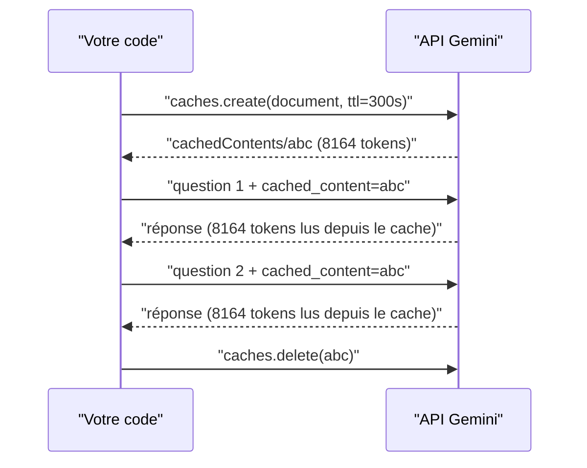

# La mise en cache du contexte

> [!NOTE]
> Dans cette leçon, vous allez comprendre comment l'API réutilise un long préfixe déjà traité (cache implicite), comment réserver explicitement un cache pour un document que vous interrogez souvent, et lire dans `usage_metadata` ce que cela change.

## L'idée

Quand vous envoyez le même long document à chaque question, le modèle refait à chaque fois le même travail de lecture. La **mise en cache du contexte** (*context caching*) garde ce travail côté serveur : les tokens servis depuis le cache sont facturés à un tarif réduit (voir la page de tarifs) et peuvent répondre plus vite.

| | Cache **implicite** | Cache **explicite** |
| --- | --- | --- |
| Activation | automatique (modèles Gemini 2.5 et plus récents, d'après la documentation) | vous créez un objet `CachedContent` avec une durée de vie (TTL) |
| Condition | un **préfixe identique** envoyé à peu d'intervalle, au-dessus d'un minimum de tokens (4 096 pour les modèles Gemini 3.x listés, 2 048 pour Gemini 2.5 Flash) | le contenu dépasse le minimum du modèle |
| Garantie | aucune : c'est une optimisation « au mieux » | les appels qui citent le cache l'utilisent |
| Coût en plus | aucun | stockage facturé à la durée tant que le cache existe |
| À faire | mettre le contenu stable **en tête** | **supprimer** le cache quand on a fini |



## Le code

```python title="files/demo_contexte.py"
cache = c.caches.create(model=MODEL, config=types.CreateCachedContentConfig(
    display_name="lab-context-engineering", contents=[doc], ttl="300s",
    system_instruction="Tu réponds uniquement à partir du catalogue fourni, en une phrase."))
try:
    for q in [QUESTION, "Quelle est la garantie de la référence AT-1050 ?"]:
        show("explicite", ask(c, q, cached_content=cache.name))
finally:
    c.caches.delete(name=cache.name)   # même en cas d'erreur
```

Le cache contient le document **et** l'instruction système : les appels qui l'utilisent n'envoient plus que la question. Le `try/finally` garantit la suppression même si une question échoue.

> [!WARNING]
> Un cache explicite oublié se facture jusqu'à expiration de son TTL. Mettez toujours un TTL court en test, nommez vos caches (`display_name`) et vérifiez qu'il n'en reste pas : `[x.name for x in client.caches.list()]`.

```quiz
question: "Vous voulez profiter du cache implicite. Où placez-vous le long document dans la requête ?"
options:
  - "À la fin, après la question"
  - "Au début, avant la question, identique d'un appel à l'autre"
  - "Peu importe, le cache implicite compare tout le texte"
answer: 1
explanation: "Le cache implicite fonctionne sur un préfixe commun. Si la question (qui change) est placée avant le document, le préfixe diffère dès les premiers tokens et rien n'est réutilisé."
```

## Résultat obtenu

Exécution réelle de `python demo_contexte.py` le 2026-10-15 (`gemini-3.5-flash`, document de 8 149 tokens) :

```text
implicite, appel 1      1.42 s | entrée  8161 (dont cache     0) | sortie   27 | 'Le prix du produit **AT-1050** (Chaise rotin terracotta) est de **93 euros TTC**.'
implicite, appel 2      1.44 s | entrée  8161 (dont cache  6119) | sortie   26 | 'Le prix de la référence AT-1050 (Chaise rotin terracotta) est de **93 euros TTC**.'

cache créé : 8164 tokens, expire 15:01:08 UTC
explicite               2.92 s | entrée  8197 (dont cache  8164) | sortie   54 | "La référence AT-1137 coûte 821 euros TTC, est expédiée depuis l'entrepôt de Nantes, et ne bénéficie pas de la livraison "
explicite               2.29 s | entrée  8179 (dont cache  8164) | sortie   17 | 'La garantie pour la référence AT-1050 est de 1 an.'
cache supprimé ; caches restants du lab : []
```

Ce qu'on lit :

- Le **cache implicite** a servi 6 119 tokens sur 8 161 au deuxième appel, sans aucune configuration. Pas 100 % : le cache travaille par blocs, la fin du préfixe n'est pas toujours couverte.
- Le **cache explicite** a servi la totalité du document (8 164 tokens) aux deux questions.
- La latence n'a pas baissé de façon visible sur ces essais isolés : l'intérêt principal mesuré ici est le **coût** des tokens d'entrée.
- Un test équivalent sur Vertex AI (`gemini-2.5-flash`, europe-west1, même document) a donné `prompt 8157, cached 8149`, puis le cache a été supprimé et la liste des caches était vide.

```quiz
question: "Au 2e appel implicite, cached_content_token_count vaut 6119 sur 8161 tokens d'entrée. Qu'est-ce que cela signifie ?"
options:
  - "Le cache a échoué"
  - "6 119 tokens ont été servis depuis le cache (tarif réduit), les 2 042 autres ont été traités normalement"
  - "La réponse a été copiée depuis l'appel précédent"
answer: 1
explanation: "Seule la lecture du préfixe est réutilisée ; la réponse est générée à nouveau. Une partie du préfixe a été servie depuis le cache, le reste (dont la question) a été traité normalement."
```

## Exercice : rentable ou pas ?

Un cache explicite coûte un stockage horaire. Vous interrogez un manuel de 50 000 tokens. Quelles informations vous faut-il pour décider s'il est rentable, et quelle est la règle ?

<details>
<summary>Voir la solution</summary>

Il faut : le nombre de questions par heure $n$, le tarif normal des tokens d'entrée $p$, le tarif des tokens en cache $p_c$ et le tarif de stockage par token et par heure $s$ (tous sur la page de tarifs de votre modèle).

Économie par heure : $n \times 50\,000 \times (p - p_c)$. Coût du stockage par heure : $50\,000 \times s$. Le cache est rentable si $n \times (p - p_c) > s$.

En pratique : quelques questions par heure sur le même gros document suffisent souvent, une question par jour jamais. Et si vos questions arrivent en rafale, le cache **implicite** gratuit peut suffire : mesurez `cached_content_token_count` avant de payer un cache explicite.

</details>

## Je sais faire

- [ ] Distinguer cache implicite et cache explicite
- [ ] Structurer une requête pour favoriser le cache implicite
- [ ] Créer, utiliser et supprimer un cache explicite, avec un TTL court
- [ ] Lire `cached_content_token_count` et raisonner sur la rentabilité
