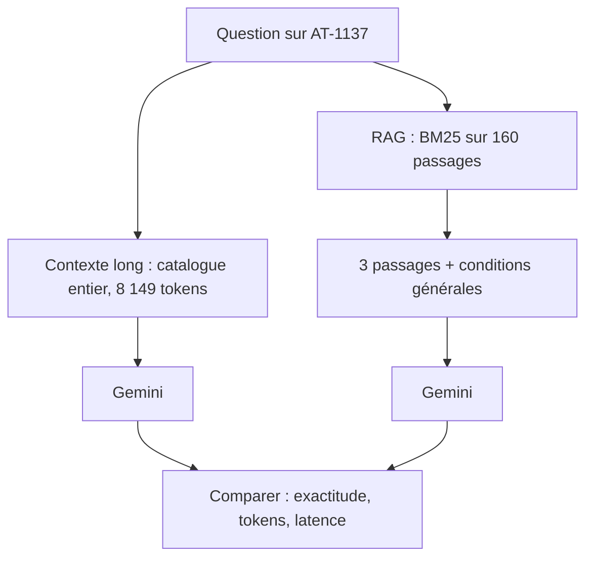

# Document entier ou RAG : mesurer pour choisir

> [!NOTE]
> Dans cette leçon, vous allez poser la même question à un catalogue de 8 000 tokens de deux façons (document entier, ou 3 passages retrouvés par recherche) et comparer qualité, tokens et latence, pour savoir quand chaque approche gagne.

## Deux stratégies

- **Contexte long** : on met le document entier dans la requête. Simple, aucun index à construire, le modèle voit tout (y compris les règles générales qui s'appliquent à tous les produits).
- **RAG** (*Retrieval-Augmented Generation*, génération augmentée par la recherche) : on découpe le document en passages, on cherche les plus pertinents pour la question, et on n'envoie qu'eux.



Ici la recherche est **lexicale** (BM25, un classement par mots communs pondérés par leur rareté), pas sémantique : pour un identifiant exact comme « AT-1137 », la correspondance de mots est imbattable, et elle ne coûte aucun appel d'API.

```python title="files/demo_contexte.py"
def bm25_top(chunks, query, k=3):
    tok = lambda s: s.lower().replace(":", " ").replace(".", " ").split()
    scores = BM25Okapi([tok(c) for c in chunks]).get_scores(tok(query))
    return [chunks[i] for i in sorted(range(len(chunks)), key=lambda i: -scores[i])[:k]]

head = doc.split("## Produits")[0]          # les conditions générales, toujours utiles
passages = "\n".join(bm25_top(catalogue.chunks(), QUESTION))
show("RAG (BM25, 3 passages)", ask(c, f"{head}\n{passages}\n\nQuestion : {QUESTION}"))
```

> [!TIP]
> Remarquez `head` : la question demande si la livraison express est possible, et la règle (« express pour les produits expédiés depuis Lyon uniquement ») n'est **pas** dans la fiche produit. Un RAG qui n'enverrait que les fiches répondrait mal. Les informations transverses doivent accompagner les passages.

```quiz
question: "Pourquoi le RAG du lab ajoute-t-il l'en-tête du catalogue aux 3 passages trouvés ?"
options:
  - "Pour atteindre le minimum de tokens du cache"
  - "Parce que la règle sur la livraison express est dans l'en-tête et pas dans les fiches produits"
  - "Parce que BM25 l'exige"
answer: 1
explanation: "La question combine une donnée produit (prix, entrepôt) et une règle générale (express depuis Lyon uniquement). Sans la règle, le modèle ne peut pas répondre correctement à la seconde partie."
```

## Résultat obtenu

Exécution réelle du 2026-10-15 (`gemini-3.5-flash`), question : « Quel est le prix et l'entrepôt d'expédition de la référence AT-1137 ? Et la livraison express est-elle possible ? »

```text
Document : 23042 caractères, 8149 tokens

document entier          2.62 s | entrée  8184 (dont cache 0) | sortie 79 | "Pour la référence **AT-1137** :\n\n* **Prix :** 821 euros TTC\n* **Entrepôt d'expédition :** Nantes\n* **Livraison express :"
RAG (BM25, 3 passages)    3.9 s | entrée   234 (dont cache 0) | sortie 84 | "Voici les informations concernant la référence **AT-1137** :\n\n* **Prix :** 821 euros TTC.\n* **Entrepôt d'expédition :** "
```

Les deux réponses sont exactes (821 euros, Nantes, et pas d'express puisque le produit ne part pas de Lyon). Le RAG a utilisé **35 fois moins** de tokens d'entrée. Il n'a pas été plus rapide sur cet essai unique (3,9 s contre 2,62 s) : à ces tailles, la latence dépend surtout de la charge du service. Comme toujours, une mesure isolée n'est pas une moyenne.

## Quand choisir quoi

| Situation | Plutôt | Pourquoi |
| --- | --- | --- |
| Un document moyen, beaucoup de questions transverses (« résume », « compare ») | contexte long + cache | le modèle a besoin de tout voir |
| Une base qui grandit (des milliers de pages) | RAG | ne tient plus dans la fenêtre, ou coûte trop |
| Questions pointues sur des identifiants | RAG lexical ou hybride | correspondance exacte, coût minimal |
| Prototype, peu de questions | contexte long | zéro infrastructure |
| Exigence de citer la source | RAG | on sait quels passages ont servi |

> [!WARNING]
> Le contexte long **n'élimine pas** les erreurs : un modèle peut confondre deux fiches voisines dans un catalogue de 160 produits. Évaluez les deux approches sur un jeu de questions représentatif, pas sur une démo qui marche.

```quiz
question: "Votre base documentaire fait 3 millions de tokens et grossit chaque semaine. Que choisissez-vous ?"
options:
  - "Le contexte long, puisque la fenêtre fait un million de tokens"
  - "Un RAG, éventuellement combiné à un cache pour les parties stables et très consultées"
  - "Un fine-tuning du modèle sur la base"
answer: 1
explanation: "3 millions de tokens dépassent la fenêtre, et le contenu change souvent. Le RAG sélectionne les passages utiles ; le cache peut servir pour un sous-ensemble stable (un règlement, une FAQ) interrogé en permanence."
```

## Exercice : la question transverse

Posez au RAG la question « Quel est le produit le moins cher expédié depuis Lyon ? ». Que va-t-il se passer, et comment le corriger ?

<details>
<summary>Voir la solution</summary>

BM25 va remonter 3 passages qui contiennent « Lyon » (et « produit », « expédié »), choisis par score de mots et non par prix. Le modèle répondra avec le moins cher **des 3**, pas du catalogue : réponse fausse, mais plausible.

Corrections possibles :

1. Reconnaître que c'est une **question d'agrégation** : c'est un filtre et un tri (`min(p for p in products() if p["entrepot"] == "Lyon")`), à faire en code ou en SQL, exposé au modèle comme un outil.
2. Ou basculer vers le **contexte long** (8 000 tokens, avec cache) pour ce type de question.

Le RAG répond bien aux questions dont la réponse tient dans quelques passages ; il répond mal à celles qui demandent de parcourir tout le corpus.

</details>

## Je sais faire

- [ ] Comparer document entier et RAG sur la même question, avec des mesures
- [ ] Accompagner les passages des règles transverses nécessaires
- [ ] Choisir une recherche lexicale pour des identifiants exacts
- [ ] Reconnaître une question d'agrégation que le RAG traitera mal
