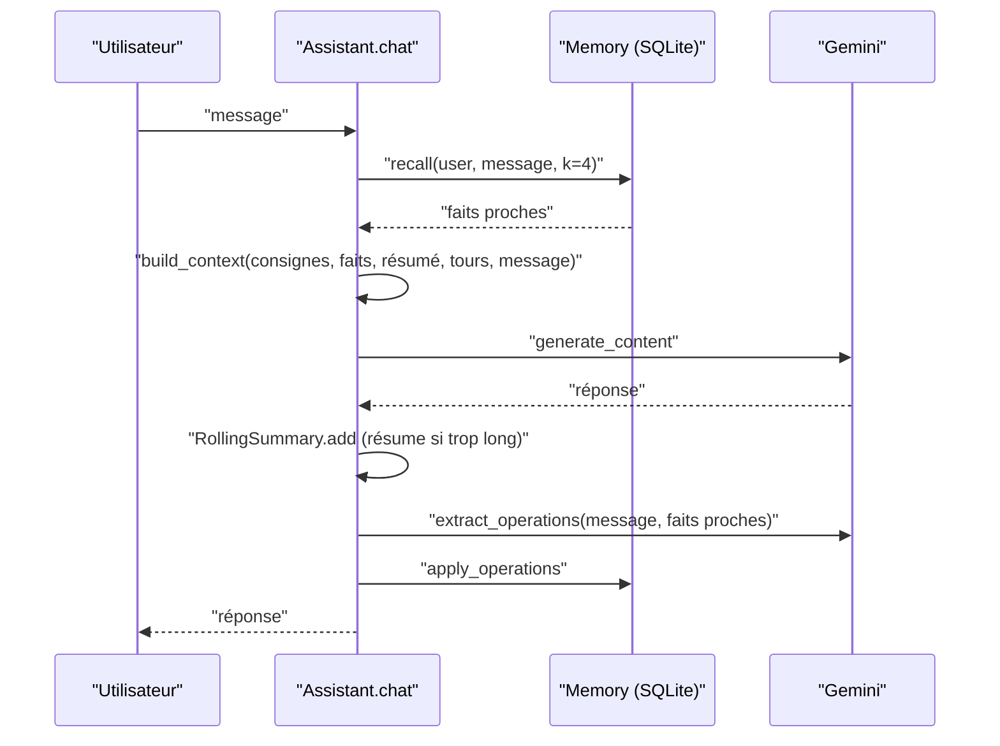

# L'assistant qui se souvient : assemblage

> [!NOTE]
> Dans cette leçon, vous allez assembler la mémoire long terme, le résumé glissant et le contexte budgété en un assistant de moins de 70 lignes, le tester sans clé, puis lui parler sur plusieurs sessions.

## Le cahier des charges

- D'une session à l'autre, l'assistant se souvient des **préférences et contraintes** de chaque utilisateur.
- Il **met à jour** un fait qui change (équipe) au lieu d'accumuler des contradictions.
- Il ne mélange **jamais** deux utilisateurs.
- Il **n'invente pas** ce qu'il ne sait pas.
- Le contexte reste **borné**, quelle que soit la longueur de la conversation.



## Le cœur : `Assistant.chat`

```python title="files/assistant.py"
def chat(self, message: str, learn: bool = True) -> str:
    recalled = self.mem.recall(self.user, message, K) if self.mem else []
    system, contents, est = contexte.build_context(
        SYSTEM, [t for _, _, t in recalled], self.conv.summary, self.conv.turns, message)
    r = memoire.with_retry(lambda: self.c.models.generate_content(
        model=self.model, contents=contents, config={"system_instruction": system}))
    answer = (r.text or "").strip()
    self.conv.add("user", message)
    self.conv.add("model", answer)
    ...
    if learn and self.mem:
        known = [(i, t) for _, i, t in recalled]
        ops = memoire.extract_operations(self.c, message, known)
        self.last["memory_ops"] = memoire.apply_operations(self.mem, self.user, ops, {i for i, _ in known})
    return answer
```

Le même rappel sert deux fois : pour **répondre** (les faits vont dans le contexte) et pour **apprendre** (les faits sont montrés à l'extracteur, qui peut les mettre à jour). L'extraction se fait **après** la réponse : en production, on la lancerait en tâche de fond pour ne pas allonger le temps de réponse.

> [!TIP]
> Le paramètre `learn=False` sert à l'évaluation : on interroge la mémoire sans la modifier, pour que l'ordre des questions ne change pas le résultat.

```quiz
question: "Qu'est-ce qui survit quand l'utilisateur ferme l'assistant et en ouvre un nouveau ?"
options:
  - "Le résumé glissant et les derniers tours"
  - "Seulement les faits stockés dans SQLite"
  - "Tout l'historique, rechargé depuis la base"
answer: 1
explanation: "RollingSummary vit en mémoire vive, le temps d'une session. Seule la table facts est persistante. C'est voulu : on garde l'essentiel, pas le bavardage."
```

## Les tests sans clé

[test_memoire.py](../files/test_memoire.py) remplace l'embedding par un **sac de mots haché** (deux textes qui partagent des mots ont un cosinus élevé) et le LLM par un faux client. Le test central simule deux sessions et deux utilisateurs :

```python title="files/test_memoire.py"
def test_assistant_remembers_between_sessions(tmp_path):
    c = NS(models=FakeModels())
    mem = memoire.Memory(str(tmp_path / "m.db"), fake_embed)
    s1 = assistant.Assistant(c, mem, "camille", summarize=lambda s, t: "résumé")
    s1.chat("Je travaille dans l'équipe Logistique")
    s2 = assistant.Assistant(c, memoire.Memory(str(tmp_path / "m.db"), fake_embed), "camille",
                             summarize=lambda s, t: "résumé")  # nouvelle session, nouvelle connexion
    assert "Logistique" in s2.chat("Dans quelle équipe je travaille ?", learn=False)
    s3 = assistant.Assistant(c, mem, "bob", summarize=lambda s, t: "résumé")
    assert "Logistique" not in s3.chat("Dans quelle équipe je travaille ?", learn=False)
```

## Lancer

```bash
cd files
pip install -r requirements.txt
cp .env.example .env              # votre clé, ou la configuration Vertex AI
python -m pytest -q               # 7 tests, sans réseau
python assistant.py camille       # session 1 : présentez-vous, donnez des préférences
python assistant.py camille       # session 2 : demandez-lui ce qu'il sait
```

## Résultat obtenu

Tests du 2026-10-15, sans aucune variable d'environnement :

```text
.......                                                                  [100%]
7 passed in 0.38s
```

Session 1 réelle (via `eval_rappel.py`), puis contenu de la base :

```text
faits stockés pour camille : ["L'utilisateur s'appelle Camille.", "L'utilisateur vient d'arriver chez Atelier.",
  "L'utilisateur est allergique aux arachides.", "L'utilisateur code surtout en Go au travail, et c'est son langage principal.",
  "L'utilisateur habite à Nantes.", "L'utilisateur vient au bureau en vélo.",
  "L'utilisateur souhaite que les prix soient toujours exprimés hors taxe (HT).",
  "L'utilisateur n'est jamais disponible le mercredi, car c'est son jour de télétravail sans réunion.",
  "L'utilisateur utilise Jira avec le projet PAY pour créer les tickets de bug.",
  "L'utilisateur fait partie de l'équipe Logistique."]
faits stockés pour bob : ["L'utilisateur se nomme Bob.", "L'utilisateur s'occupe du support client de niveau 2."]
```

Dix messages de Camille sont devenus dix faits, l'équipe Paiements a disparu au profit de Logistique, et la question sur les webhooks n'a rien laissé.

```quiz
question: "Pourquoi le test crée-t-il une nouvelle connexion Memory pour la session 2 ?"
options:
  - "Pour vérifier que les faits sont bien écrits sur disque (commit) et relus, comme après un redémarrage"
  - "Parce que SQLite interdit deux lectures sur la même connexion"
  - "Pour accélérer le test"
answer: 0
explanation: "Une nouvelle connexion sur le même fichier simule un nouveau processus : si les faits n'étaient pas validés (commit), la session 2 ne les verrait pas."
```

## Exercice : extraire en arrière-plan

L'extraction ajoute un appel LLM après chaque réponse. Comment la sortir du chemin critique sans changer le comportement visible ?

<details>
<summary>Voir la solution</summary>

Plusieurs niveaux, du plus simple au plus robuste :

1. **Thread** : `threading.Thread(target=self._learn, args=(message, known)).start()` après avoir renvoyé la réponse. Attention : SQLite n'aime pas qu'un objet connexion soit partagé entre threads ; ouvrez une connexion dans le thread (`check_same_thread` reste à `True`).
2. **File de tâches** : on pousse `(user, message, known_ids)` dans une file (Cloud Tasks, Pub/Sub), un travailleur applique les opérations. La réponse part immédiatement.
3. **Par lots** : on extrait en fin de session, sur l'ensemble des messages. Moins d'appels, mais un fait donné au début de la session n'est pas disponible pour une **autre** session ouverte en parallèle.

Dans tous les cas, gardez `allowed_ids` : les ids montrés au moment du rappel.

</details>

## Je sais faire

- [ ] Assembler rappel, contexte budgété, résumé glissant et extraction dans une boucle de chat
- [ ] Tester la mémoire entre sessions et entre utilisateurs, sans clé
- [ ] Expliquer ce qui survit à une session et ce qui disparaît
- [ ] Sortir l'extraction du chemin critique
