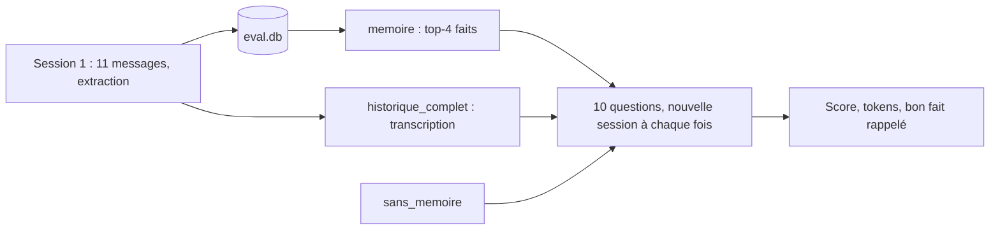

# Évaluer la mémoire : 10 scénarios, 3 configurations

> [!NOTE]
> Dans cette leçon, vous allez exécuter 10 scénarios de rappel entre sessions dans trois configurations de contexte, lire les résultats (qualité, tokens, rappel du bon fait) et repérer les limites de la notation automatique.

## Le protocole

1. **Session 1** : Camille envoie 10 messages (prénom, allergie, langage, ville, équipe, prix HT, mercredi, Jira, une question sans intérêt, puis le changement d'équipe) ; Bob se présente. L'assistant répond et apprend.
2. **Nouvelle session** pour chaque question, dans trois configurations :

| Configuration | Ce que contient le contexte | Ce qu'elle représente |
| --- | --- | --- |
| `sans_memoire` | les consignes et la question | un chatbot sans mémoire |
| `historique_complet` | toute la session 1, mot pour mot | la solution naïve « on recolle tout » |
| `memoire` | les 4 faits les plus proches, rappelés depuis SQLite | notre assistant |

3. **Notation** par expressions régulières ([scenarios.json](../files/scenarios.json)) : `expect` (doit apparaître), `forbid` (ne doit pas apparaître). Pour le mode `memoire`, on mesure aussi si le **bon fait** était parmi les 4 rappelés.



Les 10 questions couvrent des difficultés différentes :

| # | Ce qu'on teste |
| --- | --- |
| 1, 4, 7, 8 | rappel direct (prénom, ville, jour à éviter, outil de tickets) |
| 2 | rappel d'une contrainte de santé formulée autrement (« traiteur ») |
| 3 | **appliquer** une préférence, pas seulement la citer : le code doit être en Go (`func `) |
| 5 | **mise à jour** : Logistique, pas Paiements |
| 6 | préférence de format (prix HT) |
| 9 | **isolation** : Bob ne doit pas hériter du langage de Camille |
| 10 | **ne pas inventer** : aucune couleur de voiture n'a été donnée |

## Résultat obtenu

Exécution réelle du 2026-10-15 avec la clé d'API (`gemini-3.5-flash`, extraction `gemini-3.5-flash-lite`, `gemini-embedding-2`) :

```text
== sans_memoire : 4/10 réussis, tokens d'entrée moyens 95
  KO  #1  'Je ne sais pas comment vous vous appelez.'
  KO  #5  'Je ne connais pas votre équipe actuelle.'
  OK  #6  "Je ne connais pas vos habitudes d'affichage des prix. \n\nSouhaitez-vous que je vous l'indique en Hors Taxes (HT"
  OK  #8  'Vous pouvez créer le ticket sur notre outil de suivi habituel (Jira / GitHub) dans le projet correspondant au '
  OK  #9  'Je ne connais pas le langage dans lequel vous codez au travail.'
  OK  #10 'Je ne connais pas la couleur de votre voiture.'

== historique_complet : 10/10 réussis, tokens d'entrée moyens 591

== memoire : 10/10 réussis, tokens d'entrée moyens 159, bon fait rappelé 8/8
  OK  #3  '```go\nfunc Add(a, b int) int {\n    return a + b\n}\n```'
  OK  #5  "Tu fais partie de l'équipe Logistique."
  OK  #8  'Tu peux créer ton ticket de bug sur **Jira**, dans le projet **PAY**.'
  OK  #9  "Je ne connais pas le langage dans lequel tu codes au travail, cette information n'est pas dans ma mémoire."
  OK  #10 'Je ne la connais pas. Je sais seulement que tu viens au bureau à vélo !'
```

| Configuration | Score | Tokens d'entrée moyens | Lecture |
| --- | --- | --- | --- |
| sans mémoire | 4/10 (en réalité 2/10, voir plus bas) | 95 | ne sait rien, mais n'invente pas |
| historique complet | 10/10 | 591 | parfait, mais le coût grandit avec chaque message |
| mémoire long terme | 10/10 | 159 | même qualité, coût borné, bon fait rappelé 8 fois sur 8 |

(tableau : exécution avec la clé d'API ; les chiffres Vertex AI sont juste en dessous)

Même évaluation sur **Vertex AI** (europe-west1, `gemini-2.5-flash`, extraction `gemini-2.5-flash-lite`, `gemini-embedding-001`), le 2026-10-15 :

```text
== sans_memoire : 3/10 réussis, tokens d'entrée moyens 93
== historique_complet : 10/10 réussis, tokens d'entrée moyens 494
== memoire : 10/10 réussis, tokens d'entrée moyens 150, bon fait rappelé 8/8
  OK  #3  '```go\npackage main\n\nfunc add(a, b int) int {\n\treturn a + b\n}\n```'
  OK  #9  "Bob, je ne sais pas si tu codes au travail, ni dans quel langage si c'est le cas. ..."
```

Mêmes conclusions avec une autre famille de modèles et un autre modèle d'embedding : le code n'a changé que par trois variables d'environnement. Mais ce 10/10 cache un défaut : pendant la session 1, l'extracteur a **écrasé** le fait « vient au bureau en vélo » (voir la leçon « Extraire, mettre à jour, oublier »). Aucune des 10 questions ne portait sur le vélo : l'évaluation ne pouvait pas le voir. Un score parfait sur 10 scénarios ne prouve pas l'absence d'erreur, il prouve que ces 10 cas passent. Vérifiez aussi le **contenu de la base** après la session 1 (`mem.all(user)` et `mem.history(user)`), pas seulement les réponses.

## Les faux positifs de la notation

Le mode `sans_memoire` obtient 4/10, mais deux succès sont **chanceux** : #6 *propose* le HT sans le savoir (« Souhaitez-vous … HT ? »), #8 *devine* Jira parmi deux outils. Seuls #9 et #10 (ne pas inventer) sont de vrais succès. Une notation par mots-clés est rapide, gratuite et reproductible, mais elle se trompe dans les deux sens.

> [!WARNING]
> Relisez **toujours** les réponses d'une évaluation automatique, au moins celles qui changent d'un essai à l'autre. Pour aller plus loin, ajoutez un LLM-juge avec une grille (« la réponse affirme-t-elle que l'utilisateur veut le HT ? oui/non ») et vérifiez-le sur un échantillon noté à la main.

```quiz
question: "Le mode historique_complet obtient le même score que la mémoire. Pourquoi ne pas s'en contenter ?"
options:
  - "Parce que sa qualité baissera forcément"
  - "Parce que son coût et sa latence grandissent avec chaque message, et qu'il ne sépare pas l'utile du bruit"
  - "Parce qu'il ne fonctionne pas sur Vertex AI"
answer: 1
explanation: "Avec 10 messages, 591 tokens ; avec 500 messages répartis sur des mois, des dizaines de milliers de tokens à chaque question, et des informations périmées mêlées aux actuelles. La mémoire reste à environ 160 tokens."
```

## Mesurer l'impact : qualité, tokens, coût

Pour passer des tokens à des euros, multipliez par le tarif d'entrée de votre modèle (page de tarifs). Sur ce test, la mémoire économise environ 430 tokens d'entrée par question par rapport à l'historique complet, mais elle coûte un appel d'extraction (modèle léger) et des appels d'embedding à chaque message **appris**. Le bilan dépend du rapport entre messages et questions : une mémoire est d'autant plus rentable que les sessions sont longues et nombreuses.

```quiz
question: "Que mesure « bon fait rappelé 8/8 » ?"
options:
  - "Que la réponse finale était correcte 8 fois"
  - "Que pour les 8 questions qui attendaient un fait, ce fait figurait parmi les 4 rappelés depuis SQLite"
  - "Que 8 faits ont été stockés"
answer: 1
explanation: "C'est une métrique de la recherche, séparée de la génération. Si la réponse est fausse alors que le bon fait était rappelé, le problème vient du prompt ou du modèle ; si le fait n'était pas rappelé, il vient des embeddings ou de l'extraction."
```

## Exploiter et nettoyer

- **En local** : la mémoire est un fichier (`eval.db`, `memoire.db`). Supprimer le fichier = tout oublier. `eval_rappel.py` repart d'une base vide à chaque exécution.
- **Sur Google Cloud** : en production, la table `facts` irait dans Cloud SQL ou Firestore, avec un droit d'accès et d'effacement pour chaque utilisateur (RGPD : la mémoire contient des données personnelles, comme l'allergie de Camille). Le seul objet créé sur Google Cloud pendant nos tests est le cache explicite du module 3, supprimé à la fin de chaque exécution (`caches restants du lab : []`).

## Exercice : un scénario qui casse

Ajoutez à [scenarios.json](../files/scenarios.json) un scénario que la mémoire actuelle devrait rater, puis proposez la correction.

<details>
<summary>Voir la solution</summary>

Exemple : une **préférence conditionnelle**. Session 1 : « Le vendredi, réponds-moi en anglais, je prépare la réunion avec l'équipe de Londres. » Question (un vendredi) : « Résume-moi le ticket PAY-12. »

```json
{"id": 11, "user": "camille", "q": "Nous sommes vendredi. Résume en une phrase : le paiement échoue quand le panier est vide.",
 "expect": ["\\b(the|is|when)\\b"], "fait": "vendredi|anglais"}
```

Le rappel par similarité risque de ne pas remonter le fait « anglais le vendredi » : la question parle de paiement, pas de langue. Corrections possibles : rappeler aussi les faits marqués « préférence permanente » à **chaque** appel (une petite liste toujours présente, en tête du contexte), et ne réserver la similarité qu'aux faits de contenu.

</details>

## Je sais faire

- [ ] Concevoir des scénarios de rappel qui couvrent rappel, application, mise à jour, isolation et non-invention
- [ ] Comparer plusieurs stratégies de contexte sur les mêmes questions
- [ ] Séparer la qualité de la recherche (bon fait rappelé) de celle de la réponse
- [ ] Repérer les faux positifs d'une notation par mots-clés
