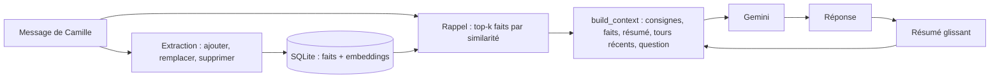

Un LLM ne se souvient de rien : à chaque appel, il ne connaît que ce que vous mettez dans sa **fenêtre de contexte**. Le *context engineering* (ingénierie du contexte), c'est l'art de choisir ce qui y entre, dans quel ordre, sous quelle forme, et ce qui en sort. C'est ce qui fait la différence entre un assistant qui oublie votre prénom à chaque session et un assistant qui se souvient que vous êtes allergique aux arachides, sans pour autant lui renvoyer 50 pages d'historique à chaque question.

Fil rouge : l'**assistant interne** de l'entreprise fictive « Atelier ». Camille, nouvelle développeuse, lui confie des informations au fil d'une première conversation ; le lendemain, dans une nouvelle session, l'assistant doit s'en souvenir, prendre en compte un changement d'équipe, ne pas mélanger Camille avec Bob, et ne rien inventer.

## Pour qui ?

- Développeurs qui ont déjà construit une application LLM (chatbot, RAG ou agent) et veulent la rendre plus fiable, moins chère et capable de mémoire.
- À l'aise avec Python, SQL de base et la notion d'embedding (sinon : la formation « Embeddings et recherche sémantique » de la section Pratiquer).

## Ce que vous allez construire

Le code est dans [files](./files/assistant.py) : [memoire.py](./files/memoire.py) (stockage, rappel, extraction), [contexte.py](./files/contexte.py) (ordre, budget, résumé glissant), [assistant.py](./files/assistant.py) (l'assistant), [eval_rappel.py](./files/eval_rappel.py) et [scenarios.json](./files/scenarios.json) (l'évaluation), [demo_contexte.py](./files/demo_contexte.py) et [catalogue.py](./files/catalogue.py) (contexte long, cache, RAG), [test_memoire.py](./files/test_memoire.py) (tests sans clé).

## Prérequis techniques

- Python 3.10 ou plus récent, `pip install -r requirements.txt` ([requirements.txt](./files/requirements.txt)).
- Une clé d'API Gemini **ou** un projet Google Cloud avec Vertex AI ; voir [.env.example](./files/.env.example).

## Programme

| Module | Contenu | Durée indicative |
| --- | --- | --- |
| 1. La fenêtre de contexte | Tokens, coût, dégradation dans les longs contextes, ordonner et budgéter | 1h |
| 2. Résumés et mémoire long terme | Résumé glissant, extraction de faits, mises à jour, stockage SQLite + embeddings, rappel par similarité | 1h45 |
| 3. Contexte long, cache et RAG | Cache implicite et explicite, document entier contre RAG, mesures réelles | 1h |
| 4. Projet final | Assistant à mémoire persistante, 10 scénarios de rappel, 3 configurations comparées (qualité, tokens, coût) | 1h15 |

## En local ou sur Google Cloud ?

| | API Gemini (clé) | Vertex AI (projet GCP) |
| --- | --- | --- |
| Modèles testés le 2026-10-15 | `gemini-3.5-flash`, `gemini-3.5-flash-lite`, `gemini-embedding-2` | `gemini-2.5-flash`, `gemini-2.5-flash-lite`, `gemini-embedding-001` (europe-west1) |
| Mémoire | fichier SQLite local | idem en test ; en production, Cloud SQL ou Firestore |
| Cache explicite | `client.caches.create(...)`, supprimé à la fin | même code ; le cache est une ressource du projet, à supprimer |
| Ce qui change dans le code | rien | trois variables d'environnement |

> [!WARNING]
> Sur Vertex AI, `gemini-embedding-2` renvoie une erreur 404 en `europe-west1` (il n'est proposé qu'en location `global`) et n'accepte qu'un contenu par requête. Notre code envoie toujours un texte par appel ; pour Vertex en Europe, nous utilisons `gemini-embedding-001`.

## Ce que vous saurez faire

- Mesurer ce que coûte un contexte et décider ce qui mérite d'y entrer.
- Construire une mémoire qui retient, met à jour et oublie, et la rappeler par similarité.
- Choisir entre contexte long, cache et RAG en fonction de vos mesures.
- Évaluer une mémoire sur des scénarios reproductibles, avec des métriques de qualité et de tokens.
