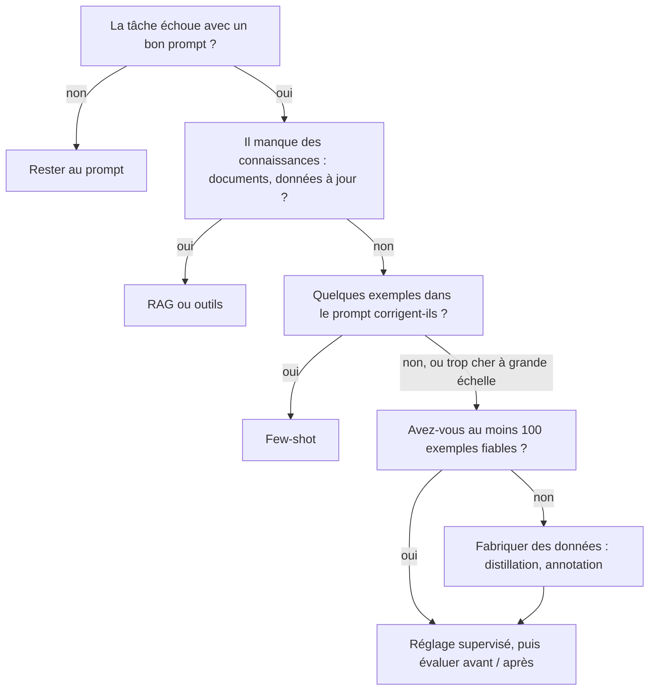

# Prompt, few-shot, RAG ou fine-tuning : l'arbre de décision

> [!NOTE]
> Dans cette leçon, vous allez distinguer les quatre façons d'adapter un modèle à une tâche, savoir ce que chacune change vraiment, et appliquer un arbre de décision au cas des tickets de support.

## Quatre leviers, quatre effets différents

Adapter un modèle, c'est le faire mieux réussir **votre** tâche. On dispose de quatre leviers, du moins cher au plus cher :

| Levier | Ce qu'on change | Ce que ça apporte | Coût de mise en place |
| --- | --- | --- | --- |
| **Prompt** (consignes) | le texte d'instructions | le comportement attendu, le format de sortie | minutes |
| **Few-shot** | on ajoute quelques exemples question / réponse dans le prompt | le style, les cas limites, le format | minutes, mais chaque appel coûte plus de tokens |
| **RAG** (génération augmentée par la recherche) | on injecte des documents trouvés par une recherche | des **connaissances** à jour ou privées | jours (index, découpage, évaluation) |
| **Fine-tuning** (réglage supervisé) | les poids du modèle, à partir d'exemples | un **comportement** stable, des prompts plus courts | jours à semaines (données, job payant, suivi) |

Le **réglage supervisé** (SFT, *supervised fine-tuning*) consiste à montrer au modèle des centaines d'exemples « entrée → sortie attendue » ; Vertex AI entraîne alors un petit ensemble de poids supplémentaires (un **adaptateur**) au-dessus du modèle de base.

> [!WARNING]
> Le fine-tuning n'apprend **pas** de faits fiables. Pour qu'un assistant connaisse vos conditions générales de vente ou le statut d'une commande, c'est un problème de **connaissances** : RAG ou appel d'outil. Le fine-tuning sert à changer la **manière** de répondre.

## L'arbre de décision



Trois raisons valables de régler un modèle, toutes citées par la documentation Vertex AI :

1. le prompt ne donne pas des résultats **constants** (format qui varie, étiquettes inventées) ;
2. la tâche est **trop difficile à décrire** en consignes (un jugement métier subtil) ;
3. vous voulez **raccourcir le contexte** : remplacer 10 exemples few-shot répétés à chaque appel par un modèle qui « sait déjà ».

La troisième raison est économique : sur des millions d'appels, des centaines de tokens d'exemples en moins par appel, ça se voit sur la facture.

```quiz
question: "Un assistant interne doit répondre à partir du règlement intérieur, mis à jour chaque trimestre. Quel levier choisir en premier ?"
options:
  - "Le fine-tuning sur le règlement intérieur"
  - "Le RAG : rechercher les passages du règlement et les injecter dans le prompt"
  - "Le few-shot avec trois questions sur le règlement"
answer: 1
explanation: "C'est un besoin de connaissances qui changent : le RAG lit la dernière version à chaque question. Un modèle réglé figerait une version du règlement, sans garantie de restituer les faits exactement."
```

## Appliqué aux tickets de support

| Question de l'arbre | Réponse pour les tickets |
| --- | --- |
| Besoin de connaissances externes ? | Non : classer un ticket ne demande pas de documents |
| Le prompt suffit-il ? | À mesurer (leçon suivante) |
| Volume ? | Élevé : chaque token par appel compte |
| Données disponibles ? | Pas encore : on va les fabriquer par **distillation** |

On ne décide donc rien avant d'avoir **une ligne de base** : la note qu'obtient le modèle sans aucune adaptation lourde.

> [!TIP]
> Les leviers se combinent. Un modèle réglé peut très bien recevoir aussi un contexte RAG. Commencez par le plus simple, mesurez, et n'ajoutez une couche que si la mesure le demande.

```quiz
question: "Quelles situations justifient d'envisager un réglage supervisé ? (plusieurs réponses)"
options:
  - "Le modèle invente régulièrement des étiquettes hors de la liste malgré des consignes claires"
  - "Le modèle doit connaître le prix du jour de vos produits"
  - "Vous envoyez 10 exemples few-shot à chaque appel, sur des millions d'appels par mois"
  - "Vous n'avez encore aucune mesure de la qualité actuelle"
answer: [0, 2]
explanation: "Un comportement instable et un contexte few-shot coûteux à grande échelle sont deux raisons classiques. Le prix du jour est une connaissance (outil ou RAG). Et sans mesure, on ne peut ni décider ni prouver un gain."
```

## Exercice : classez ces besoins

Pour chacun, choisissez le premier levier à essayer : prompt, few-shot, RAG ou fine-tuning.

1. Répondre aux questions des clients sur leur commande en cours.
2. Rédiger les réponses du support dans le ton très particulier de la marque, avec 2 000 réponses validées disponibles.
3. Extraire la date et le montant d'une facture en JSON.
4. Classer 5 millions de tickets par mois dans 40 catégories, avec un historique de 30 000 tickets déjà classés par des humains.

<details>
<summary>Voir la solution</summary>

1. **Outil (ou RAG)** : le statut d'une commande est une donnée vivante, il faut aller la chercher.
2. **Few-shot d'abord**, puis **fine-tuning** si le ton reste approximatif : 2 000 réponses validées sont un excellent jeu de réglage.
3. **Prompt** avec sortie structurée (`response_schema`) : c'est souvent suffisant ; few-shot pour les formats exotiques.
4. **Fine-tuning** très probablement : beaucoup de catégories (le prompt devient long), énorme volume (chaque token compte) et des données étiquetées déjà là. Mais on mesure quand même la ligne de base avant.

</details>

## Résultat obtenu

Mesure réelle du 2026-10-15 (détails à la leçon suivante) sur 15 tickets de test, modèle `gemini-2.5-flash-lite` sur Vertex AI :

```text
zero-shot  exactitude=0.933 hors_etiquette=0.000 tokens_entree_moyens=88
few-shot   exactitude=0.933 hors_etiquette=0.000 tokens_entree_moyens=497
```

Sur cette tâche, 10 exemples few-shot multiplient les tokens d'entrée par 5,6 **sans gagner un point**. L'arbre de décision a déjà une réponse partielle : le few-shot ne vaut pas son coût ici.

## Je sais faire

- [ ] Expliquer ce que change chacun des quatre leviers
- [ ] Distinguer un besoin de connaissances d'un besoin de comportement
- [ ] Citer trois raisons valables de régler un modèle
- [ ] Refuser un fine-tuning tant qu'il n'y a pas de ligne de base
