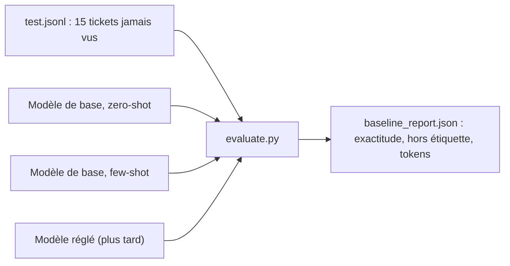

# Mesurer une ligne de base zero-shot et few-shot

> [!NOTE]
> Dans cette leçon, vous allez écrire le script d'évaluation qui servira **avant et après** le réglage, mesurer pour de vrai un petit modèle en zero-shot et en few-shot, et lire le résultat sans vous raconter d'histoires.

## Le principe : un seul script, un seul jeu de test

Une **ligne de base** (*baseline*) est la note obtenue par la solution la plus simple. Toute adaptation ultérieure doit la battre, **sur le même jeu de test, avec le même script**. Sinon on compare des pommes et des poires.



- **Zero-shot** : le modèle reçoit seulement la consigne et le ticket.
- **Few-shot** : on ajoute quelques exemples résolus avant le ticket, ici 2 par étiquette, soit 10.

## Les exemples few-shot au format du réglage

Les exemples sont passés comme des **tours de conversation** `user` / `model`, exactement la forme des lignes du jeu de réglage. Ainsi le few-shot et le fine-tuning voient la même chose.

```python title="files/evaluate.py (extrait)"
def build_contents(ticket, shots):
    """Les exemples few-shot sont des tours user/model : le même format que le jeu de réglage."""
    contents = []
    for t, l in shots:
        contents += [{"role": "user", "parts": [{"text": t}]}, {"role": "model", "parts": [{"text": l}]}]
    return contents + [{"role": "user", "parts": [{"text": ticket}]}]
```

Les exemples sont pris dans `train.jsonl` (jamais dans le test) et toujours les mêmes, pour que deux exécutions soient comparables.

## Les métriques

| Métrique | Définition | Pourquoi |
| --- | --- | --- |
| exactitude | part des tickets bien classés | la note principale |
| hors étiquette | part des réponses qui ne sont pas une étiquette connue | mesure l'**instabilité** du format |
| rappel par étiquette | pour chaque étiquette, part des tickets de cette classe retrouvés | repère la classe qui pose problème |
| tokens d'entrée moyens | `usage_metadata.prompt_token_count` | le **coût** de l'approche |

```python title="files/evaluate.py (extrait)"
def model_classifier(client, model):
    from google.genai import types

    cfg = types.GenerateContentConfig(system_instruction=SYSTEM, temperature=0, max_output_tokens=20)

    def classify(contents):
        r = generate(client, model, contents, cfg)
        return r.text, r.usage_metadata.prompt_token_count or 0

    return classify
```

`temperature=0` réduit la part d'aléatoire ; `max_output_tokens=20` évite de payer une longue réponse quand on attend un seul mot. La fonction `generate` de [common.py](../files/common.py) réessaie avec une attente croissante sur les erreurs 429 (quota) et 503 (surcharge).

```quiz
question: "Pourquoi les exemples few-shot doivent-ils venir de train.jsonl et pas de test.jsonl ?"
options:
  - "Parce que test.jsonl est trop petit"
  - "Parce qu'un exemple du test placé dans le prompt donne la réponse au modèle : la note serait gonflée artificiellement"
  - "Parce que le format est différent"
answer: 1
explanation: "C'est une fuite de données : le modèle verrait la bonne réponse d'un ticket qu'il doit ensuite classer. La note ne mesurerait plus sa capacité à généraliser."
```

## Lancer la mesure

```bash
# sur GCP, sur le modèle qu'on réglerait ensuite
GOOGLE_GENAI_USE_VERTEXAI=TRUE GOOGLE_CLOUD_PROJECT=mon-projet GOOGLE_CLOUD_LOCATION=europe-west1 \
MODEL=gemini-2.5-flash-lite python evaluate.py

# en local avec une clé d'API
MODEL=gemini-3.5-flash-lite python evaluate.py
```

Deux modes × 15 tickets = 30 appels. Mesurez la ligne de base **sur le modèle que vous comptez régler** : comparer un `gemini-2.5-flash-lite` réglé à un autre modèle non réglé ne dirait rien de l'effet du réglage.

> [!WARNING]
> Avec 15 tickets de test, une seule erreur vaut 6,7 points d'exactitude. N'interprétez pas un écart d'un ticket comme un progrès. Pour décider en production, visez plusieurs centaines d'exemples de test.

```quiz
question: "Zero-shot et few-shot obtiennent la même exactitude, mais le few-shot consomme 5,6 fois plus de tokens d'entrée. Que conclure ?"
options:
  - "Le few-shot est meilleur car il a plus d'informations"
  - "Sur cette tâche et ce jeu de test, le few-shot n'apporte rien et coûte plus cher : on garde le zero-shot, ou on cherche ailleurs le gain"
  - "Il faut forcément passer au fine-tuning"
answer: 1
explanation: "À qualité égale, la solution la moins chère gagne. Le fine-tuning ne s'impose que si l'on a un écart de qualité à combler ou un coût à réduire ; ici le zero-shot est déjà très bon."
```

## Exercice : trouver la classe faible

Ouvrez [baseline_report.json](../files/baseline_report.json). Quelle étiquette a le plus faible rappel ? Lisez les deux tickets mal classés : est-ce le modèle qui se trompe, ou l'étiquette qui est discutable ?

<details>
<summary>Voir la solution</summary>

C'est `resiliation` (rappel 0,67 dans les deux modes). Les erreurs réelles :

- « C'est beaucoup trop compliqué de partir de chez vous, le bouton pour désactiver… » → classé `acces_compte` ;
- « Bonjour, nous souhaitons rétrograder notre formule vers la version basique gratuite… » → classé `facturation`.

Les deux sont **ambigus** : le premier parle d'un bouton (accès), le second d'un changement d'offre (facturation). Avant tout réglage, la bonne action est de **préciser la consigne** : « un client qui veut partir ou passer à l'offre gratuite pour arrêter de payer relève de `resiliation` ». Améliorer la définition des étiquettes est souvent plus rentable qu'un fine-tuning.

</details>

## Résultat obtenu

Exécution réelle le 2026-10-15, `MODEL=gemini-2.5-flash-lite`, Vertex AI `europe-west1`, 15 tickets de test :

```text
zero-shot  exactitude=0.933 hors_etiquette=0.000 tokens_entree_moyens=88
few-shot   exactitude=0.933 hors_etiquette=0.000 tokens_entree_moyens=497
```

```json title="files/baseline_report.json (extrait)"
"zero-shot": {
  "exactitude": 0.933,
  "rappel_par_etiquette": {"facturation": 1.0, "acces_compte": 1.0, "bug_technique": 1.0,
                           "demande_fonctionnalite": 1.0, "resiliation": 0.67},
  "tokens_entree_moyens": 88
}
```

## Je sais faire

- [ ] Écrire un script d'évaluation réutilisable avant et après réglage
- [ ] Passer des exemples few-shot sous forme de tours `user` / `model`
- [ ] Mesurer qualité **et** coût en tokens d'une approche
- [ ] Me méfier des écarts minuscules sur un petit jeu de test
