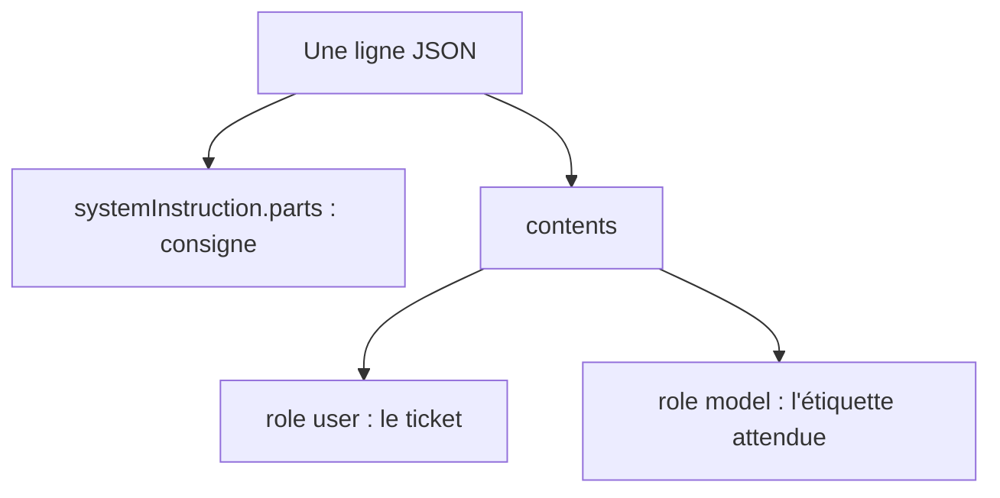

# Le format JSONL du réglage supervisé Gemini

> [!NOTE]
> Dans cette leçon, vous allez écrire des exemples au format exact attendu par Vertex AI pour régler Gemini, connaître les limites documentées, et valider un fichier **avant** de payer un job qui échouerait.

## Une ligne = un exemple

Le **JSONL** (*JSON Lines*) est un fichier texte où **chaque ligne est un objet JSON complet**. Pour le réglage supervisé de Gemini, chaque ligne contient :

| Champ | Obligatoire | Contenu |
| --- | --- | --- |
| `contents` | oui | la conversation : messages `user`, puis la réponse attendue en `model` |
| `systemInstruction` | non | la consigne système ; seules des parts `text` sont admises, son `role` est ignoré |
| `tools` | non | des déclarations de fonctions, pour apprendre à appeler des outils |

Chaque message a un `role` (`user` ou `model`) et une liste `parts` ; pour du texte, une part est `{"text": "..."}`. Le **dernier message `model`** est ce que le modèle doit apprendre à produire.



Le lab fabrique les lignes avec une seule fonction :

```python title="files/common.py (extrait)"
def to_example(ticket: str, label: str) -> dict:
    """Une ligne du JSONL de réglage supervisé Gemini sur Vertex AI."""
    return {
        "systemInstruction": {"parts": [{"text": SYSTEM}]},
        "contents": [
            {"role": "user", "parts": [{"text": ticket}]},
            {"role": "model", "parts": [{"text": label}]},
        ],
    }
```

Une vraie ligne du `train.jsonl` généré (mise en forme sur plusieurs lignes pour la lecture) :

```json
{"systemInstruction": {"parts": [{"text": "Tu classes les tickets du support client d'un logiciel de gestion en ligne. Réponds UNIQUEMENT par une étiquette parmi : facturation, acces_compte, bug_technique, demande_fonctionnalite, resiliation."}]},
 "contents": [{"role": "user", "parts": [{"text": "Bonjour, serait-il envisageable d'ajouter un export comptable direct vers le format Sage ? ..."}]},
              {"role": "model", "parts": [{"text": "demande_fonctionnalite"}]}]}
```

> [!TIP]
> Gardez **la même consigne système** à l'entraînement et en production. Le modèle réglé apprend la tâche dans ce contexte précis ; une consigne différente au moment de l'appel peut dégrader le résultat.

## Les limites documentées

Relevées le 2026-10-15 dans la documentation Vertex AI (Gemini 3.5 Flash, 3.1 Flash-Lite, et valeurs proches pour la famille 2.5) :

| Limite | Valeur |
| --- | --- |
| tokens par exemple (entrée + sortie) | 131 072 |
| taille d'un fichier JSONL d'entraînement | 1 Go |
| exemples de validation | 5 000 au plus |
| taille d'adaptateur | 1, 2, 4, 8 ou 16 (1 à 8 pour 2.5 Pro) |
| point de départ conseillé | **100 exemples**, la qualité compte plus que la quantité |

Les fichiers doivent être déposés dans un bucket **Cloud Storage** (`gs://...`) avant le lancement.

```quiz
question: "Quelle ligne est valide pour le réglage supervisé de Gemini ?"
options:
  - "{\"messages\": [{\"role\": \"user\", \"content\": \"...\"}, {\"role\": \"assistant\", \"content\": \"...\"}]}"
  - "{\"contents\": [{\"role\": \"user\", \"parts\": [{\"text\": \"...\"}]}, {\"role\": \"model\", \"parts\": [{\"text\": \"...\"}]}]}"
  - "{\"input\": \"...\", \"output\": \"...\"}"
answer: 1
explanation: "Gemini attend contents avec des rôles user / model et des parts. Le format messages / assistant / content est celui d'autres fournisseurs ; input / output était utilisé par d'anciens modèles."
```

## Valider avant de payer

Un job de réglage met du temps à démarrer ; une erreur de format découverte au bout de 20 minutes coûte cher en temps. [validate_jsonl.py](../files/validate_jsonl.py) vérifie chaque ligne localement :

```python title="files/validate_jsonl.py (extrait)"
    if contents[-1].get("role") != "model":
        errs.append("le dernier message doit être la réponse attendue (role 'model')")
    elif labels:
        answer = contents[-1].get("parts", [{}])[0].get("text", "")
        if answer not in labels:
            errs.append(f"réponse attendue hors étiquettes : {answer!r}")
```

Il contrôle aussi : JSON valide, champs inconnus, rôles autorisés, parts vides, deux messages du même rôle d'affilée, estimation de tokens, doublons, et **fuites** entre fichiers (un même ticket dans train et test). Il renvoie le code de sortie 1 en cas d'erreur : on peut l'appeler en CI.

> [!WARNING]
> Une étiquette mal orthographiée (`Facturation` au lieu de `facturation`) n'est **pas** une erreur de format pour Vertex AI : le job réussira et le modèle apprendra deux classes différentes. Seul **votre** validateur, qui connaît la liste des étiquettes, peut l'attraper.

```quiz
question: "Pourquoi vérifier qu'aucun ticket n'apparaît à la fois dans train.jsonl et test.jsonl ?"
options:
  - "Parce que Vertex AI refuse les doublons"
  - "Parce que le modèle aurait appris la réponse d'un ticket de test : l'évaluation après réglage serait trop optimiste"
  - "Pour réduire la taille du fichier"
answer: 1
explanation: "C'est une fuite : le test doit contenir des cas jamais vus à l'entraînement, sinon on mesure la mémoire du modèle plutôt que sa capacité à généraliser."
```

## Exercice : réparer un fichier

Créez un fichier `casse.jsonl` avec deux lignes valides du train, une ligne au format `messages`, une ligne dont la réponse est `Facturation` et une copie d'une ligne de test. Lancez le validateur. Combien d'erreurs ? Comment corriger chacune ?

<details>
<summary>Voir la solution</summary>

```bash
python validate_jsonl.py casse.jsonl
```

Trois erreurs : la ligne `messages` (champ inconnu **et** `contents` manquant) et l'étiquette `Facturation`. La copie du test n'est pas signalée car on n'a validé qu'un fichier : relancez avec `python validate_jsonl.py casse.jsonl test.jsonl` pour voir la fuite.

Corrections : convertir `messages` en `contents` (`assistant` devient `model`, `content` devient `parts: [{"text": ...}]`), normaliser l'étiquette en minuscules, supprimer la ligne dupliquée du test.

</details>

## Résultat obtenu

Exécution réelle le 2026-10-15 sur les fichiers générés, puis sur le fichier cassé de l'exercice :

```text
train.jsonl: {"exemples": 70, "par_etiquette": {"demande_fonctionnalite": 14, "resiliation": 14, "facturation": 14, "acces_compte": 14, "bug_technique": 14}, "tokens_estimes": 6620}
validation.jsonl: {"exemples": 15, ..., "tokens_estimes": 1478}
test.jsonl: {"exemples": 15, ..., "tokens_estimes": 1434}
OK : format valide

casse.jsonl: {"exemples": 3, "par_etiquette": {"demande_fonctionnalite": 1, "resiliation": 1, "facturation": 1}, "tokens_estimes": 329}
ERREUR casse.jsonl:3 champs inconnus : ['messages']
ERREUR casse.jsonl:3 contents manquant ou vide
ERREUR casse.jsonl:4 réponse attendue hors étiquettes : 'Facturation'
3 erreur(s)
```

## Je sais faire

- [ ] Écrire une ligne JSONL `systemInstruction` / `contents` / `parts` valide
- [ ] Citer les principales limites d'un jeu de réglage Gemini
- [ ] Valider un fichier localement, y compris les étiquettes et les fuites
- [ ] Brancher la validation en CI grâce au code de sortie
