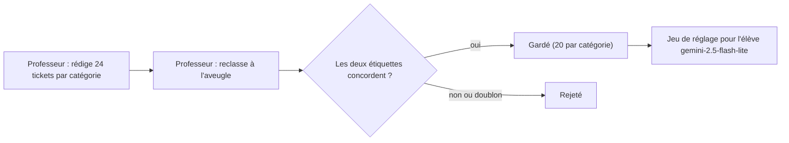

# Distillation : un grand modèle fabrique les données d'un petit

> [!NOTE]
> Dans cette leçon, vous allez générer pour de vrai 100 tickets étiquetés avec un grand modèle « professeur », filtrer ceux sur lesquels il se contredit, et comprendre les limites de données synthétiques.

## Le principe professeur / élève

La **distillation** consiste à transférer le savoir-faire d'un grand modèle (le **professeur**, cher et lent) vers un petit modèle (l'**élève**, rapide et bon marché). L'idée a été formalisée par Hinton et al. en 2015 ; avec les LLM, la version la plus simple est : le professeur **produit des exemples**, l'élève est réglé dessus.



| | Professeur | Élève |
| --- | --- | --- |
| Modèle du lab | `gemini-3.8-flash` (clé d'API) | `gemini-2.5-flash-lite` (Vertex AI, réglable) |
| Rôle | générer et étiqueter | apprendre la tâche, servir en production |
| Appels | ~10, une seule fois | des millions, chaque jour |

## Étape 1 : générer des entrées variées

On demande au professeur une **liste JSON** grâce à la sortie structurée (`response_schema`) : pas de parsing fragile.

```python title="files/distill.py (extrait)"
def generate_tickets(client, label: str, n: int) -> list[str]:
    from google.genai import types

    prompt = (
        f"Rédige {n} tickets de support client FICTIFS, en français, pour un logiciel de gestion en ligne. "
        f"Catégorie : {label} ({DESCRIPTIONS[label]}). Varie le ton (poli, pressé, agacé), la longueur "
        "(1 à 4 phrases), les fautes de frappe occasionnelles. Pas de nom réel, pas d'e-mail, pas de numéro réel. "
        "Ne cite jamais le nom de la catégorie."
    )
    cfg = types.GenerateContentConfig(response_mime_type="application/json",
                                      response_schema=list[Ticket], temperature=1.0)
    r = generate(client, TEACHER, prompt, cfg)
    return [t.texte.strip() for t in r.parsed if t.texte.strip()]
```

Trois précautions dans le prompt : **variété** (ton, longueur, fautes), **pas de fuite de l'étiquette** (« ne cite jamais le nom de la catégorie », sinon l'élève apprendrait à repérer un mot) et **pas de données personnelles**.

## Étape 2 : réétiqueter à l'aveugle

Le professeur reçoit ensuite les tickets **sans** la catégorie demandée et les classe. On ne garde un ticket que si son étiquette concorde avec la catégorie de génération : c'est un **contrôle de cohérence** gratuit qui élimine les tickets ambigus ou ratés.

```python title="files/distill.py (extrait)"
        for t, l in zip(tickets, labels):
            if n >= PER_LABEL:
                break
            if l != label or norm(t) in seen:
                rejected += 1
                continue
```

`norm()` met en minuscules et retire la ponctuation : deux tickets presque identiques sont considérés comme des doublons.

```quiz
question: "Pourquoi le professeur reclasse-t-il les tickets sans connaître la catégorie demandée ?"
options:
  - "Pour économiser des tokens"
  - "Pour détecter les tickets ambigus ou hors sujet : si le professeur lui-même ne retrouve pas la catégorie, l'exemple enseignerait de la confusion"
  - "Parce que Vertex AI l'exige"
answer: 1
explanation: "Un exemple que le professeur classe autrement qu'il ne l'a écrit est suspect. L'écarter améliore la qualité du jeu, ce qui compte plus que la quantité."
```

> [!WARNING]
> Des données synthétiques héritent des **biais du professeur** et de sa vision « propre » des tickets. Les vrais tickets sont plus courts, plus confus, parfois multi-sujets. En production, mélangez les exemples distillés avec un échantillon de **vrais** tickets anonymisés et validés par un humain, et testez toujours sur de vraies données.

> [!CAUTION]
> Vérifiez les conditions d'utilisation du fournisseur avant d'utiliser les sorties d'un modèle pour en entraîner un autre. Pour Gemini vers Gemini sur Vertex AI, c'est un usage prévu ; pour d'autres combinaisons, lisez les conditions.

## Lancer la distillation

```bash
export GOOGLE_API_KEY=...      # ou un fichier .env, voir files/.env.example
python distill.py              # environ 10 appels, quelques minutes
python validate_jsonl.py
```

Le script écrit `tickets_distilles.jsonl` (les 100 tickets avec le nom du professeur, pour la traçabilité) puis `train.jsonl`, `validation.jsonl` et `test.jsonl` (leçon suivante).

```quiz
question: "Quel risque la consigne « Ne cite jamais le nom de la catégorie » réduit-elle ?"
options:
  - "Que l'élève apprenne un raccourci : repérer le mot facturation plutôt que comprendre le ticket"
  - "Que le professeur coûte trop cher"
  - "Que le JSON soit invalide"
answer: 0
explanation: "Si chaque ticket de facturation contient le mot facturation, le modèle réglé s'appuiera sur ce mot. Sur de vrais tickets, qui ne le contiennent pas toujours, il échouera."
```

## Exercice : mesurer la diversité

Écrivez quelques lignes de Python qui lisent `tickets_distilles.jsonl` et affichent, par étiquette, la longueur moyenne des tickets en mots et le nombre de tickets contenant le mot de l'étiquette (par exemple « factur » pour `facturation`).

<details>
<summary>Voir la solution</summary>

```python
import json
from collections import defaultdict

racines = {"facturation": "factur", "acces_compte": "compte", "bug_technique": "bug",
           "demande_fonctionnalite": "fonctionnalit", "resiliation": "résili"}
mots, indices = defaultdict(list), defaultdict(int)
for l in open("tickets_distilles.jsonl", encoding="utf-8"):
    r = json.loads(l)
    mots[r["label"]].append(len(r["ticket"].split()))
    indices[r["label"]] += racines[r["label"]] in r["ticket"].lower()
for lab, m in mots.items():
    print(f"{lab:24s} mots_moyens={sum(m)/len(m):5.1f} contient_l_indice={indices[lab]}/{len(m)}")
```

Sur le jeu réellement généré le 2026-10-15 :

```text
facturation              mots_moyens= 27.6 contient_l_indice=0/20
acces_compte             mots_moyens= 28.0 contient_l_indice=4/20
bug_technique            mots_moyens= 24.9 contient_l_indice=0/20
demande_fonctionnalite   mots_moyens= 23.8 contient_l_indice=0/20
resiliation              mots_moyens= 25.2 contient_l_indice=0/20
```

La consigne a bien tenu, sauf « compte » (difficile à éviter quand on parle d'un compte bloqué). Si une classe a beaucoup de tickets contenant son mot-clé, l'élève risque d'apprendre ce raccourci : régénérez-la avec une consigne plus stricte ou ajoutez de vrais tickets. Notez aussi que les tickets font environ 25 mots : de vrais tickets sont souvent plus courts.

</details>

## Résultat obtenu

Exécution réelle le 2026-10-15, professeur `gemini-3.8-flash`, 10 appels, 3 min 12 s (attentes de quota comprises) :

```text
facturation              générés=24 gardés=20
acces_compte             générés=24 gardés=20
bug_technique            générés=24 gardés=20
demande_fonctionnalite   générés=24 gardés=20
resiliation              générés=24 gardés=20
{"total": 100, "rejetes": 4, "train": 70, "validation": 15, "test": 15}
```

Deux tickets réellement générés, extraits de [tickets_distilles.jsonl](../files/tickets_distilles.jsonl) :

```json
{"ticket": "Vous venez de me prélever deux fois ce matin pour le même abonnement !! Merci de procéder au remboursement du trop-perçu sur le champ.", "label": "facturation", "teacher": "gemini-3.8-flash"}
{"ticket": "Bonjour, je n'arrive pas à retrouver le document comptable du mois de novembre dans la section correspondante. Est-il possible de me l'envoyer au format PDF ? Bien cordialement.", "label": "facturation", "teacher": "gemini-3.8-flash"}
```

## Je sais faire

- [ ] Expliquer la distillation professeur / élève et son intérêt économique
- [ ] Générer des exemples variés avec une sortie structurée
- [ ] Filtrer les exemples incohérents par un réétiquetage à l'aveugle
- [ ] Citer les limites des données synthétiques et comment les compenser
