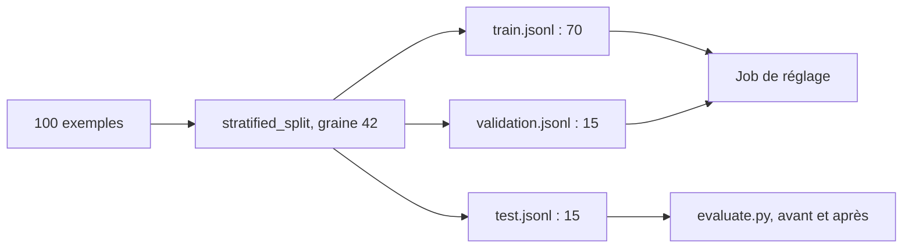

# Découper en train, validation et test

> [!NOTE]
> Dans cette leçon, vous allez découper les 100 exemples en trois jeux qui ne se recouvrent pas, en gardant la même proportion de chaque étiquette, et comprendre à quoi sert chacun pendant et après le réglage.

## Trois jeux, trois rôles

| Jeu | Taille dans le lab | Qui le voit | Sert à |
| --- | --- | --- | --- |
| **train** (entraînement) | 70 | le job de réglage, pour ajuster les poids | apprendre |
| **validation** | 15 | le job de réglage, seulement pour **mesurer** à chaque étape | détecter le surapprentissage, choisir le nombre d'époques |
| **test** | 15 | personne pendant le réglage : seulement `evaluate.py` | la note finale, avant / après |

Le **surapprentissage** (*overfitting*) se produit quand le modèle apprend les exemples par cœur au lieu de la règle : sa perte (*loss*, l'erreur mesurée) baisse sur train mais remonte sur validation. Vertex AI affiche les deux courbes pendant le job.



> [!IMPORTANT]
> Vertex AI ne demande que train et (fortement recommandé) validation. Le jeu de **test** est votre affaire : comme la validation a influencé le choix du point d'arrêt, elle n'est plus tout à fait « neutre ». Le test, lui, ne sert qu'une fois, à la fin.

## Un découpage stratifié et reproductible

**Stratifié** veut dire que chaque jeu garde la même répartition des étiquettes que l'ensemble. Sans cela, le hasard peut mettre toutes les résiliations dans le train et aucune dans le test.

```python title="files/distill.py (extrait)"
def stratified_split(rows: list[dict], ratios=(0.7, 0.15, 0.15), seed=SEED):
    """Découpe train/validation/test en gardant la même proportion de chaque étiquette."""
    rng = random.Random(seed)
    parts = ([], [], [])
    for label in LABELS:
        group = [r for r in rows if r["label"] == label]
        rng.shuffle(group)
        n_train = round(len(group) * ratios[0])
        n_val = round(len(group) * ratios[1])
        parts[0].extend(group[:n_train])
        parts[1].extend(group[n_train:n_train + n_val])
        parts[2].extend(group[n_train + n_val:])
    for p in parts:
        rng.shuffle(p)
    return parts
```

`random.Random(42)` rend le découpage **reproductible** : relancer le script donne les mêmes jeux, donc des évaluations comparables. Le test unitaire correspondant vérifie les tailles, la stratification et l'absence de recouvrement :

```python title="files/test_lab.py (extrait)"
def test_split_is_stratified_and_disjoint():
    rows = [{"ticket": f"{l} {i}", "label": l} for l in LABELS for i in range(20)]
    train, val, test = stratified_split(rows)
    assert (len(train), len(val), len(test)) == (70, 15, 15)
    for part, n in ((train, 14), (val, 3), (test, 3)):
        assert all(sum(r["label"] == l for r in part) == n for l in LABELS)
```

```quiz
question: "Pendant le job, la perte sur train continue de baisser mais celle sur validation remonte depuis la 3e époque. Que se passe-t-il ?"
options:
  - "Le modèle s'améliore encore, il faut ajouter des époques"
  - "Le modèle commence à apprendre les exemples par cœur : il faut moins d'époques ou plus de données"
  - "Le jeu de validation est mal formaté"
answer: 1
explanation: "C'est la signature du surapprentissage. On réduit le nombre d'époques (Vertex AI propose aussi des points de contrôle intermédiaires) ou on enrichit le jeu d'entraînement."
```

## Les pièges classiques

| Piège | Symptôme | Parade |
| --- | --- | --- |
| Quasi-doublons répartis entre train et test | note de test anormalement haute | dédoublonner **avant** de découper (`norm()`) |
| Découpage non stratifié | une classe absente du test | `stratified_split` |
| Données réelles découpées au hasard dans le temps | le modèle « connaît le futur » | pour des tickets réels, test = les plus récents |
| Même client dans train et test | le modèle apprend ses tournures | découper par client ou par conversation |

> [!TIP]
> Avec de vraies données de production, découpez de préférence **par date** : entraînez sur les tickets de janvier à août, testez sur septembre. C'est ce qui se passera en production : le modèle verra des tickets écrits après son entraînement.

```quiz
question: "Pourquoi fixer la graine aléatoire du découpage ?"
options:
  - "Pour que le modèle réglé soit meilleur"
  - "Pour que relancer le script produise exactement les mêmes jeux, et que les évaluations avant / après portent sur le même test"
  - "Parce que Vertex AI l'exige"
answer: 1
explanation: "Si le test change à chaque exécution, une différence de note peut venir du jeu et non du modèle. La reproductibilité est la base d'une comparaison honnête."
```

## Exercice : un découpage 80 / 20

Votre équipe ne veut pas de jeu de test séparé : « 80 % train, 20 % validation, et on évalue sur la validation ». Écrivez l'appel à `stratified_split` correspondant et expliquez en deux phrases le risque.

<details>
<summary>Voir la solution</summary>

```python
train, val, test = stratified_split(rows, ratios=(0.8, 0.2, 0.0))
# test est vide : 16 + 4 par étiquette
```

Risque : la validation a été vue par le job (pour la perte de validation et, si l'on choisit un point de contrôle, pour sélectionner le meilleur). La note mesurée dessus est donc légèrement optimiste : on a « choisi » le modèle qui réussit le mieux ce jeu précis. Un test jamais touché donne une estimation honnête de ce qui se passera en production.

</details>

## Résultat obtenu

Exécution réelle le 2026-10-15 : les trois jeux produits par `distill.py`, puis la suite de tests hors ligne (`pytest`, sans clé) :

```text
train.jsonl: {"exemples": 70, "par_etiquette": {"demande_fonctionnalite": 14, "resiliation": 14, "facturation": 14, "acces_compte": 14, "bug_technique": 14}, ...}
validation.jsonl: {"exemples": 15, "par_etiquette": {"resiliation": 3, "facturation": 3, "bug_technique": 3, "demande_fonctionnalite": 3, "acces_compte": 3}, ...}
test.jsonl: {"exemples": 15, "par_etiquette": {"facturation": 3, "acces_compte": 3, "resiliation": 3, "demande_fonctionnalite": 3, "bug_technique": 3}, ...}
OK : format valide

$ pytest -q
..............                                                           [100%]
14 passed in 0.31s
```

## Je sais faire

- [ ] Expliquer les rôles de train, validation et test
- [ ] Reconnaître le surapprentissage sur les courbes de perte
- [ ] Faire un découpage stratifié et reproductible
- [ ] Éviter les fuites : doublons, temps, même client
