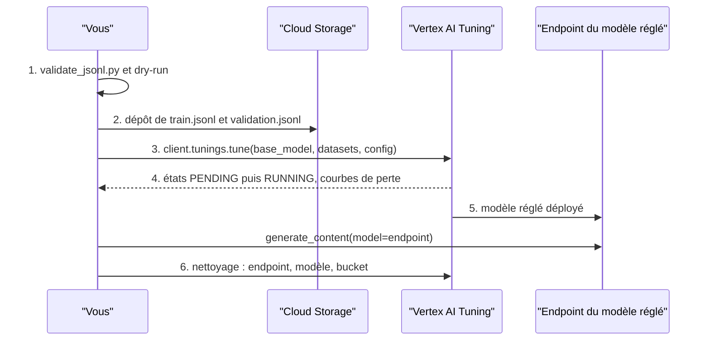

# Le réglage supervisé sur Vertex AI, de bout en bout

> [!NOTE]
> Dans cette leçon, vous allez suivre la procédure complète d'un réglage supervisé de Gemini sur Vertex AI : dépôt des données, création du job, hyperparamètres, suivi, appel du modèle réglé et nettoyage. Vous exécuterez le script en **dry-run** : il vérifie tout sans rien dépenser.

## La procédure en six étapes



Modèles réglables d'après la documentation (relevé du 2026-10-15) : Gemini 3.5 Flash, 3.1 Flash-Lite, 2.5 Pro, 2.5 Flash et 2.5 Flash-Lite. Le lab cible **`gemini-2.5-flash-lite`**, l'élève dont on a mesuré la ligne de base sur Vertex AI `europe-west1`.

> [!WARNING]
> La disponibilité du réglage varie selon la **région** et le modèle. Vérifiez dans la documentation que votre région propose le réglage du modèle choisi ; le modèle réglé est déployé dans la région du job.

## Étape 1 : le dry-run

[launch_tuning.py](../files/launch_tuning.py) commence **toujours** par construire un « plan » : il revalide les fichiers, calcule les chemins `gs://`, applique les étiquettes et estime les tokens facturés. Puis il construit les objets du SDK `google-genai` : une faute dans un nom de paramètre échoue ici, sans réseau.

```python title="files/launch_tuning.py (extrait)"
def sdk_objects(plan: dict):
    """Construit les objets du SDK google-genai : une faute de nom de paramètre échoue ICI, sans réseau."""
    from google.genai import types

    return types.TuningDataset(**plan["training_dataset"]), types.CreateTuningJobConfig(**plan["config"])
```

## Étapes 2 et 3 : déposer et lancer

Avec `--run` (et seulement avec), le script crée le bucket étiqueté `formation-lab=adapter-modele`, y dépose les fichiers, puis lance le job :

```python title="files/launch_tuning.py (extrait)"
    client = genai.Client(vertexai=True, project=plan["project"], location=plan["location"])
    training_dataset, config = sdk_objects(plan)
    job = client.tunings.tune(base_model=plan["base_model"], training_dataset=training_dataset, config=config)
    print("job :", job.name)
    while job.state in (types.JobState.JOB_STATE_PENDING, types.JobState.JOB_STATE_RUNNING):
        time.sleep(60)
        job = client.tunings.get(name=job.name)
```

## Les hyperparamètres

Un **hyperparamètre** est un réglage de l'entraînement lui-même, choisi par vous et non appris.

| Hyperparamètre | Option du script | Effet | Conseil |
| --- | --- | --- | --- |
| `epoch_count` | `--epochs` | nombre de passages sur tout le train | laisser Vertex AI choisir au premier essai |
| `adapter_size` | `--adapter-size` | nombre de poids entraînables (1 à 16) | plus grand = plus de capacité, mais plus de données nécessaires |
| `learning_rate_multiplier` | `--lr-multiplier` | multiplie le pas d'apprentissage recommandé | 1.0 par défaut ; baisser si la perte oscille |

La documentation recommande de **commencer par les valeurs par défaut**. Le script ne les envoie que si vous les précisez.

```quiz
question: "Votre premier réglage surapprend dès la 2e époque avec un adaptateur de taille 16 et 70 exemples. Quelle correction tenter d'abord ?"
options:
  - "Passer l'adaptateur à 32"
  - "Réduire la taille d'adaptateur et le nombre d'époques, ou ajouter des exemples"
  - "Supprimer le jeu de validation"
answer: 1
explanation: "Un grand adaptateur sur peu de données apprend par cœur. On réduit la capacité (taille d'adaptateur), la durée (époques), ou on augmente les données. Sans validation, on ne verrait même plus le problème."
```

## Étape 4 : estimer le coût avant de lancer

La documentation indique que les tokens d'entraînement facturés valent **tokens du jeu × nombre d'époques**. Le dry-run fait ce calcul (avec une estimation de 4 caractères par token ; `client.models.count_tokens` donne le chiffre exact). Multipliez par le tarif de réglage du modèle sur la page des prix Vertex AI. Ensuite, chaque appel au modèle réglé est facturé comme de l'inférence.

## Étapes 5 et 6 : utiliser, puis nettoyer

Le modèle réglé s'appelle comme n'importe quel modèle, avec son **endpoint** comme nom :

```bash
MODEL=projects/.../locations/.../endpoints/1234567890 python evaluate.py --modes zero-shot --out apres_reglage.json
```

Nettoyage, à faire dès que l'expérience est terminée (remplacez les identifiants) :

```bash
gcloud ai endpoints list --region=REGION --project=PROJET
gcloud ai endpoints undeploy-model ENDPOINT_ID --deployed-model-id=DEPLOYED_ID --region=REGION --project=PROJET
gcloud ai endpoints delete ENDPOINT_ID --region=REGION --project=PROJET
gcloud ai models delete MODEL_ID --region=REGION --project=PROJET
gcloud storage rm -r gs://lab-adapter-modele-PROJET --project=PROJET
```

> [!CAUTION]
> Les jeux de données déposés dans Cloud Storage contiennent vos tickets. Avec de vraies données, appliquez la même politique de rétention et de droits d'accès qu'à la base de tickets elle-même.

```quiz
question: "Que fait python launch_tuning.py sans option ?"
options:
  - "Il lance le job de réglage"
  - "Il valide les fichiers, estime les tokens, vérifie les paramètres contre le SDK et affiche le plan, sans aucun appel réseau"
  - "Il dépose les fichiers dans Cloud Storage mais ne lance pas le job"
answer: 1
explanation: "Le mode par défaut est un dry-run complet et gratuit. Seule l'option --run crée le bucket, dépose les fichiers et lance le job payant."
```

## Exercice : préparer un deuxième essai

Votre premier job (valeurs par défaut) donne une perte de validation qui remonte après 2 époques. Écrivez la commande dry-run d'un second essai avec 2 époques, un adaptateur de taille 4 et un multiplicateur de 0,5, et donnez le nombre de tokens facturés estimé.

<details>
<summary>Voir la solution</summary>

```bash
python launch_tuning.py --epochs 2 --adapter-size 4 --lr-multiplier 0.5
```

Le plan contient `"epoch_count": 2`, `"adapter_size": "ADAPTER_SIZE_FOUR"`, `"learning_rate_multiplier": 0.5`, et l'estimation `tokens_factures_estimes` = 6 620 × 2 = **13 240** tokens (avec le train du lab). Ce n'est qu'une estimation à 4 caractères par token : vérifiez avec `count_tokens` avant un vrai lancement.

</details>

## Résultat obtenu

Dry-run réel du 2026-10-15 (`GOOGLE_CLOUD_PROJECT=mon-projet python launch_tuning.py --epochs 4 --adapter-size 4`) :

```json
{
  "project": "mon-projet",
  "location": "europe-west1",
  "base_model": "gemini-2.5-flash-lite",
  "training_dataset": {"gcs_uri": "gs://lab-adapter-modele-mon-projet/train.jsonl"},
  "config": {
    "tuned_model_display_name": "lab-adapter-modele-tickets",
    "validation_dataset": {"gcs_uri": "gs://lab-adapter-modele-mon-projet/validation.jsonl"},
    "labels": {"formation-lab": "adapter-modele"},
    "epoch_count": 4,
    "adapter_size": "ADAPTER_SIZE_FOUR"
  },
  "estimation": {"exemples_train": 70, "exemples_validation": 15, "tokens_train": 6620,
                 "epochs_supposes": 4, "tokens_factures_estimes": 26480}
}
DRY-RUN : rien n'a été envoyé. Ajoutez --run pour lancer le job (payant).
```

Le job lui-même n'a **pas** été lancé (règle de coûts du lab) : aucune ressource Google Cloud n'a été créée, il n'y a donc rien à nettoyer.

## Je sais faire

- [ ] Décrire les six étapes d'un réglage supervisé sur Vertex AI
- [ ] Choisir et justifier des hyperparamètres de départ
- [ ] Estimer les tokens facturés d'un job avant de le lancer
- [ ] Appeler un modèle réglé et supprimer toutes les ressources créées
