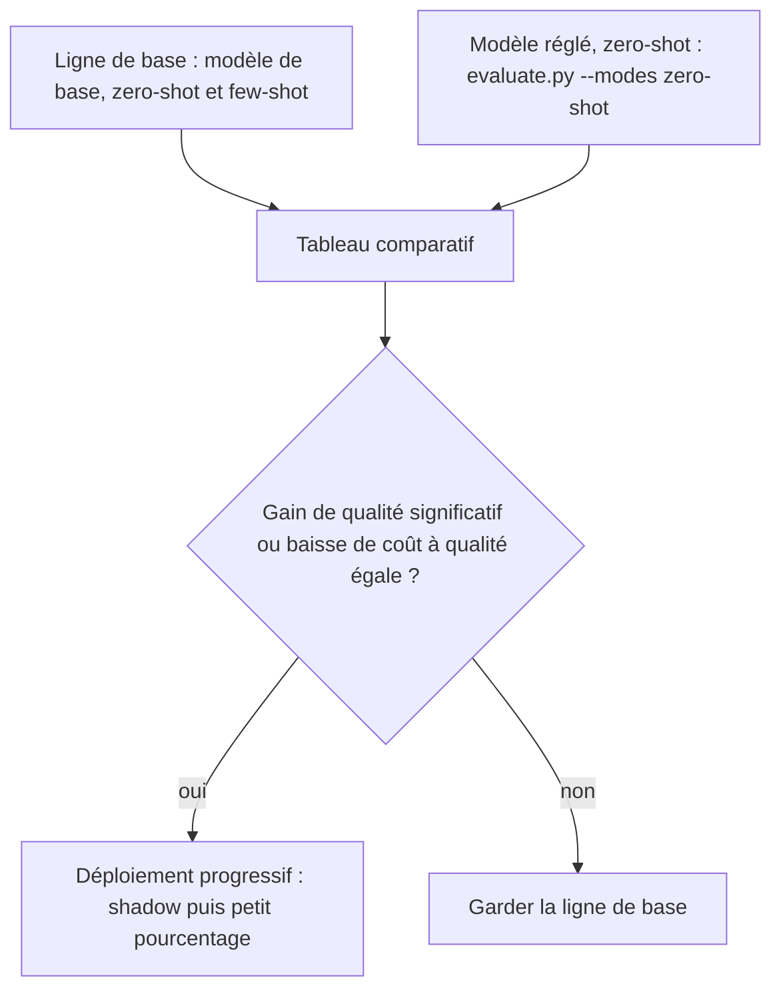

# Évaluer avant / après et décider

> [!NOTE]
> Dans cette leçon, vous allez comparer honnêtement un modèle réglé à sa ligne de base : même jeu de test, même script, qualité **et** coût, avec la bonne dose de prudence statistique. Puis vous déciderez s'il faut déployer.

## Le protocole



Règles à respecter :

1. **Même test** (`test.jsonl`, jamais vu à l'entraînement) et **même script** (`evaluate.py`).
2. Le modèle réglé est évalué **en zero-shot** : c'est tout l'intérêt, il n'a plus besoin d'exemples dans le prompt.
3. Même consigne système qu'à l'entraînement.

```bash
MODEL=gemini-2.5-flash-lite python evaluate.py                         # avant (déjà fait)
MODEL=projects/.../endpoints/ID python evaluate.py --modes zero-shot --out apres_reglage.json
```

## Lire un écart : la prudence statistique

Avec 15 tickets, 14 bonnes réponses donnent 93,3 %. Mais l'**intervalle de confiance** à 95 % (méthode de Wilson), c'est-à-dire la plage où se trouve probablement la vraie exactitude, est très large :

| Bonnes réponses | Exactitude mesurée | Intervalle à 95 % (Wilson) |
| --- | --- | --- |
| 14 / 15 | 93,3 % | 70,2 % à 98,8 % |
| 140 / 150 | 93,3 % | 88,2 % à 96,3 % |
| 1 400 / 1 500 | 93,3 % | 92,0 % à 94,5 % |

Conclusion : sur 15 exemples, un modèle réglé à 100 % (15 / 15) n'est **pas** prouvé meilleur que la ligne de base à 93,3 %. Pour une décision, il faut un test de plusieurs centaines d'exemples, idéalement de vrais tickets.

```quiz
question: "La ligne de base fait 14/15 et le modèle réglé 15/15 sur le même test. Que dire ?"
options:
  - "Le réglage a apporté +6,7 points, on déploie"
  - "L'écart d'un ticket est dans le bruit statistique : il faut un test plus grand avant de conclure"
  - "Le modèle réglé est forcément moins bon"
answer: 1
explanation: "Avec 15 exemples, l'intervalle de confiance de 14/15 va d'environ 70 % à 99 %. Un seul ticket d'écart ne permet pas de conclure."
```

## Le coût compte autant que la qualité

Le réglage peut se justifier **à qualité égale** s'il réduit le coût par appel. Comparez les tokens d'entrée mesurés :

| Approche | Tokens d'entrée moyens (mesurés) | Exemples dans le prompt |
| --- | --- | --- |
| Base + few-shot | 497 | 10 |
| Base zero-shot | 88 | 0 |
| Réglé zero-shot | ≈ 88 (même prompt) | 0 |

Ici, le zero-shot de base fait **déjà** aussi bien que le few-shot : le réglage n'a donc pas d'avantage de coût par rapport à lui. Il n'aurait d'intérêt que s'il corrigeait les erreurs restantes (les résiliations ambiguës), ce qu'il faut prouver sur un test plus grand.

> [!TIP]
> Comptez aussi les coûts cachés : le job lui-même (tokens × époques), le temps humain pour construire et maintenir le jeu, et un **nouveau réglage** à chaque changement d'étiquettes. Un prompt se modifie en 5 minutes ; un modèle réglé, non.

## Au-delà de l'exactitude globale

- **Rappel par étiquette** : un réglage peut améliorer la moyenne et dégrader une classe rare mais critique (par exemple `resiliation`, qui déclenche une action de rétention).
- **Taux hors étiquette** : un bon modèle réglé devrait tomber à 0.
- **Latence** : souvent inchangée à prompt égal ; plus faible si le réglage permet de supprimer le few-shot.
- **Déploiement progressif** : faites d'abord tourner le modèle réglé **en ombre** (*shadow*), sur le trafic réel, sans utiliser ses réponses, et comparez avec la production.

```quiz
question: "Quelles mesures doivent figurer dans le tableau avant / après ? (plusieurs réponses)"
options:
  - "L'exactitude sur le même test"
  - "Le rappel par étiquette"
  - "Les tokens d'entrée moyens par appel"
  - "La perte d'entraînement finale"
answer: [0, 1, 2]
explanation: "Qualité globale, qualité par classe et coût par appel décident d'un déploiement. La perte d'entraînement sert à diagnostiquer le job, pas à comparer avec la ligne de base."
```

## Exercice : le calcul de rentabilité

Avec un prix **fictif** de 0,10 $ par million de tokens d'entrée, combien coûtent les tokens d'entrée de 3 millions de tickets par mois en few-shot (497 tokens) et en zero-shot (88 tokens) ? Si un réglage coûtait 50 $ au total, au bout de combien de mois serait-il remboursé, **à supposer** qu'il remplace le few-shot ?

<details>
<summary>Voir la solution</summary>

- Few-shot : 3 000 000 × 497 × 0,10 / 1 000 000 = **149,10 $** par mois.
- Zero-shot : 3 000 000 × 88 × 0,10 / 1 000 000 = **26,40 $** par mois.
- Économie : 122,70 $ par mois : le réglage à 50 $ serait remboursé en **moins d'un mois**.

Mais l'hypothèse est fausse ici : le zero-shot **sans** réglage fait déjà aussi bien que le few-shot. L'économie est donc disponible gratuitement, en retirant simplement les exemples. C'est la leçon principale : mesurez avant de régler.

</details>

## Résultat obtenu

Mesure réelle du 2026-10-15 (`gemini-2.5-flash-lite`, Vertex AI `europe-west1`, 15 tickets de test). La colonne « réglé » reste vide : le job n'a pas été lancé dans le cadre du lab.

```text
mode          exactitude  hors_etiquette  tokens_entree_moyens  erreurs
zero-shot     0.933       0.000           88                    resiliation -> acces_compte
few-shot      0.933       0.000           497                   resiliation -> facturation
réglé         (non lancé)
```

## Je sais faire

- [ ] Comparer avant / après avec le même test et le même script
- [ ] Calculer et interpréter un intervalle de confiance sur une exactitude
- [ ] Intégrer le coût par appel et les coûts cachés à la décision
- [ ] Déployer un modèle réglé en ombre avant de basculer le trafic
