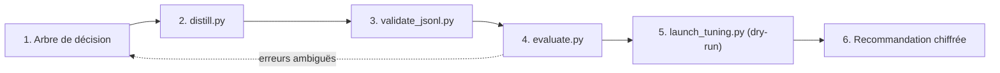

# Projet final : le pipeline d'adaptation complet

> [!NOTE]
> Dans ce projet, vous allez rejouer tout le pipeline sur une tâche de votre choix : décider avec l'arbre, distiller un jeu, le valider, mesurer la ligne de base, préparer le réglage en dry-run et rédiger une recommandation chiffrée.

## Le cahier des charges

Choisissez une tâche de **classification** de votre métier (par exemple : router des e-mails entrants vers 4 équipes, détecter le sentiment d'un avis client en 3 classes, trier des demandes d'achat par urgence). Livrables :

| Livrable | Fichier | Critère de réussite |
| --- | --- | --- |
| Étiquettes et consigne | `common.py` (`LABELS`, `SYSTEM`, `DESCRIPTIONS` dans `distill.py`) | 3 à 6 étiquettes définies sans ambiguïté |
| Jeu distillé | `tickets_distilles.jsonl` + 3 jeux | 100 exemples, `validate_jsonl.py` → `OK` |
| Ligne de base | `baseline_report.json` | zero-shot et few-shot sur le modèle réglable |
| Plan de réglage | sortie du dry-run | paramètres justifiés, tokens estimés |
| Recommandation | un paragraphe | décision argumentée : prompt, few-shot, RAG ou réglage |



## Les commandes

```bash
pip install -r requirements.txt
cp .env.example .env            # renseignez votre clé, jamais dans le code
python distill.py               # ~10 appels au professeur
python validate_jsonl.py        # doit afficher OK
GOOGLE_GENAI_USE_VERTEXAI=TRUE GOOGLE_CLOUD_PROJECT=mon-projet GOOGLE_CLOUD_LOCATION=europe-west1 \
  MODEL=gemini-2.5-flash-lite python evaluate.py      # 30 appels
python launch_tuning.py         # dry-run, gratuit
pytest -q                       # sans clé
```

> [!WARNING]
> N'ajoutez `--run` à `launch_tuning.py` que si votre recommandation conclut au réglage **et** que votre test est assez grand pour mesurer le gain. Pensez au nettoyage (leçon 3.1) le jour même.

## Adapter le code à votre tâche

Trois endroits seulement changent : `LABELS` et `SYSTEM` dans [common.py](../files/common.py), `DESCRIPTIONS` dans [distill.py](../files/distill.py). Les tests de [test_lab.py](../files/test_lab.py) utilisent `LABELS` : ils restent valides tant que vous gardez 5 étiquettes (sinon adaptez les tailles attendues dans `test_split_is_stratified_and_disjoint`).

```quiz
question: "Votre ligne de base zero-shot atteint 98 % sur 300 exemples de test réels, avec 0 % hors étiquette. Quelle recommandation ?"
options:
  - "Régler quand même, pour atteindre 100 %"
  - "Rester au prompt zero-shot, surveiller la qualité en production et réévaluer si les données changent"
  - "Passer au few-shot"
answer: 1
explanation: "Avec un test de cette taille, 98 % est une mesure fiable et le format est stable. Le réglage coûterait du temps et de l'argent pour un gain marginal ; le zero-shot est aussi le moins cher à l'appel."
```

## La grille d'évaluation

| Critère | Points |
| --- | --- |
| Étiquettes non ambiguës, consigne identique à l'entraînement et à l'appel | 3 |
| Jeu validé, stratifié, sans fuite ni donnée personnelle | 4 |
| Ligne de base mesurée sur le modèle réglable, avec tokens | 4 |
| Dry-run cohérent (paramètres, estimation) | 3 |
| Recommandation qui cite qualité, intervalle de confiance et coût | 4 |
| Tests verts sans clé | 2 |

```quiz
question: "Que doit contenir une recommandation de réglage solide ? (plusieurs réponses)"
options:
  - "L'exactitude de la ligne de base et sa marge d'incertitude"
  - "Le coût estimé du job et le coût par appel avant / après"
  - "Le nom du modèle le plus récent du marché"
  - "Les erreurs restantes et leur cause probable"
answer: [0, 1, 3]
explanation: "Une décision se fonde sur des mesures de qualité avec leur incertitude, des coûts, et une analyse des erreurs. La nouveauté d'un modèle n'est pas un argument."
```

## Exercice : rédiger la recommandation du lab

À partir des résultats réels du lab (leçons 1.2 et 3.2), rédigez en cinq phrases la recommandation pour l'équipe support.

<details>
<summary>Voir la solution</summary>

« Sur 15 tickets de test, `gemini-2.5-flash-lite` classe correctement 14 tickets en zero-shot comme en few-shot (93,3 %, intervalle à 95 % d'environ 70 % à 99 %), sans aucune réponse hors étiquette. Le few-shot multiplie les tokens d'entrée par 5,6 (497 contre 88) sans gain : nous l'abandonnons. Les deux erreurs portent sur des résiliations ambiguës (désactivation, passage à l'offre gratuite) : nous précisons la définition de `resiliation` dans la consigne. Nous ne lançons pas de réglage maintenant : le gain potentiel n'est pas mesurable sur un test aussi petit. Prochaine étape : constituer un test de 300 vrais tickets anonymisés et réévaluer ; le jeu distillé et le script de réglage sont prêts si l'écart le justifie. »

</details>

## Résultat obtenu

Pipeline complet exécuté le 2026-10-15 (extraits réels) :

```text
$ python distill.py
{"total": 100, "rejetes": 4, "train": 70, "validation": 15, "test": 15}
$ python validate_jsonl.py
OK : format valide
$ MODEL=gemini-2.5-flash-lite python evaluate.py      # Vertex AI europe-west1
zero-shot  exactitude=0.933 hors_etiquette=0.000 tokens_entree_moyens=88
few-shot   exactitude=0.933 hors_etiquette=0.000 tokens_entree_moyens=497
$ python launch_tuning.py --epochs 4 --adapter-size 4
... "tokens_factures_estimes": 26480 ...
DRY-RUN : rien n'a été envoyé. Ajoutez --run pour lancer le job (payant).
$ pytest -q
14 passed in 0.31s
```

## Je sais faire

- [ ] Rejouer le pipeline complet sur une nouvelle tâche
- [ ] Adapter étiquettes, consigne et descriptions sans casser les tests
- [ ] Rédiger une recommandation chiffrée et nuancée
- [ ] Décider de **ne pas** régler quand les mesures ne le justifient pas
