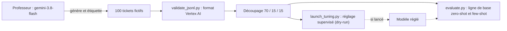

Votre équipe support reçoit des centaines de tickets par jour et veut les **classer automatiquement** (facturation, accès au compte, bug, demande de fonctionnalité, résiliation). Quelqu'un propose : « Il faut fine-tuner un modèle ! ». Peut-être. Peut-être pas. Cette formation vous apprend à **trancher avec des mesures**, puis à préparer un réglage proprement si les mesures le justifient.

Le fil rouge est un vrai lab, exécuté le 2026-10-15 : un grand modèle (`gemini-3.8-flash`) fabrique et étiquette 100 tickets fictifs, un petit modèle (`gemini-2.5-flash-lite` sur Vertex AI) est évalué en zero-shot et en few-shot, et un script de réglage supervisé est prêt, validé en dry-run.

> [!IMPORTANT]
> Le lab ne lance **aucun** job de réglage : c'est payant et ce n'est pas nécessaire pour apprendre. Le script `launch_tuning.py` est complet, ses paramètres sont vérifiés contre le SDK, et la leçon 3.1 détaille la procédure et le nettoyage.

## Pour qui ?

- Développeurs et ingénieurs data qui ont déjà appelé l'API Gemini en Python.
- Vous savez lire du JSON et lancer `pytest`.
- Pas besoin d'avoir déjà entraîné un modèle : chaque terme est expliqué.

## Ce que vous allez construire

## Prérequis techniques

- Python 3.10 ou plus récent, `pip install -r files/requirements.txt`.
- **En local (sans GCP)** : une clé d'API Gemini (Google AI Studio) dans `GOOGLE_API_KEY` suffit pour la distillation et pour l'évaluation (avec `MODEL=gemini-3.5-flash-lite`).
- **Sur GCP** : un projet avec l'API Vertex AI activée et `gcloud auth application-default login` pour évaluer le modèle qui sera réglé (`gemini-2.5-flash-lite`) et, si vous le décidez, lancer le réglage.

## Programme

| Module | Contenu | Durée indicative |
| --- | --- | --- |
| 1. Choisir la bonne approche | Arbre de décision prompt / few-shot / RAG / fine-tuning, mesurer une ligne de base | 1h15 |
| 2. Préparer les données | Format JSONL de Vertex AI, distillation, découpage train / validation / test | 1h45 |
| 3. Régler et évaluer | Procédure complète de réglage supervisé, évaluation avant / après | 1h15 |
| 4. Projet final | Le pipeline complet sur votre propre tâche de classification | 45 min |

## En local ou sur GCP

| Étape | En local (clé d'API) | Sur GCP (Vertex AI) |
| --- | --- | --- |
| Distillation (`distill.py`) | oui, `gemini-3.8-flash` | possible aussi |
| Validation du format | oui, sans réseau | identique |
| Ligne de base (`evaluate.py`) | oui, `gemini-3.5-flash-lite` | oui, **sur le modèle à régler** |
| Réglage (`launch_tuning.py --run`) | non | oui, payant |

Le code complet est dans le dossier `files/` (section Ressources) : `common.py`, `distill.py`, `validate_jsonl.py`, `evaluate.py`, `launch_tuning.py`, `test_lab.py` et les jeux de données réellement générés.
