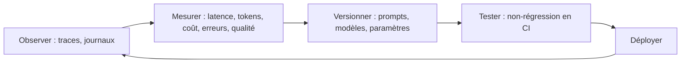

# Pourquoi le LLMOps : ce qui change avec un LLM en production

> [!NOTE]
> Dans cette leçon, vous allez comprendre en quoi une application LLM se surveille différemment d'une API classique, identifier les quatre signaux à suivre et découvrir l'architecture du lab : un wrapper unique par lequel passent tous les appels.

## Une API classique, mais en plus imprévisible

Une API classique est **déterministe** : même entrée, même sortie. Si elle répond 200 en 50 ms, tout va bien. Un appel LLM peut répondre 200 en 800 ms… avec une réponse fausse, ou dans un mauvais format. Trois différences changent la manière d'exploiter :

| | API classique | Application LLM |
| --- | --- | --- |
| Correction | un code 200 suffit souvent | 200 ne dit **rien** de la qualité de la réponse |
| Coût | fixe (CPU, mémoire) | **variable** : au token, et la taille des prompts change tout |
| Changement | un déploiement de code | changer **un mot** du prompt, ou la version du modèle, change le comportement |
| Latence | stable | dépend du nombre de tokens générés, de la charge du fournisseur |

Le **LLMOps** (opérations des applications LLM) adapte les pratiques DevOps et MLOps à ces trois points : on **observe** chaque appel, on **mesure** coûts et qualité, on **versionne** prompts et modèles comme du code, et on **teste** avant de déployer.



## Les quatre signaux

Les ingénieurs fiabilité de Google parlent de « signaux dorés » (latence, trafic, erreurs, saturation). Pour un LLM, on adapte :

1. **Latence** : p50 (la valeur médiane) et p95 (95 % des appels sont plus rapides). Le p95 capte les appels lents que la moyenne cache.
2. **Tokens et coût** : tokens d'entrée, de sortie (y compris la « réflexion » des modèles qui raisonnent), coût calculé.
3. **Erreurs** : erreurs techniques (429 quota, 503 surcharge, délai dépassé) **et** erreurs de format (JSON invalide).
4. **Qualité** : mesurée hors ligne sur un jeu de référence à chaque changement, et par échantillonnage en production.

```quiz
question: "Votre tableau de bord montre 0 % d'erreurs HTTP et une latence stable, mais les utilisateurs se plaignent de mauvais routages depuis hier. Que manque-t-il ?"
options:
  - "Une mesure de la qualité des réponses et la version de prompt associée à chaque appel"
  - "Un deuxième serveur"
  - "Un délai d'attente plus long"
answer: 0
explanation: "Pour un LLM, une réponse fausse est un succès HTTP. Il faut journaliser la version du prompt et du modèle, et mesurer la qualité sur un jeu de référence pour relier la plainte à un changement."
```

## L'architecture du lab : un seul point d'entrée

Toute l'application appelle le LLM via **une seule fonction**, `call_llm`. C'est là, et seulement là, qu'on trace, journalise et calcule le coût. Le code métier ne connaît ni OpenTelemetry ni les prix.

```python title="files/llm_wrapper.py (usage)"
from llm_wrapper import call_llm

r = call_llm("router", "v1", demande="Mon PC ne démarre plus")
print(r["text"], r["latency_ms"], r["cost_usd"], r["trace_id"])
```

Le cas d'usage : un **routeur de demandes internes**. Un salarié écrit une demande libre, le modèle renvoie `{"service": "it|rh|achats|juridique", "urgence": "haute|normale"}`. Le prompt est stocké dans un **registre versionné** ([prompts.json](../files/prompts.json)), jamais en dur dans le code.

> [!TIP]
> Même avec un framework (ADK, LangChain…), gardez ce principe : **un** endroit où passent tous les appels. ADK émet d'ailleurs ses propres traces OpenTelemetry, et le wrapper vous apprend ce qu'elles contiennent.

> [!WARNING]
> L'observabilité collecte des données. Le wrapper du lab ne journalise **ni la demande ni la réponse** : seulement des métadonnées (version, tokens, latence, coût). Si vous journalisez les textes pour déboguer, masquez les données personnelles et fixez une durée de rétention.

```quiz
question: "Pourquoi faire passer tous les appels LLM par une seule fonction call_llm ? (plusieurs réponses)"
options:
  - "Pour tracer, journaliser et calculer le coût au même endroit, sans dupliquer de code"
  - "Pour garantir que la version du prompt est enregistrée pour chaque appel"
  - "Pour rendre le modèle plus intelligent"
  - "Pour pouvoir remplacer le modèle par un faux dans les tests"
answer: [0, 1, 3]
explanation: "Un point d'entrée unique centralise l'instrumentation, garantit la traçabilité des versions et permet d'injecter un faux modèle (paramètre generate) dans les tests. Il ne change rien à la qualité du modèle."
```

## Exercice : quels signaux pour quel incident ?

Pour chaque incident, quel signal l'aurait détecté en premier ?

1. Le fournisseur renvoie des 429 pendant 10 minutes.
2. Un développeur ajoute 3 pages de documentation dans le prompt système.
3. Le passage à une nouvelle version du modèle change le format des réponses.
4. 2 % des appels prennent 15 secondes.

<details>
<summary>Voir la solution</summary>

1. **Taux d'erreur** (et le nombre de tentatives `attempts` dans les journaux, qui monte avant l'échec).
2. **Tokens d'entrée et coût** : les tokens par appel explosent du jour au lendemain.
3. **Qualité** (test de non-régression) et **erreurs de format** : JSON invalide ou valeurs hors liste.
4. **Latence p95 ou p99** : la médiane ne bouge presque pas, le p95 ou p99 si.

</details>

## Résultat obtenu

Rapport réel du 2026-10-15, produit par `report.py` à partir des 24 appels du lab (12 par version de prompt) :

```text
| version                            | appels | taux_erreur | p50_ms | p95_ms | tokens_in_moy | tokens_out_moy | cout_1000_appels_usd |
| router@v1 (gemini-3.5-flash-lite)  | 12     | 0.0         | 797    | 1050   | 102           | 19             | 0.0781               |
| router@v2 (gemini-3.5-flash-lite)  | 12     | 0.0         | 763    | 1438   | 37            | 23             | 0.0695               |
```

Les deux versions ont 0 % d'erreur technique ; v2 est 11 % moins chère. Pourtant v2 classe **0 demande sur 12** correctement (module 3). Sans le quatrième signal, la qualité, on l'aurait déployée.

## Je sais faire

- [ ] Expliquer pourquoi un code 200 ne suffit pas pour un LLM
- [ ] Citer les quatre signaux à suivre et leur intérêt
- [ ] Justifier un point d'entrée unique pour les appels LLM
- [ ] Limiter les données personnelles dans l'observabilité
