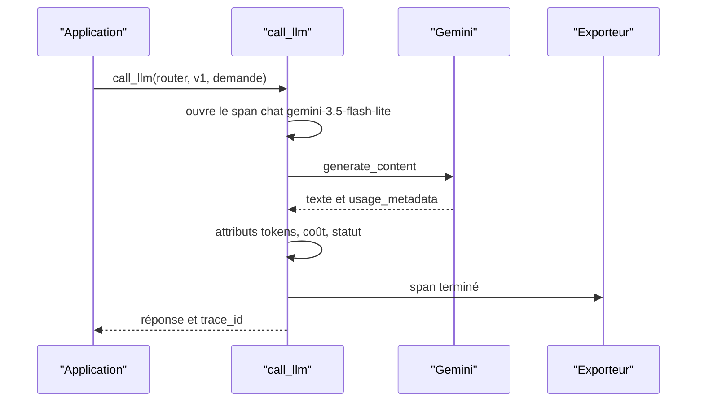

# Tracer chaque appel avec OpenTelemetry

> [!NOTE]
> Dans cette leçon, vous allez créer une trace OpenTelemetry pour chaque appel LLM, avec les attributs standard `gen_ai.*`, l'exporter dans un fichier en local, et savoir l'envoyer vers Cloud Trace sur Google Cloud.

## Trace, span, attributs

**OpenTelemetry** (OTel) est un standard ouvert pour produire des traces, métriques et journaux, indépendamment de l'outil qui les affiche.

- Une **trace** raconte une requête de bout en bout (par exemple : réception HTTP → recherche → appel LLM → réponse).
- Un **span** est une étape de cette trace, avec un début, une fin et des **attributs** (des paires clé / valeur).
- Un **exporteur** envoie les spans terminés quelque part : console, fichier, Cloud Trace, Jaeger…



## Les conventions sémantiques gen_ai

Pour que n'importe quel outil comprenne vos spans, OTel définit des **conventions sémantiques** : des noms d'attributs standard. Pour l'IA générative :

| Attribut | Exemple | Sens |
| --- | --- | --- |
| `gen_ai.operation.name` | `chat` | type d'opération |
| `gen_ai.provider.name` | `gcp.gemini` ou `gcp.vertex_ai` | fournisseur |
| `gen_ai.request.model` | `gemini-3.5-flash-lite` | modèle demandé |
| `gen_ai.request.temperature` | `0` | paramètre de génération |
| `gen_ai.usage.input_tokens` | `100` | tokens d'entrée |
| `gen_ai.usage.output_tokens` | `20` | tokens de sortie |
| `error.type` | `RuntimeError` | type d'erreur, si échec |

On ajoute nos attributs métier sous un préfixe à nous (`app.*`) : identifiant et version du prompt, empreinte, coût, nombre de tentatives.

```python title="files/llm_wrapper.py (extrait)"
    with _tracer.start_as_current_span(f"chat {pv.model}", kind=SpanKind.CLIENT) as span:
        span.set_attributes({"gen_ai.operation.name": "chat", "gen_ai.provider.name": provider,
                             "gen_ai.request.model": pv.model,
                             "gen_ai.request.temperature": pv.config.get("temperature", -1),
                             "app.prompt.id": pv.prompt_id, "app.prompt.version": pv.version,
                             "app.prompt.sha256": pv.sha256})
```

Le span est de type `CLIENT` : notre code est le client d'un service distant. Après l'appel, on ajoute les tokens et le coût ; en cas d'erreur, `span.set_status(Status(StatusCode.ERROR, ...))` colore la trace en rouge dans les outils.

```quiz
question: "Pourquoi utiliser gen_ai.usage.input_tokens plutôt qu'un nom maison comme tokens_entree ?"
options:
  - "Parce que c'est plus court"
  - "Parce que les outils d'observabilité qui suivent la convention savent l'afficher et l'agréger sans configuration"
  - "Parce que Gemini refuse les autres noms"
answer: 1
explanation: "Les conventions sémantiques rendent les traces portables : un tableau de bord ou un outil d'analyse LLM reconnaît ces attributs quel que soit le langage ou la bibliothèque qui les a produits."
```

## En local : un fichier, une ligne par span

```python title="files/llm_wrapper.py (extrait)"
    elif exporter == "console":
        out = open("traces.jsonl", "a", encoding="utf-8")
        provider.add_span_processor(SimpleSpanProcessor(
            ConsoleSpanExporter(out=out, formatter=lambda s: s.to_json(indent=None) + "\n")))
```

`SimpleSpanProcessor` exporte chaque span dès qu'il se termine : pratique en local. En production, `BatchSpanProcessor` les regroupe en arrière-plan pour ne pas ralentir les requêtes.

## Sur Google Cloud : Cloud Trace

Avec `OTEL_EXPORTER=gcp`, le wrapper utilise l'exporteur Cloud Trace :

```bash
pip install opentelemetry-exporter-gcp-trace
gcloud services enable cloudtrace.googleapis.com --project=MON_PROJET
OTEL_EXPORTER=gcp GOOGLE_CLOUD_PROJECT=MON_PROJET python regression.py --version v1
```

Le compte de service de l'application doit avoir le rôle **Agent Cloud Trace** (`roles/cloudtrace.agent`). Sur Cloud Run, l'identité du service suffit, sans clé. Les traces apparaissent dans la console, page **Trace Explorer**, filtrables par attribut (par exemple `app.prompt.version:v2`).

> [!TIP]
> Si votre application reçoit des requêtes HTTP (FastAPI…), instrumentez aussi le framework web : le span `chat` deviendra un **enfant** du span de la requête, et vous verrez dans une même trace le temps passé dans le LLM et ailleurs.

> [!WARNING]
> N'ajoutez pas le texte de la demande ou de la réponse en attribut de span « pour voir ». Les traces sont souvent accessibles plus largement que les données métier, et conservées longtemps.

```quiz
question: "En production, quel processeur de spans préférer et pourquoi ?"
options:
  - "SimpleSpanProcessor, pour voir les spans immédiatement"
  - "BatchSpanProcessor, qui exporte par lots en arrière-plan sans bloquer chaque requête"
  - "Aucun, les spans s'exportent tout seuls"
answer: 1
explanation: "SimpleSpanProcessor exporte de façon synchrone à la fin de chaque span : acceptable en local, coûteux en latence sous charge. BatchSpanProcessor met en file et exporte en arrière-plan."
```

## Exercice : tester la trace sans réseau

Écrivez un test pytest qui appelle `call_llm` avec un faux modèle et vérifie, grâce à `InMemorySpanExporter`, que le span contient `gen_ai.usage.input_tokens == 100` et `app.prompt.version == "v1"`.

<details>
<summary>Voir la solution</summary>

```python title="files/test_llmops.py (extrait)"
from opentelemetry.sdk.trace.export.in_memory_span_exporter import InMemorySpanExporter
import llm_wrapper

EXPORTER = InMemorySpanExporter()
llm_wrapper.setup_tracing(span_exporter=EXPORTER)

def test_call_is_traced(tmp_path, monkeypatch):
    monkeypatch.setattr(llm_wrapper, "LOG_PATH", str(tmp_path / "calls.jsonl"))
    fake = lambda model, system, prompt, config: ('{"service":"it","urgence":"haute"}', 100, 20)
    llm_wrapper.call_llm("router", "v1", generate=fake, demande="x")
    span = EXPORTER.get_finished_spans()[0]
    assert span.attributes["gen_ai.usage.input_tokens"] == 100
    assert span.attributes["app.prompt.version"] == "v1"
```

Le paramètre `generate` du wrapper permet d'injecter un faux modèle : le test tourne en CI sans clé.

</details>

## Résultat obtenu

Un span réel de `traces.jsonl`, produit le 2026-10-15 pendant le lab (extrait, ligne reformatée) :

```json
{"name": "chat gemini-3.5-flash-lite",
 "context": {"trace_id": "0x3120a671504368d55f8a8668c5cde572", "span_id": "0x7d857361a829b656"},
 "start_time": "2026-10-15T14:40:09.556792Z", "end_time": "2026-10-15T14:40:10.530532Z",
 "status": {"status_code": "UNSET"},
 "attributes": {"gen_ai.operation.name": "chat", "gen_ai.provider.name": "gcp.gemini",
                "gen_ai.request.model": "gemini-3.5-flash-lite", "gen_ai.request.temperature": 0,
                "app.prompt.id": "router", "app.prompt.version": "v1", "app.prompt.sha256": "7dc8e870b139",
                "gen_ai.usage.input_tokens": 100, "gen_ai.usage.output_tokens": 20,
                "app.cost_usd": 8e-05, "app.attempts": 1},
 "resource": {"attributes": {"service.name": "assistant-interne", ...}}}
```

## Je sais faire

- [ ] Expliquer trace, span, attribut et exporteur
- [ ] Utiliser les attributs standard `gen_ai.*` et un préfixe maison pour le métier
- [ ] Exporter en local dans un fichier et vers Cloud Trace sur GCP
- [ ] Tester l'instrumentation sans réseau avec `InMemorySpanExporter`
