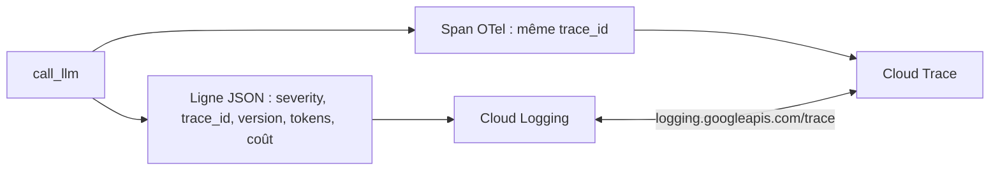

# Des journaux structurés, reliés aux traces

> [!NOTE]
> Dans cette leçon, vous allez écrire une ligne de journal JSON par appel LLM, avec les champs que Cloud Logging comprend, la relier à sa trace, et voir comment ce journal a détecté un vrai incident pendant le lab.

## Pourquoi du JSON plutôt que du texte

Un **journal structuré** est une ligne JSON avec des champs nommés, au lieu d'une phrase libre. La différence se voit au moment de chercher :

| Journal texte | Journal structuré |
| --- | --- |
| `Appel router v2 ok en 763ms, 37 tokens` | `{"prompt_version": "v2", "ok": true, "latency_ms": 763, "tokens_in": 37}` |
| il faut une expression régulière pour extraire la latence | filtre direct : `jsonPayload.latency_ms > 1000` |
| fragile au moindre changement de phrase | stable : les champs sont un contrat |

Sur Cloud Run ou GKE, **tout ce que l'application écrit sur la sortie standard** est capté par Cloud Logging ; une ligne JSON devient un `jsonPayload` interrogeable. Quelques champs ont un sens spécial :

| Champ | Effet dans Cloud Logging |
| --- | --- |
| `severity` | niveau du journal (`INFO`, `ERROR`…), filtres et couleurs |
| `message` | texte affiché dans la liste |
| `logging.googleapis.com/trace` | relie la ligne à sa trace Cloud Trace (`projects/PROJET/traces/TRACE_ID`) |



## La ligne écrite par le wrapper

```python title="files/llm_wrapper.py (extrait)"
        ctx = span.get_span_context()
        record = {"severity": "ERROR" if error else "INFO", "message": "llm_call",
                  "call_id": uuid.uuid4().hex[:12], "trace_id": format(ctx.trace_id, "032x"),
                  "span_id": format(ctx.span_id, "016x"), "prompt_id": pv.prompt_id, "prompt_version": pv.version,
                  "prompt_sha256": pv.sha256, "model": pv.model, "latency_ms": latency_ms,
                  "tokens_in": tin, "tokens_out": tout, "cost_usd": cost, "attempts": attempts,
                  "ok": error is None, "error": f"{type(error).__name__}: {str(error)[:120]}" if error else None}
        project = os.environ.get("GOOGLE_CLOUD_PROJECT")
        if project:   # relie la ligne de journal à sa trace dans la console Google Cloud
            record["logging.googleapis.com/trace"] = f"projects/{project}/traces/{record['trace_id']}"
```

Le `trace_id` est le même que celui du span : depuis une ligne d'erreur, on ouvre la trace complète, et inversement. Le lab écrit dans `calls.jsonl` (variable `LLM_LOG`) ; en production, écrivez sur la sortie standard.

> [!IMPORTANT]
> Le message d'erreur est tronqué à 120 caractères et **ni la demande ni la réponse** ne sont journalisées. Les messages d'exception de certaines bibliothèques peuvent contenir le prompt : tronquer est une protection simple.

```quiz
question: "Quel champ permet à Cloud Logging d'afficher le lien vers la trace correspondante ?"
options:
  - "trace_id"
  - "logging.googleapis.com/trace, au format projects/PROJET/traces/TRACE_ID"
  - "span_id"
answer: 1
explanation: "Cloud Logging reconnaît ce champ spécial dans un journal structuré et en fait le lien vers Cloud Trace. Le champ trace_id seul est une donnée comme une autre."
```

## Un vrai incident, détecté par le journal

Lors de la première exécution du lab, **les 24 appels ont échoué**. Aucune exception visible : le script affichait juste une exactitude de 0. Le journal a donné la cause en une ligne :

```json
{"severity": "ERROR", "message": "llm_call", "prompt_version": "v1", "latency_ms": 357, "ok": false,
 "attempts": 1, "error": "RuntimeError: Cannot send a request, as the client has been closed."}
```

Cause : le code créait un `genai.Client()` temporaire à chaque appel, détruit avant la fin de la requête. Correction : un seul client par processus, mis en cache.

```python title="files/llm_wrapper.py (extrait)"
@functools.cache
def _client():
    from google import genai

    return genai.Client()   # un seul client par processus (il garde ses connexions ouvertes)
```

> [!TIP]
> L'incident a aussi montré une règle utile : `regression.py --save-baseline` **refuse** désormais d'enregistrer une référence si une seule réponse n'est pas un JSON valide. Une référence mesurée pendant une panne serait pire que pas de référence.

```quiz
question: "Pourquoi l'erreur RuntimeError n'est-elle pas retentée par le wrapper ?"
options:
  - "Parce que le wrapper ne réessaie jamais"
  - "Parce que seuls les codes 429, 500 et 503 sont considérés comme temporaires ; une erreur de programmation ne se résout pas en réessayant"
  - "Parce que la latence était trop faible"
answer: 1
explanation: "Réessayer une erreur permanente gaspille du temps et masque le problème. Le wrapper ne réessaie que les erreurs transitoires (quota, surcharge, erreur serveur) et journalise les autres immédiatement."
```

## Exercice : interroger le journal

Avec quelques lignes de Python (ou `jq`), affichez à partir de `calls.jsonl` : le nombre d'appels par version, le nombre d'erreurs, et les 3 appels les plus lents avec leur `trace_id`.

<details>
<summary>Voir la solution</summary>

```python
import json
from collections import Counter

rs = [json.loads(l) for l in open("calls.jsonl", encoding="utf-8")]
print(Counter(r["prompt_version"] for r in rs))
print("erreurs :", sum(not r["ok"] for r in rs))
for r in sorted(rs, key=lambda r: -r["latency_ms"])[:3]:
    print(r["latency_ms"], r["prompt_version"], r["trace_id"])
```

Ou avec `jq` : `jq -s 'sort_by(-.latency_ms)[:3][] | [.latency_ms, .trace_id]' calls.jsonl`. Dans Cloud Logging, le filtre équivalent est `jsonPayload.message="llm_call" AND jsonPayload.latency_ms>1000`.

</details>

## Résultat obtenu

Exécution réelle de la solution le 2026-10-15 sur le `calls.jsonl` du lab (24 appels, après correction) :

```text
Counter({'v1': 12, 'v2': 12})
erreurs : 0
1438 v2 659928ce8a93a4689307b335a6f8ec13
1152 v2 4327caf3b143c6debf75e991a2cf6f09
1050 v1 7c36a6627963b97f8296720ae2f43bd7
```

Et la suite de tests hors ligne : `pytest -q` → `6 passed, 1 skipped` (le test ignoré est le test réel, qui ne tourne qu'avec une clé).

## Je sais faire

- [ ] Écrire un journal JSON avec `severity`, `message` et des champs métier
- [ ] Relier une ligne de journal à sa trace
- [ ] Diagnostiquer un incident à partir des journaux
- [ ] Choisir quelles erreurs réessayer et lesquelles signaler tout de suite
