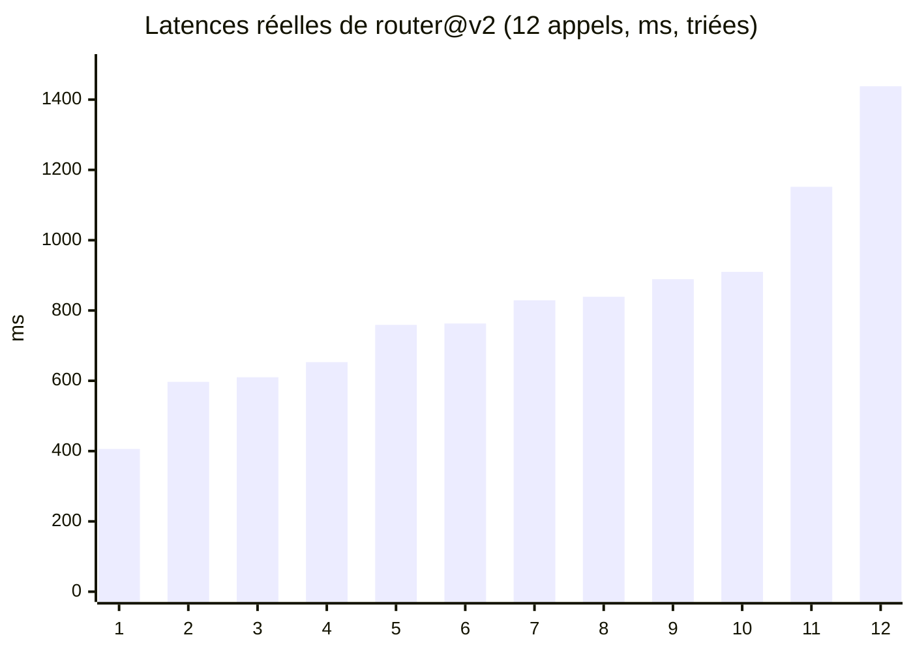

# Latence p50 / p95, tokens, coût et taux d'erreur

> [!NOTE]
> Dans cette leçon, vous allez calculer les métriques clés d'une application LLM à partir du journal : percentiles de latence, tokens moyens, coût par appel et pour 1 000 appels, taux d'erreur, et les lire avec prudence sur un petit échantillon.

## Pourquoi des percentiles et pas la moyenne

La **moyenne** est tirée par quelques appels très lents. Les **percentiles** décrivent ce que vivent les utilisateurs :

- **p50** (médiane) : la moitié des appels sont plus rapides. C'est l'expérience « typique ».
- **p95** : 95 % des appels sont plus rapides. C'est l'expérience des **5 % les moins bien servis**, souvent ceux qui se plaignent.



Le lab utilise le percentile « au rang le plus proche », simple et sans interpolation :

```python title="files/report.py (extrait)"
def percentile(values: list[float], p: float) -> float:
    """Percentile « au rang le plus proche » : la valeur sous laquelle tombent p % des mesures."""
    s = sorted(values)
    return s[max(0, math.ceil(p / 100 * len(s)) - 1)]
```

> [!WARNING]
> Avec 12 appels, le p95 est le rang `ceil(0,95 × 12) = 12`, c'est-à-dire **l'appel le plus lent**. Un seul appel lent fait le p95. Les percentiles élevés n'ont de sens qu'à partir de quelques centaines de mesures ; en production, calculez-les par fenêtre (5 minutes, 1 heure).

```quiz
question: "La latence moyenne est stable mais le p95 double. Que se passe-t-il le plus probablement ?"
options:
  - "Tous les appels sont devenus plus lents"
  - "Une minorité d'appels est devenue beaucoup plus lente : réponses plus longues, nouvelles tentatives, surcharge ponctuelle"
  - "Le p95 est mal calculé"
answer: 1
explanation: "Le p95 réagit à la queue de distribution que la moyenne dilue. Regardez les appels lents dans les journaux : tokens de sortie, nombre de tentatives, version du prompt."
```

## Le coût : tokens × prix

Le coût d'un appel se calcule à partir des tokens renvoyés par l'API dans `usage_metadata` :

$$\text{coût} = \frac{\text{tokens\_entrée} \times \text{prix\_entrée} + \text{tokens\_sortie} \times \text{prix\_sortie}}{10^6}$$

Les prix sont exprimés par million de tokens. Attention : pour les modèles qui « réfléchissent », les **tokens de réflexion** (`thoughts_token_count`) sont facturés comme de la sortie. Le wrapper les ajoute :

```python title="files/llm_wrapper.py (extrait)"
    u = r.usage_metadata
    return r.text, u.prompt_token_count or 0, (u.candidates_token_count or 0) + (u.thoughts_token_count or 0)
```

La table `PRICES` du wrapper contient les prix relevés le 2026-10-15 sur la page tarifaire de l'API Gemini (palier payant, texte), surchargeables par la variable `PRICES_JSON`. Ils changent : la page officielle fait foi.

| Métrique | Calcul dans `report.py` | Pour décider quoi |
| --- | --- | --- |
| `taux_erreur` | appels `ok=false` / appels | fiabilité, alertes |
| `p50_ms`, `p95_ms` | percentiles des appels réussis | expérience utilisateur, délais d'attente |
| `tokens_in_moy`, `tokens_out_moy` | moyennes | taille des prompts, verbosité |
| `cout_1000_appels_usd` | coût total / appels × 1 000 | budget, comparaison de versions |

> [!TIP]
> Comparez toujours les coûts **par appel** (ou pour 1 000 appels), jamais en total : deux versions testées sur des volumes différents ne sont pas comparables autrement.

```quiz
question: "Une nouvelle version du prompt réduit les tokens d'entrée de 102 à 37 en moyenne, mais les tokens de sortie passent de 19 à 23. Le coût par appel baisse-t-il forcément d'autant ?"
options:
  - "Oui, de 64 %"
  - "Non : la sortie coûte ici plus de 8 fois plus cher par token que l'entrée, sa hausse compense une partie de la baisse"
  - "Non, le coût ne dépend que de la sortie"
answer: 1
explanation: "Avec 0,30 $ en entrée et 2,50 $ en sortie par million, la sortie pèse lourd. Dans le lab, la baisse réelle n'est que de 11 % (0,0781 $ contre 0,0695 $ pour 1 000 appels)."
```

## Exercice : budget mensuel

Le routeur reçoit 50 000 demandes par jour. Avec le coût mesuré de `router@v1` (0,0781 $ pour 1 000 appels), quel est le budget mensuel (30 jours) ? Et si un développeur ajoute au prompt système un règlement de 2 000 tokens ?

<details>
<summary>Voir la solution</summary>

- Appels par mois : 50 000 × 30 = 1 500 000.
- Coût v1 : 1 500 000 / 1 000 × 0,0781 ≈ **117 $** par mois.
- Avec 2 000 tokens d'entrée de plus par appel : 1 500 000 × 2 000 × 0,30 / 10⁶ = **900 $** de plus par mois, soit environ 8 fois le budget initial.

Leçon : la taille du prompt système est le premier poste de coût à surveiller. Une alerte sur `tokens_in_moy` (leçon suivante) aurait détecté ce changement dès le premier jour. Pour un long contexte stable, regardez aussi la mise en cache du contexte proposée par l'API.

</details>

## Résultat obtenu

`python report.py > rapport.md`, exécution réelle du 2026-10-15 sur les 24 appels du lab :

```text
| version | appels | taux_erreur | p50_ms | p95_ms | tokens_in_moy | tokens_out_moy | cout_total_usd | cout_1000_appels_usd |
|---|---|---|---|---|---|---|---|---|
| router@v1 (gemini-3.5-flash-lite) | 12 | 0.0 | 797 | 1050 | 102 | 19 | 0.000937 | 0.0781 |
| router@v2 (gemini-3.5-flash-lite) | 12 | 0.0 | 763 | 1438 | 37 | 23 | 0.000834 | 0.0695 |
```

Le rapport complet est dans [rapport.md](../files/rapport.md), le journal source dans [calls.jsonl](../files/calls.jsonl).

## Je sais faire

- [ ] Expliquer p50 et p95 et leurs limites sur un petit échantillon
- [ ] Calculer le coût d'un appel à partir de `usage_metadata`, réflexion comprise
- [ ] Comparer des versions au coût pour 1 000 appels
- [ ] Estimer un budget mensuel et l'impact d'un prompt plus long
