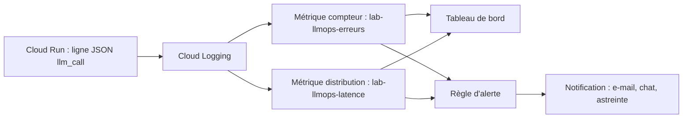

# Alertes et tableaux de bord avec Cloud Monitoring

> [!NOTE]
> Dans cette leçon, vous allez transformer les journaux JSON en métriques Cloud Monitoring, construire un tableau de bord latence / erreurs par version de prompt, et définir des alertes qui réveillent quelqu'un pour de bonnes raisons.

## Du journal à la métrique

Sur Google Cloud, le chemin le plus court ne demande **aucun code en plus** : les **métriques basées sur les journaux** (*log-based metrics*) comptent ou mesurent des champs des journaux déjà écrits par le wrapper.



| Type de métrique | Ce qu'elle mesure | Exemple |
| --- | --- | --- |
| **compteur** | nombre de lignes qui correspondent à un filtre | appels en erreur |
| **distribution** | la répartition d'un champ numérique, d'où les percentiles | `latency_ms`, `tokens_in`, `cost_usd` |

Un compteur se crée en une ligne :

```bash
gcloud logging metrics create lab-llmops-erreurs --project=MON_PROJET \
  --description="Appels LLM en erreur" \
  --log-filter='jsonPayload.message="llm_call" AND jsonPayload.ok=false'
```

Une distribution demande un fichier de configuration, avec un **libellé** extrait du journal pour séparer les versions de prompt :

```yaml title="files/logmetric-latence.yaml"
description: "Latence des appels LLM (ms), par version de prompt"
filter: 'jsonPayload.message="llm_call"'
valueExtractor: EXTRACT(jsonPayload.latency_ms)
labelExtractors:
  prompt_version: EXTRACT(jsonPayload.prompt_version)
metricDescriptor:
  metricKind: DELTA
  valueType: DISTRIBUTION
  unit: ms
  labels:
    - key: prompt_version
      valueType: STRING
bucketOptions:
  exponentialBuckets:
    numFiniteBuckets: 40
    growthFactor: 1.3
    scale: 50
```

```bash
gcloud logging metrics create lab-llmops-latence --config-from-file=logmetric-latence.yaml --project=MON_PROJET
```

> [!WARNING]
> Un libellé à **forte cardinalité** (beaucoup de valeurs distinctes, comme `call_id` ou `trace_id`) multiplie les séries temporelles et les coûts. Libellez par version de prompt ou par modèle, jamais par appel.

```quiz
question: "Quelle métrique choisir pour suivre le p95 du coût par appel ?"
options:
  - "Un compteur sur jsonPayload.cost_usd"
  - "Une distribution qui extrait jsonPayload.cost_usd"
  - "Un compteur des appels réussis"
answer: 1
explanation: "Un compteur compte des lignes ; seule une distribution conserve la répartition des valeurs, ce qui permet de calculer des percentiles."
```

## Le tableau de bord

Un tableau de bord Cloud Monitoring se décrit en JSON ([dashboard.json](../files/dashboard.json)) et se crée avec `gcloud monitoring dashboards create --config-from-file=dashboard.json`. Le premier graphique affiche le p95 de latence par version de prompt :

```json title="files/dashboard.json (extrait)"
"filter": "metric.type=\"logging.googleapis.com/user/lab-llmops-latence\"",
"aggregation": {"alignmentPeriod": "300s", "perSeriesAligner": "ALIGN_PERCENTILE_95",
                "crossSeriesReducer": "REDUCE_MAX", "groupByFields": ["metric.label.prompt_version"]}
```

Une ligne par version : au moment d'un déploiement, on voit immédiatement si la nouvelle version se comporte différemment. Ajoutez sur le même modèle des graphiques pour `tokens_in`, le coût cumulé du jour et le taux d'erreur.

## Les alertes

Une bonne alerte est **actionnable** : quand elle sonne, quelqu'un sait quoi faire. Exemples de règles et de seuils de départ, à ajuster à votre trafic :

| Alerte | Condition | Action attendue |
| --- | --- | --- |
| Taux d'erreur | erreurs / appels > 5 % pendant 10 min | vérifier quota (429), statut du fournisseur, dernier déploiement |
| Latence | p95 > 2 × la valeur habituelle pendant 15 min | regarder les tokens de sortie et les tentatives |
| Coût | tokens d'entrée moyens + 50 % sur 1 h | un prompt a grossi : quelle version ? |
| Budget | budget de facturation à 80 % | décision humaine, pas d'astreinte la nuit |

Les règles se créent dans la console (**Monitoring › Alerting**) ou avec `gcloud monitoring policies create --policy-from-file=...`. Pour l'argent, ajoutez une **alerte de budget** dans la facturation du projet : elle couvre aussi ce que vos métriques ne voient pas.

> [!TIP]
> Pour les services critiques, alertez sur un **objectif de niveau de service** (SLO, par exemple 99 % des appels réussis en moins de 2 s) et sur sa vitesse de consommation (*burn rate*), comme le décrit le SRE Workbook de Google. Vous serez prévenu d'une dégradation durable sans être réveillé par chaque pic isolé.

```quiz
question: "Quelle alerte est la moins actionnable ?"
options:
  - "Taux d'erreur supérieur à 5 % pendant 10 minutes"
  - "Une alerte à chaque appel en erreur"
  - "p95 de latence doublé pendant 15 minutes"
answer: 1
explanation: "Une alerte par erreur sonne en permanence (quelques 503 sont normaux) et finit ignorée. On alerte sur un taux et une durée, qui distinguent un incident d'un bruit."
```

## Exercice : alerter sur le coût

Écrivez le filtre de journal et la commande pour créer une métrique de **distribution** sur `tokens_in`, par version de prompt, nommée `lab-llmops-tokens-in`.

<details>
<summary>Voir la solution</summary>

Copiez `logmetric-latence.yaml` en `logmetric-tokens.yaml` et changez deux lignes :

```yaml
description: "Tokens d'entrée par appel LLM, par version de prompt"
valueExtractor: EXTRACT(jsonPayload.tokens_in)
```

Remplacez aussi `unit: ms` par `unit: "1"`, puis :

```bash
gcloud logging metrics create lab-llmops-tokens-in --config-from-file=logmetric-tokens.yaml --project=MON_PROJET
```

L'alerte se pose ensuite sur `ALIGN_PERCENTILE_50` de cette métrique, groupée par `metric.label.prompt_version`, avec un seuil à environ 1,5 × la valeur habituelle.

</details>

## Résultat obtenu

Test réel du 2026-10-15 sur un projet de test : création des deux métriques et du tableau de bord à partir des fichiers du lab, vérification, puis suppression.

```text
$ gcloud logging metrics create lab-llmops-latence --config-from-file=logmetric-latence.yaml
Created [lab-llmops-latence].
$ gcloud logging metrics create lab-llmops-erreurs --log-filter='jsonPayload.message="llm_call" AND jsonPayload.ok=false'
Created [lab-llmops-erreurs].
$ gcloud monitoring dashboards create --config-from-file=dashboard.json
Created [2afeaa63-fae7-46d3-aa7c-f4f9ce38619b].
# nettoyage
Deleted dashboard [2afeaa63-fae7-46d3-aa7c-f4f9ce38619b].
Deleted [lab-llmops-latence].
Deleted [lab-llmops-erreurs].
```

Les règles d'alerte n'ont pas été créées (elles peuvent être facturées) : leur configuration est décrite ci-dessus. Pour nettoyer chez vous : `gcloud logging metrics delete NOM`, `gcloud monitoring dashboards delete ID`, `gcloud monitoring policies delete ID`, toujours avec `--project`.

## Je sais faire

- [ ] Créer une métrique compteur et une métrique distribution à partir des journaux
- [ ] Construire un graphique p95 par version de prompt
- [ ] Écrire des alertes actionnables sur taux, durée et coût
- [ ] Nettoyer métriques, tableaux de bord et règles créés
