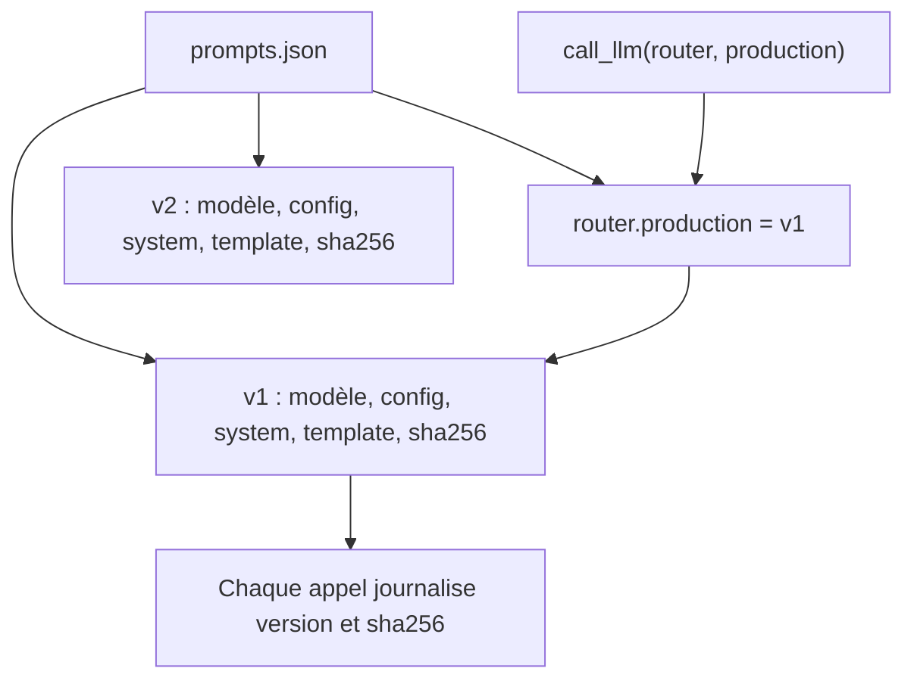

# Versionner prompts et modèles

> [!NOTE]
> Dans cette leçon, vous allez construire un registre de prompts versionnés : des versions **immuables** qui figent prompt, modèle et paramètres, une empreinte qui détecte toute modification en douce, et un alias `production` pour déployer ou revenir en arrière en changeant une seule ligne.

## Ce qu'une « version » doit figer

Le comportement d'un appel LLM dépend de **tout** ce qui part au modèle. Une version qui ne fige que le texte du prompt est incomplète :

| Élément | Exemple | Pourquoi le figer |
| --- | --- | --- |
| prompt système | « Tu routes les demandes internes… » | la consigne principale |
| gabarit utilisateur | `Demande : {demande}` | la forme de l'entrée |
| modèle | `gemini-3.5-flash-lite` | un autre modèle = un autre comportement |
| paramètres | `temperature: 0`, `response_mime_type` | la température change la variabilité |



## Le registre du lab

Un simple fichier JSON, relu en revue de code comme le reste. Chaque version porte une date, une note et son empreinte :

```json title="files/prompts.json (extrait)"
"v2": {
  "created": "2026-10-14",
  "note": "Prompt raccourci pour économiser des tokens (proposition à évaluer).",
  "model": "gemini-3.5-flash-lite",
  "config": {"temperature": 0, "response_mime_type": "application/json"},
  "system": "Indique en JSON le service concerné et l'urgence de la demande.",
  "template": "{demande}",
  "sha256": "0aaa739777c1"
}
```

L'**empreinte** (*hash*) est un résumé de 12 caractères calculé à partir du modèle, des paramètres, du prompt système et du gabarit. Si un seul caractère change, l'empreinte change. Le chargement la recalcule et refuse une version modifiée :

```python title="files/prompt_registry.py (extrait)"
def fingerprint(v: dict) -> str:
    payload = json.dumps({k: v[k] for k in ("model", "config", "system", "template")},
                         sort_keys=True, ensure_ascii=False)
    return hashlib.sha256(payload.encode()).hexdigest()[:12]


def load(prompt_id: str, version: str = "production", path: Path = REGISTRY) -> PromptVersion:
    entry = json.loads(path.read_text(encoding="utf-8"))[prompt_id]
    if version == "production":
        version = entry["production"]
    v = entry["versions"][version]
    if fingerprint(v) != v["sha256"]:
        raise ValueError(f"{prompt_id}@{version} a été modifié après publication : créez une nouvelle version")
```

Pourquoi l'immuabilité ? Parce que les journaux disent « l'appel de mardi 10 h utilisait `router@v1` ». Si `v1` a été modifié depuis, cette information ne vaut plus rien.

```quiz
question: "Un collègue corrige une faute de frappe dans le prompt système de v1, déjà en production. Que se passe-t-il avec le registre du lab ?"
options:
  - "Rien, la correction est appliquée"
  - "Le chargement de v1 échoue (empreinte différente) : il faut créer v3 avec la correction et la faire passer par le test de non-régression"
  - "Le modèle refuse le prompt"
answer: 1
explanation: "Même une correction mineure change le comportement possible. Elle mérite une nouvelle version, évaluée comme les autres. L'échec du chargement, détecté par pytest en CI, empêche la modification silencieuse."
```

## Déployer et revenir en arrière

L'alias `"production": "v1"` désigne la version servie. Le code applicatif appelle `call_llm("router")` sans version : déployer v3, c'est changer **une ligne** dans `prompts.json`, revue et CI comprises. Revenir en arrière, c'est remettre `v1`. Pas de redéploiement de code.

> [!TIP]
> Pour aller plus loin : un alias `canary` servi à 5 % du trafic (tirage aléatoire dans `call_llm`), et la comparaison de ses métriques avec `production` sur le tableau de bord, puisque chaque appel porte sa version.

## Versionner le modèle aussi

- Utilisez un **nom de modèle stable** dans le registre ; évitez les alias du type « dernière version », qui changent sans prévenir.
- Un changement de modèle est une **nouvelle version** de prompt, même si le texte ne bouge pas : il passe le même test de non-régression.
- Surveillez les annonces de fin de vie des modèles : remplacer un modèle retiré est un projet planifié, pas une urgence.
- Sur Vertex AI, un modèle réglé (formation précédente) se référence par son endpoint : c'est une version de modèle comme une autre dans le registre.

> [!WARNING]
> Ne stockez **jamais** de clé d'API ni de donnée client dans le registre : il est versionné dans Git et lu par toute l'équipe.

```quiz
question: "Quels changements doivent produire une nouvelle version dans le registre ? (plusieurs réponses)"
options:
  - "Passer temperature de 0 à 0,7"
  - "Remplacer gemini-3.5-flash-lite par gemini-3.5-flash"
  - "Modifier le gabarit Demande : {demande}"
  - "Changer l'alias production de v1 à v2"
answer: [0, 1, 2]
explanation: "Paramètres, modèle et gabarit font partie de l'empreinte. Changer l'alias ne crée pas de version : c'est un déploiement, qui doit en revanche passer le test de non-régression."
```

## Exercice : créer v3

Créez une version `v3` qui reprend v1 mais ajoute une ligne au prompt système : « Une demande d'accès à un logiciel relève de it. ». Calculez son empreinte et vérifiez que le registre la charge.

<details>
<summary>Voir la solution</summary>

1. Copiez le bloc `v1` en `v3` dans `prompts.json`, changez `created`, `note`, ajoutez la ligne à `system` et mettez `"sha256": "a-calculer"`.
2. Lancez `python prompt_registry.py` : la ligne `router@v3 sha256=xxxxxxxxxxxx À METTRE À JOUR` donne l'empreinte.
3. Recopiez-la dans `sha256`, relancez : `router@v3 ... ok`.
4. `pytest -q` doit rester vert. Ne changez **pas** encore `production` : la leçon suivante vérifie d'abord que v3 ne régresse pas.

</details>

## Résultat obtenu

Exécution réelle le 2026-10-15 : vérification du registre, puis chargement d'une copie où la température de v1 a été modifiée à 0,7 sans créer de version :

```text
$ python prompt_registry.py
router@v1 sha256=7dc8e870b139 ok
router@v2 sha256=0aaa739777c1 ok

$ python -c "from pathlib import Path; from prompt_registry import load; load('router', 'v1', path=Path('prompts_modifie.json'))"
ValueError: router@v1 a été modifié après publication : créez une nouvelle version
```

## Je sais faire

- [ ] Lister ce qu'une version de prompt doit figer
- [ ] Détecter une modification de version publiée grâce à une empreinte
- [ ] Déployer ou revenir en arrière en changeant un alias
- [ ] Traiter un changement de modèle comme une nouvelle version
