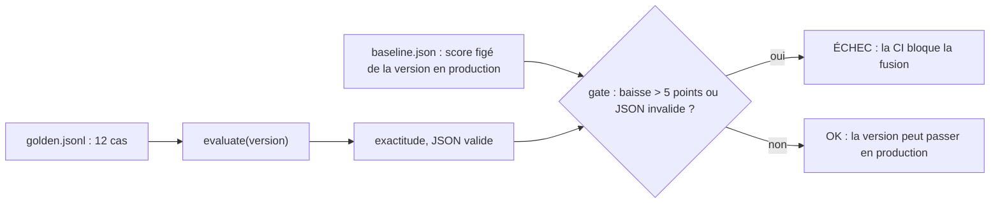

# Tests de non-régression en CI

> [!NOTE]
> Dans cette leçon, vous allez écrire un test de non-régression qui compare une version candidate de prompt à la référence sur un jeu de cas fixes, le brancher en CI, et le voir **réellement** refuser une version moins chère mais cassée.

## Le principe

Un **test de non-régression** vérifie qu'un changement ne dégrade pas ce qui marchait. Pour un LLM, on ne peut pas tester « la réponse exacte » ; on teste des **propriétés** sur un **jeu de référence** (*golden set*) : des entrées fixes avec la sortie attendue.



Le jeu du lab, [golden.jsonl](../files/golden.jsonl), contient 12 demandes fictives : 3 par service, avec des urgences hautes et normales.

```json title="files/golden.jsonl (extrait)"
{"demande": "J'ai cliqué sur un lien bizarre dans un e-mail et une page m'a demandé mon mot de passe.", "service": "it", "urgence": "haute"}
{"demande": "Combien de jours de congés me reste-t-il pour cette année ?", "service": "rh", "urgence": "normale"}
```

## La porte de qualité

```python title="files/regression.py (extrait)"
def gate(candidate: dict, baseline: dict, tolerance: float = TOLERANCE) -> list[str]:
    """Raisons de refuser la candidate (liste vide = acceptée)."""
    reasons = []
    if candidate["exactitude"] < baseline["exactitude"] - tolerance:
        reasons.append(f"exactitude {candidate['exactitude']:.2f} < référence {baseline['exactitude']:.2f} - {tolerance}")
    if candidate["json_valide"] < 1.0:
        reasons.append(f"JSON valide {candidate['json_valide']:.0%} < 100 %")
    return reasons
```

Deux règles : l'exactitude ne baisse pas de plus de 5 points (une **tolérance** absorbe un peu de variabilité), et **toutes** les réponses sont un JSON exploitable (un JSON invalide casse l'application en aval). La référence est mesurée une fois sur la version en production, puis figée dans [baseline.json](../files/baseline.json) :

```bash
python regression.py --version v1 --save-baseline   # 12 appels : fige la référence
python regression.py --version v2                    # 12 appels : code de sortie 1 si régression
```

```quiz
question: "Pourquoi une tolérance de 5 points plutôt qu'exiger une exactitude au moins égale à la référence ?"
options:
  - "Pour accepter les versions un peu moins bonnes"
  - "Parce que même à température 0, un LLM peut varier légèrement d'une exécution à l'autre : sans tolérance, le test échouerait au hasard"
  - "Parce que Gemini l'impose"
answer: 1
explanation: "Un test qui échoue au hasard (flaky) finit ignoré. La tolérance absorbe le bruit ; elle doit rester petite et se resserrer quand le jeu de référence grandit."
```

## En CI : deux étages

| Étage | Quand | Clé nécessaire | Ce qui est testé |
| --- | --- | --- | --- |
| tests hors ligne (`pytest`) | à chaque push | non | registre intact, wrapper, rapport, logique de la porte avec un faux modèle |
| non-régression réelle | quand `prompts.json` change | oui (secret CI) | la version de `production` contre `baseline.json` |

```python title="files/test_llmops.py (extrait)"
def test_gate_rejects_degraded_version():
    good = fake(['{"service":"it","urgence":"haute"}', '{"service":"rh","urgence":"normale"}'])
    bad = fake(['{"service":"Informatique","urgence":"élevée"}', "pas du JSON"])
    base = regression.evaluate("v1", good, CASES)
    cand = regression.evaluate("v2", bad, CASES)
    assert base["exactitude"] == 1.0 and regression.gate(base, base) == []
    assert cand["exactitude"] == 0.0 and cand["json_valide"] == 0.5
    assert len(regression.gate(cand, base)) == 2
```

Le fichier [ci-llmops.yml](../files/ci-llmops.yml) est un exemple GitHub Actions des deux étages ; la même logique s'écrit dans Cloud Build. La clé vient d'un **secret** de la CI, jamais du dépôt.

> [!WARNING]
> Chaque exécution réelle coûte des appels. Ne la déclenchez que si `prompts.json` change, et gardez le jeu de référence assez petit pour la CI (des dizaines de cas) ; un jeu plus large tourne chaque nuit.

> [!TIP]
> Ajoutez au jeu de référence chaque cas réel qui a posé problème en production (anonymisé). Le golden set devient la mémoire des incidents : un bug corrigé ne revient plus.

```quiz
question: "La version v2 est 11 % moins chère et 0 % d'erreurs HTTP. Le test de non-régression échoue. Que faire ?"
options:
  - "Forcer la fusion, l'économie est importante"
  - "Refuser v2, lire les échecs (valeurs hors liste) et proposer une v3 qui garde la liste fermée tout en raccourcissant le reste"
  - "Augmenter la tolérance à 100 points"
answer: 1
explanation: "Les échecs montrent la cause : sans liste fermée, le modèle invente ses propres noms de services. Une v3 peut économiser des tokens ailleurs ; elle repassera le même test."
```

## Exercice : un critère de coût

Ajoutez à `gate` une troisième règle : la candidate est refusée si ses tokens d'entrée moyens dépassent ceux de la référence de plus de 50 %. Que faut-il changer dans `evaluate` et dans `baseline.json` ?

<details>
<summary>Voir la solution</summary>

Dans `evaluate`, cumulez `r["tokens_in"]` et renvoyez `"tokens_in_moy": round(total / n)`. Dans `--save-baseline`, ajoutez `"tokens_in_moy"` à la liste des champs enregistrés. Puis :

```python
    if candidate.get("tokens_in_moy", 0) > 1.5 * baseline.get("tokens_in_moy", float("inf")):
        reasons.append(f"tokens d'entrée {candidate['tokens_in_moy']} > 1,5 × {baseline['tokens_in_moy']}")
```

`.get` avec des valeurs par défaut garde la compatibilité avec un ancien `baseline.json`. Ajoutez un test avec un faux modèle qui renvoie 300 tokens pour vérifier que la règle se déclenche.

</details>

## Résultat obtenu

Exécution réelle du 2026-10-15, `gemini-3.5-flash-lite`, 24 appels (sortie JSON condensée sur une ligne) :

```text
$ python regression.py --version v1 --save-baseline
{"version": "v1", "cas": 12, "exactitude": 1.0, "json_valide": 1.0, "echecs": []}
Référence enregistrée dans baseline.json

$ python regression.py --version v2 ; echo "exit=$?"
RÉGRESSION : exactitude 0.00 < référence 1.00 - 0.05
RÉGRESSION : JSON valide 92% < 100 %
ÉCHEC
exit=1
```

Extraits des échecs de v2 : le modèle invente ses propres valeurs dès que la liste fermée disparaît.

```text
attendu ['it', 'normale']        obtenu ['Support Informatique', 'Faible']
attendu ['it', 'haute']          obtenu ['Sécurité informatique', 'Haute']
attendu ['rh', 'normale']        obtenu ['RH', 'Faible']
attendu ['rh', 'haute']          obtenu ['Ressources Humaines', 'Haute']
```

## Je sais faire

- [ ] Constituer un jeu de référence et figer le score de la version en production
- [ ] Écrire une porte de qualité avec tolérance et règles strictes
- [ ] Séparer tests hors ligne et tests réels en CI
- [ ] Lire les échecs d'une version refusée pour proposer la suivante
