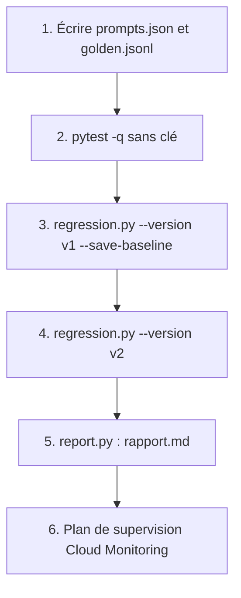

# Projet final : instrumenter votre application LLM

> [!NOTE]
> Dans ce projet, vous allez appliquer toute la chaîne LLMOps à une tâche de votre choix : wrapper instrumenté, registre de prompts, rapport de coûts et de latences sur 30 appels au plus, test de non-régression qui bloque une mauvaise version, et un plan de supervision sur Google Cloud.

## Le cahier des charges

Choisissez une tâche à sortie structurée (par exemple : extraire date, montant et fournisseur d'une note de frais ; classer un e-mail client ; résumer un compte rendu en 3 champs). Livrables :

| Livrable | Fichier | Critère de réussite |
| --- | --- | --- |
| Registre | `prompts.json` | au moins 2 versions, empreintes `ok`, alias `production` |
| Jeu de référence | `golden.jsonl` | 10 à 15 cas fictifs, variés, avec la sortie attendue |
| Wrapper | `llm_wrapper.py` | chaque appel produit un span `gen_ai.*` et une ligne JSON |
| Rapport | `rapport.md` | p50, p95, tokens, coût pour 1 000 appels, taux d'erreur, par version |
| Non-régression | `regression.py` + `baseline.json` | une version volontairement dégradée échoue (code de sortie 1) |
| Plan GCP | un paragraphe | métriques, tableau de bord, 3 alertes, nettoyage |



## Adapter le lab

1. Dans [prompts.json](../files/prompts.json), remplacez `router` par l'identifiant de votre tâche ; écrivez v1 (soignée) et v2 (une « optimisation » risquée).
2. Calculez les empreintes avec `python prompt_registry.py`.
3. Dans [regression.py](../files/regression.py), adaptez `evaluate` : l'identifiant du prompt et la comparaison entre sortie obtenue et sortie attendue.
4. Gardez le budget : 2 versions × 15 cas = 30 appels au maximum.

```bash
cp .env.example .env              # votre clé, jamais dans le code
pytest -q                         # hors ligne
python regression.py --version v1 --save-baseline
python regression.py --version v2; echo "exit=$?"
python report.py > rapport.md
```

> [!WARNING]
> Utilisez des données **fictives** dans `golden.jsonl` : il est versionné et partagé. Si vous partez de cas réels, anonymisez-les (noms, e-mails, montants identifiants).

```quiz
question: "Votre v2 passe le test de non-régression mais son p95 de latence est 3 fois plus élevé. Que faites-vous ?"
options:
  - "Je la déploie, le test est vert"
  - "J'examine les appels lents (tokens de sortie, réflexion, tentatives) et j'ajoute si besoin une règle de latence ou de tokens à la porte de qualité"
  - "Je supprime le p95 du rapport"
answer: 1
explanation: "La qualité n'est qu'un des quatre signaux. Une version qui génère beaucoup plus de tokens est plus lente et plus chère ; la porte de qualité peut intégrer ces critères."
```

## La grille d'évaluation

| Critère | Points |
| --- | --- |
| Registre immuable, empreintes vérifiées par pytest | 3 |
| Spans avec attributs `gen_ai.*` et version de prompt ; journaux JSON sans texte utilisateur | 4 |
| Rapport complet par version, coûts au prix officiel du jour | 3 |
| Test de non-régression qui échoue réellement sur la version dégradée | 4 |
| Plan Cloud Monitoring : métriques, tableau de bord, alertes actionnables | 4 |
| Nettoyage décrit, aucun secret dans le dépôt | 2 |

```quiz
question: "Quels éléments votre plan de supervision sur GCP doit-il contenir ? (plusieurs réponses)"
options:
  - "Une métrique distribution sur latency_ms libellée par version de prompt"
  - "Un compteur des appels en erreur et une alerte sur le taux pendant une durée"
  - "Une alerte à chaque appel en erreur"
  - "Une alerte de budget de facturation"
answer: [0, 1, 3]
explanation: "Distribution par version, taux d'erreur sur une durée et budget couvrent latence, fiabilité et coût. Une alerte par erreur produit du bruit et finit ignorée."
```

## Exercice : rédiger le plan de supervision

Rédigez en cinq points le plan de supervision du routeur du lab sur Google Cloud.

<details>
<summary>Voir la solution</summary>

1. **Déploiement** : Cloud Run, journaux JSON sur la sortie standard, `OTEL_EXPORTER=gcp`, rôle `roles/cloudtrace.agent` pour le compte de service.
2. **Métriques** : `lab-llmops-latence` (distribution, libellé `prompt_version`, fichier `logmetric-latence.yaml`), `lab-llmops-erreurs` (compteur), et une distribution sur `tokens_in`.
3. **Tableau de bord** : `dashboard.json` (p95 par version, erreurs par 5 min), complété par les tokens moyens et le coût du jour.
4. **Alertes** : taux d'erreur > 5 % pendant 10 min ; p95 > 2 × l'habitude pendant 15 min ; tokens d'entrée + 50 % sur 1 h ; budget de facturation à 80 %.
5. **Nettoyage** en fin d'expérience : `gcloud logging metrics delete`, `gcloud monitoring dashboards delete`, `gcloud monitoring policies delete`, suppression du service Cloud Run, toujours avec `--project`.

</details>

## Résultat obtenu

Chaîne complète exécutée le 2026-10-15 sur le routeur du lab (extraits réels) :

```text
$ pytest -q
......s                                                                  [100%]
6 passed, 1 skipped
$ python regression.py --version v1 --save-baseline
Référence enregistrée dans baseline.json        (exactitude 1.0, JSON valide 1.0)
$ python regression.py --version v2 ; echo "exit=$?"
RÉGRESSION : exactitude 0.00 < référence 1.00 - 0.05
RÉGRESSION : JSON valide 92% < 100 %
ÉCHEC
exit=1
$ python report.py
| router@v1 (gemini-3.5-flash-lite) | 12 | 0.0 | 797 | 1050 | 102 | 19 | 0.000937 | 0.0781 |
| router@v2 (gemini-3.5-flash-lite) | 12 | 0.0 | 763 | 1438 | 37 | 23 | 0.000834 | 0.0695 |
```

## Je sais faire

- [ ] Instrumenter une application LLM de bout en bout
- [ ] Produire un rapport de coûts et de latences par version
- [ ] Bloquer automatiquement une version de prompt qui dégrade les résultats
- [ ] Concevoir la supervision sur Cloud Monitoring et la nettoyer
