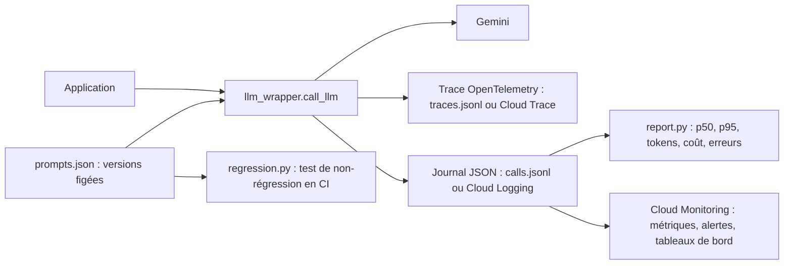

Une application LLM en production pose des questions qu'un simple `print` ne résout pas : **pourquoi** cette réponse était fausse, **combien** coûte une journée, **quelle version** du prompt tournait mardi, et **comment** être sûr que la modification de ce matin n'a rien cassé. Le LLMOps (*opérations des applications LLM*) regroupe les pratiques qui répondent à ces questions.

Le fil rouge est un vrai lab, exécuté le 2026-10-15 : un **routeur de demandes internes** (informatique, RH, achats, juridique) qui appelle `gemini-3.5-flash-lite` à travers un wrapper instrumenté. 24 vrais appels alimentent un rapport de coûts et de latences, et un test de non-régression **refuse** une version de prompt « optimisée » qui économisait 11 % de coût mais faisait tomber l'exactitude de 100 % à 0 %.

## Pour qui ?

- Développeurs et ingénieurs qui ont déjà une application LLM (ou un prototype) en Python.
- Vous savez lancer `pytest` et lire du JSON.
- Pas besoin de connaître OpenTelemetry ni Cloud Monitoring : tout est expliqué.

## Ce que vous allez construire

## Prérequis techniques

- Python 3.10 ou plus récent, `pip install -r files/requirements.txt`.
- **En local** : une clé d'API Gemini (Google AI Studio) dans `GOOGLE_API_KEY`. Traces et journaux sont écrits dans des fichiers.
- **Sur GCP** (facultatif) : un projet avec Cloud Trace, Cloud Logging et Cloud Monitoring ; la formation explique la configuration, le lab tourne entièrement en local.

## Programme

| Module | Contenu | Durée indicative |
| --- | --- | --- |
| 1. Observer | Pourquoi le LLMOps, tracer avec OpenTelemetry, journaux structurés | 1h45 |
| 2. Mesurer | Latence p50 / p95, tokens, coût, taux d'erreur ; alertes et tableaux de bord | 1h15 |
| 3. Versionner et tester | Registre de prompts versionnés, tests de non-régression en CI | 1h15 |
| 4. Projet final | Instrumenter votre propre application de bout en bout | 45 min |

## En local ou sur GCP

| Brique | En local | Sur GCP |
| --- | --- | --- |
| Traces | `OTEL_EXPORTER=console` → `traces.jsonl` | `OTEL_EXPORTER=gcp` → Cloud Trace |
| Journaux | `calls.jsonl` | sortie standard captée par Cloud Logging (Cloud Run, GKE) |
| Métriques | `report.py` | métriques basées sur les journaux dans Cloud Monitoring |
| Alertes | seuils dans la CI | règles d'alerte Cloud Monitoring |
| Non-régression | `pytest` / `regression.py` | même chose dans Cloud Build ou GitHub Actions |

Le code complet est dans le dossier `files/` (section Ressources) : `llm_wrapper.py`, `prompt_registry.py`, `prompts.json`, `regression.py`, `report.py`, `test_llmops.py`, le jeu `golden.jsonl` et les sorties réelles (`calls.jsonl`, `traces.jsonl`, `rapport.md`).
