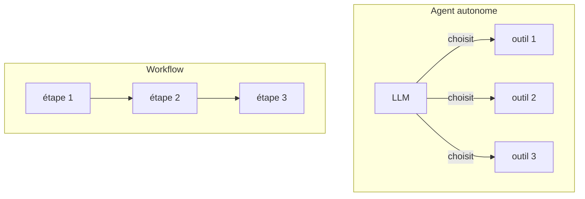

# Du LlmAgent au workflow

> [!NOTE]
> Dans cette leçon, vous allez comprendre pourquoi un processus métier à étapes connues se code comme un **workflow** d'agents, découvrir les quatre briques d'ADK 2.10 (`LlmAgent`, `SequentialAgent`, `ParallelAgent`, `LoopAgent`) et lancer le pipeline du lab avec `adk run` et `adk web`.

## Deux façons de confier une tâche à l'IA

Un **LlmAgent** (alias `Agent`) est un agent piloté par un modèle de langage : il reçoit une instruction, des outils, et **décide lui-même** quoi faire à chaque tour. Parfait pour une conversation ouverte. Mais une due diligence fournisseur suit toujours les mêmes étapes : collecter, scorer, analyser, rédiger, relire. Laisser le modèle choisir l'ordre, c'est accepter qu'il en saute une.

Un **agent de workflow** n'appelle aucun modèle : c'est du code d'orchestration qui exécute des sous-agents selon un schéma fixe.

| Brique | Rôle | Appelle un LLM ? |
| --- | --- | --- |
| `LlmAgent` | raisonne, appelle des outils, écrit | oui |
| `SequentialAgent` | exécute ses sous-agents l'un après l'autre | non |
| `ParallelAgent` | exécute ses sous-agents en même temps | non |
| `LoopAgent` | répète ses sous-agents jusqu'à un signal d'arrêt ou `max_iterations` | non |
| `BaseAgent` (sous-classe) | votre propre logique en Python | seulement si vous le décidez |



> [!TIP]
> Règle pratique : si vous pouvez dessiner le processus sur un tableau blanc avant de commencer, écrivez-le en workflow et gardez le LLM pour les étapes qui demandent du langage (résumer, analyser, rédiger).

```quiz
question: "Combien d'appels au modèle fait un SequentialAgent pour décider de l'ordre de ses sous-agents ?"
options:
  - "Un appel par sous-agent"
  - "Aucun : l'ordre est celui de la liste sub_agents"
  - "Un seul appel au début"
answer: 1
explanation: "Les agents de workflow sont déterministes : SequentialAgent parcourt sub_agents dans l'ordre. Seuls les LlmAgent qu'il contient appellent un modèle."
```

## Le pipeline du lab en une vue

```python title="files/agent.py (extrait)"
return SequentialAgent(
    name="due_diligence",
    description="Due diligence fournisseur : recherche, score, analyse, rapport relu.",
    sub_agents=[recherche, ScoreurRisque(name="scoreur"), analyste, boucle],
)
```

`recherche` est un `ParallelAgent` de trois `LlmAgent`, `ScoreurRisque` un `BaseAgent` sans IA, `analyste` un `LlmAgent`, `boucle` un `LoopAgent` (rédacteur + relecteur). Le code complet : [agent.py](../files/agent.py).

> [!WARNING]
> Dans ADK 2.10, `SequentialAgent`, `ParallelAgent` et `LoopAgent` émettent un `DeprecationWarning` : ils sont dépréciés **au profit de `Workflow`** (un graphe de nœuds, module `google.adk.workflow`) et seront retirés dans une version future. Ils restent pleinement fonctionnels, sont les mieux documentés et, selon le message du code installé, `Workflow` « ne peut pas encore être utilisé comme sous-agent d'un LlmAgent ». Tout ce que vous apprenez ici (état partagé, condition d'arrêt, callbacks) se transpose aux graphes `Workflow`.

## Structure d'un projet ADK

ADK attend **un dossier par application** contenant `__init__.py` (qui fait `from . import agent`) et `agent.py` qui définit `root_agent` :

```text
mon_projet/
└── due_diligence/          ← nom de l'application
    ├── __init__.py
    ├── agent.py            ← root_agent = construire_pipeline()
    ├── fournisseurs.json
    └── .env                ← copié depuis .env.example
```

```bash title="terminal"
cd mon_projet
pip install -r due_diligence/requirements.txt
cp due_diligence/.env.example due_diligence/.env   # puis renseignez la clé
adk run due_diligence "Due diligence du fournisseur : Composants Arvenne"
adk web --port 8000        # interface de développement sur http://127.0.0.1:8000
```

`adk run <dossier> [requête]` exécute une requête unique (ou ouvre un mode interactif sans requête). `adk web [dossier_des_agents]` lance une interface web qui liste les applications, montre chaque événement, l'état de session et les traces.

> [!WARNING]
> L'aide de `adk web` le rappelle : ses points d'accès ne sont **pas authentifiés**. Ne l'exposez jamais sur un réseau public.

## Exercice : dessiner avant de coder

Un service RH veut automatiser la présélection de candidatures : extraire les informations du CV, vérifier en parallèle diplômes et expériences, calculer un score selon une grille fixe, puis rédiger un avis relu par un second agent. Indiquez la brique ADK pour chaque étape.

<details>
<summary>Voir la solution</summary>

- `SequentialAgent` en racine.
- Extraction du CV : `LlmAgent` (langage non structuré → champs).
- Vérifications diplômes / expériences : `ParallelAgent` de deux `LlmAgent` (indépendantes l'une de l'autre).
- Score selon une grille fixe : `BaseAgent` personnalisé, **sans LLM** (règles auditables).
- Avis + relecture : `LoopAgent` avec `max_iterations`, le relecteur arrêtant la boucle par un outil.

Point de vigilance : une grille RH doit être auditable et non discriminante ; c'est une raison de plus pour la coder en Python plutôt que de la confier au modèle.

</details>

```quiz
question: "Quel fichier ADK cherche-t-il dans le dossier passé à adk run ?"
options:
  - "Un fichier main.py avec une fonction main()"
  - "Un module agent qui définit la variable root_agent, importé via __init__.py"
  - "Un fichier agent.yaml obligatoire"
answer: 1
explanation: "Le dossier est un paquet Python : __init__.py importe agent, et agent.py expose root_agent. Le nom du dossier devient le nom de l'application."
```

## Résultat obtenu

Serveur `adk web --port 8791` lancé le 2026-10-15 sur le dossier du lab, interrogé avec `curl` :

```text
$ curl -s localhost:8791/list-apps
["due_diligence"]
$ curl -s -o /dev/null -w "dev-ui %{http_code}\n" -L localhost:8791/dev-ui/
dev-ui 200
$ curl -s -X POST localhost:8791/apps/due_diligence/users/u/sessions -d '{}' -H 'content-type: application/json'
{"id":"b528905d-…","appName":"due_diligence","userId":"u","state":{},"events":[],…}
```

## Je sais faire

- [ ] Expliquer quand préférer un workflow à un agent autonome
- [ ] Citer les quatre briques d'ADK et dire lesquelles appellent un LLM
- [ ] Organiser un dossier d'application ADK avec `root_agent`
- [ ] Lancer un agent avec `adk run` et l'inspecter avec `adk web`
