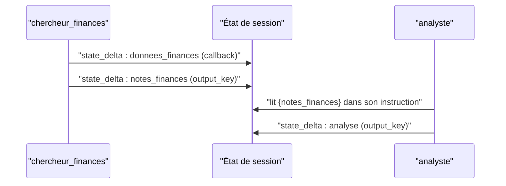

# État partagé et output_key

> [!NOTE]
> Dans cette leçon, vous allez faire circuler les données entre les agents du pipeline grâce à l'**état de session** : écrire avec `output_key` ou `tool_context.state`, lire avec `{cle}` dans une instruction, et éviter les collisions quand des agents écrivent en parallèle.

## L'état, un tableau blanc commun

Une **session** ADK regroupe l'historique d'une conversation (les **événements**) et un **état** : un dictionnaire clé → valeur que tous les agents d'une même invocation peuvent lire et modifier. Dans un workflow, c'est le moyen normal de passer un résultat d'une étape à la suivante.

ADK ne modifie jamais l'état « en douce » : chaque écriture voyage dans un événement, sous `event.actions.state_delta`, et le `SessionService` l'applique quand l'événement est enregistré. C'est ce qui rend l'état traçable dans `adk web`.



## Trois façons d'écrire

| Moyen | Où | Exemple du lab |
| --- | --- | --- |
| `output_key="cle"` | sur un `LlmAgent` : sa réponse finale (texte) est copiée dans `state["cle"]` | `notes_registre`, `analyse`, `rapport`, `critique` |
| `tool_context.state["cle"] = …` | dans un outil ou un callback d'outil | `donnees_finances`, `statut_relecture` |
| `EventActions(state_delta={…})` | dans un `BaseAgent` personnalisé | `score_risque` |

```python title="files/agent.py (extraits)"
analyste = LlmAgent(
    name="analyste", model=model, output_key="analyse", **CALLBACKS,
    instruction=("… Registre : {notes_registre}\nFinances : {notes_finances}\n"
                 "Réputation : {notes_reputation}\n"
                 "Score calculé (il fait foi, ne le modifie pas) : {score_risque}\n" + CONSIGNE_DONNEES),
)
redacteur = LlmAgent(
    name="redacteur", model=model, output_key="rapport", **CALLBACKS,
    instruction=("… Retours de la relecture précédente (vide au premier passage) : {critique?}\n …"),
)
```

## Lire : les gabarits `{cle}` et `{cle?}`

Avant chaque appel au modèle, ADK remplace `{cle}` dans l'instruction par `str(state["cle"])`. Si la clé n'existe pas, il lève une `KeyError`. Avec `{cle?}`, une clé absente est remplacée par une chaîne vide : c'est indispensable pour `{critique?}`, qui n'existe pas encore au premier passage du rédacteur.

> [!TIP]
> Une valeur non textuelle (comme le dictionnaire `score_risque`) est insérée sous sa forme `str()`. Pour un rendu plus lisible, stockez une chaîne déjà formatée ou utilisez une fonction comme `instruction=` (un *InstructionProvider* qui reçoit le contexte et renvoie le texte).

```quiz
question: "Le rédacteur utilise {critique} sans point d'interrogation. Que se passe-t-il au premier tour de boucle ?"
options:
  - "La phrase est remplacée par une chaîne vide"
  - "ADK lève une KeyError car la clé critique n'existe pas encore dans l'état"
  - "Le modèle reçoit littéralement {critique}"
answer: 1
explanation: "Sans ?, une variable absente de l'état provoque une KeyError. Le ? rend la variable optionnelle."
```

## Portée des clés

Le **préfixe** d'une clé fixe sa durée de vie : sans préfixe, la session ; `user:` toutes les sessions d'un utilisateur ; `app:` toute l'application ; `temp:` l'invocation en cours seulement (jamais persisté). Une due diligence est un dossier ponctuel : toutes nos clés sont sans préfixe.

## Le piège du parallèle : une clé par écrivain

Les trois chercheurs tournent **en même temps**. S'ils ajoutaient tous leur résultat à une même liste `state["journal"]`, chacun lirait la liste, ajouterait son élément et réécrirait la liste : la dernière écriture gagnerait et les autres seraient perdues. C'est une **condition de course** (*race condition*).

La parade : **une clé distincte par agent parallèle** (`notes_registre`, `notes_finances`, `notes_reputation`), puis une étape suivante qui les rassemble. C'est exactement ce que fait l'analyste.

```quiz
question: "Pourquoi chaque chercheur a-t-il son propre output_key ?"
options:
  - "Parce qu'ADK interdit deux agents avec le même output_key"
  - "Pour que les trois résultats coexistent dans l'état sans s'écraser, les agents tournant en parallèle"
  - "Pour réduire le nombre de tokens"
answer: 1
explanation: "Avec une clé commune, le dernier chercheur à finir écraserait les deux autres. Des clés distinctes rendent les écritures indépendantes de l'ordre d'arrivée."
```

## Exercice : ajouter un quatrième chercheur

Ajoutez un chercheur `chercheur_conformite` qui appelle un outil `consulter_conformite(fournisseur)` (à écrire, il peut renvoyer `{"rgpd": "clauses signées"}`), et faites lire son résultat par l'analyste.

<details>
<summary>Voir la solution</summary>

```python title="files/agent.py (ajouts)"
def consulter_conformite(fournisseur: str) -> dict:
    """Renvoie l'état de conformité contractuelle (RGPD, sous-traitance) d'un fournisseur."""
    return {"fournisseur": fournisseur, "rgpd": "clauses signées"}

# dans construire_pipeline :
_chercheur("chercheur_conformite", consulter_conformite, "notes_conformite", model),
# et dans l'instruction de l'analyste :
"Conformité : {notes_conformite}\n"
```

Une nouvelle clé `notes_conformite`, jamais partagée : aucun risque de collision. Le callback `journaliser_outil` rangera aussi la donnée brute dans `donnees_conformite` (il dérive la clé du nom de l'outil).

</details>

## Résultat obtenu

Exécution réelle du pipeline le 2026-10-15 avec le faux modèle des tests (aucun appel réseau), en affichant pour chaque événement son auteur, sa **branche** et les clés de son `state_delta` :

```text
chercheur_registre recherche.chercheur_registre ['donnees_registre']
chercheur_finances recherche.chercheur_finances ['donnees_finances']
chercheur_reputation recherche.chercheur_reputation ['donnees_reputation']
chercheur_registre recherche.chercheur_registre ['notes_registre']
chercheur_finances recherche.chercheur_finances ['notes_finances']
chercheur_reputation recherche.chercheur_reputation ['notes_reputation']
scoreur None ['score_risque']
analyste None ['analyse']
redacteur None ['rapport']
relecteur None ['critique']
…
État final : ['analyse', 'critique', 'donnees_finances', 'donnees_registre', 'donnees_reputation',
             'notes_finances', 'notes_registre', 'notes_reputation', 'rapport', 'score_risque']
```

Chaque chercheur a sa branche (`recherche.chercheur_…`) : il ne voit pas l'historique des deux autres, mais tous écrivent dans le même état.

## Je sais faire

- [ ] Écrire dans l'état avec `output_key`, `tool_context.state` ou `state_delta`
- [ ] Lire l'état dans une instruction avec `{cle}` et `{cle?}`
- [ ] Choisir la portée d'une clé (`temp:`, sans préfixe, `user:`, `app:`)
- [ ] Éviter les collisions d'écriture entre agents parallèles
