# SequentialAgent et ParallelAgent

> [!NOTE]
> Dans cette leçon, vous allez assembler l'ossature du pipeline : un `SequentialAgent` qui enchaîne les étapes, et un `ParallelAgent` qui lance les trois chercheurs en même temps. Vous verrez ce que chaque agent voit de la conversation, et ce que le parallélisme fait gagner.

## SequentialAgent : la chaîne de montage

`SequentialAgent(sub_agents=[a, b, c])` exécute `a`, puis `b`, puis `c`, avec le **même contexte d'invocation** : même session, même état. Chaque étape voit donc ce que les précédentes ont écrit. Dans le code installé (ADK 2.10), la boucle est littéralement un `for sub_agent in self.sub_agents` : pas de LLM, pas de surprise.

> [!WARNING]
> Un `SequentialAgent` **ne s'arrête pas** quand un sous-agent signale `escalate` : ce signal n'est écouté que par `LoopAgent` (et `ParallelAgent` pour ses propres branches). Pour interrompre une chaîne, utilisez un `before_agent_callback` qui renvoie un contenu (l'agent est alors sauté) ou faites échouer l'étape.

## ParallelAgent : trois chercheurs à la fois

Les trois recherches (registre, finances, réputation) sont **indépendantes** : aucune n'a besoin du résultat d'une autre. Les lancer en parallèle divise le temps de cette phase par trois environ, puisque chaque chercheur passe l'essentiel de son temps à attendre le modèle.

```python title="files/agent.py (extrait)"
def _chercheur(nom: str, outil, cle: str, model) -> LlmAgent:
    return LlmAgent(
        name=nom, model=model, tools=[outil], output_key=cle,
        description=f"Collecte les informations via {outil.__name__}.",
        instruction=(f"Tu es analyste achats. Appelle l'outil {outil.__name__} UNE seule fois avec le nom exact "
                     "du fournisseur cité dans la demande, puis résume le résultat en 5 puces factuelles au plus. "
                     f"N'invente rien. {CONSIGNE_DONNEES}"),
        **CALLBACKS,
    )

recherche = ParallelAgent(name="recherche", sub_agents=[
    _chercheur("chercheur_registre", consulter_registre, "notes_registre", model),
    _chercheur("chercheur_finances", consulter_finances, "notes_finances", model),
    _chercheur("chercheur_reputation", consulter_reputation, "notes_reputation", model),
])
```

Une **fabrique** `_chercheur` évite de copier trois fois la même configuration. Elle crée un agent neuf à chaque appel, ce qui compte : dans ADK, un agent ne peut avoir **qu'un seul parent**. Réutiliser la même instance dans deux workflows lève une erreur de validation.

```mermaid
gantt
  title "Phase de recherche (ordre de grandeur)"
  dateFormat ss
  axisFormat %S s
  section Séquentiel
  registre :a1, 00, 3s
  finances :a2, after a1, 3s
  reputation :a3, after a2, 3s
  section Parallèle
  registre :b1, 00, 3s
  finances :b2, 00, 3s
  reputation :b3, 00, 3s
```



## Ce que voit chaque branche

`ParallelAgent` donne à chaque sous-agent une **branche** (`recherche.chercheur_finances`). Un agent ne reçoit dans son historique que les événements de sa propre branche et de ses ancêtres : la demande de l'utilisateur, oui ; les échanges des deux autres chercheurs, non. C'est voulu : chaque chercheur reste concentré, et ses tokens ne sont pas gaspillés à lire le travail des autres.

En revanche, **l'état est commun**. C'est pourquoi chaque branche écrit sous sa propre clé (leçon précédente).

```quiz
question: "Le chercheur_finances peut-il lire dans son historique le résumé produit par chercheur_registre pendant la phase parallèle ?"
options:
  - "Oui, tous les agents d'une session partagent l'historique complet"
  - "Non, chaque branche ne voit que ses propres événements et ceux de ses ancêtres ; seul l'état est partagé"
  - "Oui, mais seulement si les deux utilisent le même modèle"
answer: 1
explanation: "Les branches isolent l'historique. Le seul canal commun pendant le parallèle est l'état de session, et l'ordre d'arrivée n'y est pas garanti."
```

```quiz
question: "Quelles étapes du pipeline peuvent tourner en parallèle sans changer le résultat ?"
options:
  - "Les trois recherches"
  - "Le scoreur et l'analyste"
  - "Le rédacteur et le relecteur"
answer: 0
explanation: "Le scoreur a besoin des trois données brutes, l'analyste du score, le relecteur du rapport : ces étapes dépendent les unes des autres. Seules les recherches sont indépendantes."
```

> [!TIP]
> Le parallélisme multiplie les appels **simultanés** au modèle. Avec une clé d'API partagée, c'est le premier endroit où apparaissent les erreurs 429 (quota dépassé). Le lab configure `retry_options=types.HttpRetryOptions(attempts=5, initial_delay=2.0)` sur le modèle `Gemini` : le client réessaie automatiquement avec une attente croissante.

## Exercice : un pipeline à deux vitesses

Vous voulez qu'un fournisseur inconnu ne déclenche pas l'analyse et la rédaction (inutile de payer cinq appels au modèle pour un dossier vide). Proposez un mécanisme, sachant que `SequentialAgent` ignore `escalate`.

<details>
<summary>Voir la solution</summary>

Un `before_agent_callback` sur l'analyste et sur la boucle : s'il renvoie un `types.Content`, ADK **saute l'agent** et utilise ce contenu comme réponse.

```python title="agent.py (variante)"
def sauter_si_indetermine(callback_context):
    score = callback_context.state.get("score_risque") or {}
    if score.get("niveau") == "indéterminé":
        return types.Content(role="model", parts=[types.Part(
            text="Dossier incomplet : " + "; ".join(score.get("motifs", [])))])
    return None  # None = l'agent s'exécute normalement

analyste = LlmAgent(..., before_agent_callback=sauter_si_indetermine)
boucle = LoopAgent(..., before_agent_callback=sauter_si_indetermine)
```

Vérifié avec le faux modèle des tests : pour « Société Imaginaire », l'analyste et la boucle répondent `Dossier incomplet : données manquantes : registre, finances, reputation` et le modèle n'est appelé que **6 fois** (les 3 chercheurs) au lieu de 11 pour un dossier complet. Ajoutez cette assertion à `test_pipeline_fournisseur_inconnu`.

</details>

## Résultat obtenu

Extrait du journal d'`adk eval` du 2026-10-15 (modèle `gemini-3.5-flash`) : les trois requêtes des chercheurs partent dans la même dizaine de millisecondes, puis les trois outils sont appelés dans l'ordre où les réponses arrivent, différent de l'ordre de la liste.

```text
16:37:06,743 - google_llm.py - Sending out request, model: gemini-3.5-flash
16:37:06,748 - google_llm.py - Sending out request, model: gemini-3.5-flash
16:37:06,751 - google_llm.py - Sending out request, model: gemini-3.5-flash
16:37:08,380 - agent.py - {"agent": "chercheur_finances", "outil": "consulter_finances", …}
16:37:08,609 - agent.py - {"agent": "chercheur_reputation", "outil": "consulter_reputation", …}
16:37:08,642 - agent.py - {"agent": "chercheur_registre", "outil": "consulter_registre", …}
```

## Je sais faire

- [ ] Enchaîner des étapes avec `SequentialAgent` en sachant qu'il ignore `escalate`
- [ ] Paralléliser des étapes indépendantes avec `ParallelAgent`
- [ ] Expliquer ce que voit une branche (historique isolé, état commun)
- [ ] Créer des agents par fabrique pour respecter la règle « un seul parent »
