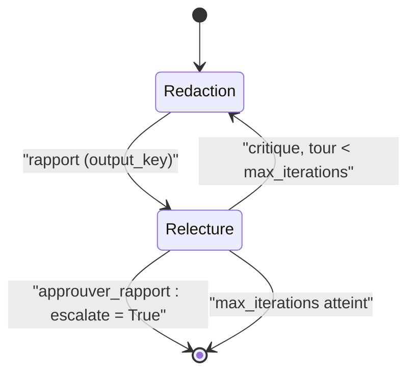

# LoopAgent et condition d'arrêt

> [!NOTE]
> Dans cette leçon, vous allez construire la boucle **rédaction → relecture** : un `LoopAgent` qui répète ses sous-agents jusqu'à ce qu'un outil signale `escalate`, avec `max_iterations` comme filet de sécurité, et une validation **déterministe** qui empêche le relecteur d'approuver un rapport non conforme.

## Le fonctionnement exact

Dans ADK 2.10, `LoopAgent` exécute ses sous-agents dans l'ordre, puis recommence, tant que :

1. aucun événement n'a `event.actions.escalate == True` ;
2. le nombre de tours est inférieur à `max_iterations` (si `max_iterations` vaut `None`, la boucle est **infinie** tant que personne n'escalade).

Dès qu'un événement escalade, la boucle sort **immédiatement**, sans finir le tour en cours.



```python title="files/agent.py (extrait)"
boucle = LoopAgent(name="redaction_relecture", sub_agents=[redacteur, relecteur],
                   max_iterations=int(os.environ.get("MAX_ITERATIONS", "3")))
```

> [!WARNING]
> Ne créez jamais un `LoopAgent` sans `max_iterations` en production. Un relecteur trop exigeant (ou un rédacteur qui n'arrive pas à corriger) ferait tourner la boucle, et la facture, indéfiniment.

## Qui décide de s'arrêter ?

ADK fournit un outil prêt à l'emploi, `google.adk.tools.exit_loop`, qui fait exactement `tool_context.actions.escalate = True`. Le problème : il laisse le **LLM seul juge**. Lors d'un premier essai réel sur Vertex AI, le relecteur a approuvé un rapport dont les titres étaient « Synthèse Exécutive » et qui contenait une date inventée : le modèle est indulgent avec son propre style.

Le lab remplace `exit_loop` par un outil maison qui **vérifie avant d'escalader** : le LLM propose, le code dispose.

```python title="files/agent.py (extrait)"
SECTIONS = ("## Synthèse", "## Risques", "## Recommandation", "## Plan d'action")
RECOMMANDATIONS = ("RETENIR SOUS CONDITIONS", "RETENIR", "ÉCARTER")

def verifier_rapport(rapport: str, score: dict | None) -> list[str]:
    """Contrôles déterministes de la politique achats. Renvoie la liste des manques."""
    lignes = [ligne.strip() for ligne in rapport.splitlines()]
    manques = [f"section manquante : {s}" for s in SECTIONS if not any(l.startswith(s) for l in lignes)]
    if not any(r in rapport for r in RECOMMANDATIONS):
        manques.append("recommandation absente : RETENIR, RETENIR SOUS CONDITIONS ou ÉCARTER")
    if score and score.get("score") is not None and str(score["score"]) not in rapport:
        manques.append(f"le score {score['score']} n'est pas cité")
    return manques

def approuver_rapport(tool_context: ToolContext) -> dict:
    """Approuve le rapport : à appeler UNIQUEMENT si tous les critères de relecture sont respectés."""
    manques = verifier_rapport(tool_context.state.get("rapport", ""), tool_context.state.get("score_risque"))
    if manques:  # le LLM propose, le code dispose : pas d'approbation si un contrôle échoue
        return {"statut": "refusé", "manques": manques}
    tool_context.state["statut_relecture"] = "approuvé"
    tool_context.actions.escalate = True            # condition d'arrêt de la LoopAgent
    tool_context.actions.skip_summarization = True  # pas d'appel LLM supplémentaire
    return {"statut": "approuvé"}
```

Trois détails comptent :

- `escalate = True` est posé sur l'événement de réponse de l'outil : c'est lui que `LoopAgent` détecte.
- `skip_summarization = True` évite qu'ADK rappelle le modèle pour « commenter » le résultat de l'outil : un appel économisé par dossier.
- En cas de refus, l'outil renvoie la liste des manques au modèle, qui la transforme en critique (`output_key="critique"`) pour le tour suivant.

```quiz
question: "Le relecteur appelle approuver_rapport mais le score n'est pas cité dans le rapport. Que se passe-t-il ?"
options:
  - "La boucle s'arrête quand même, car l'outil a été appelé"
  - "L'outil renvoie statut refusé sans escalader ; le relecteur écrit une critique et la boucle continue si max_iterations n'est pas atteint"
  - "ADK lève une exception"
answer: 1
explanation: "escalate n'est posé que si verifier_rapport ne trouve aucun manque. Sinon la réponse de l'outil retourne au modèle, qui produit la critique lue par le rédacteur au tour suivant."
```

```quiz
question: "Quelles affirmations sont vraies pour LoopAgent dans ADK 2.10 ?"
options:
  - "Sans max_iterations, il boucle tant qu'aucun sous-agent n'escalade"
  - "Il termine toujours le tour en cours avant de sortir"
  - "max_iterations=0 n'exécute aucun sous-agent"
  - "Il appelle un LLM pour décider s'il doit continuer"
answer: [0, 2]
explanation: "La sortie est immédiate dès l'événement qui escalade (break dans la boucle interne). Avec max_iterations à 0 ou moins, la condition du while est fausse dès le départ. Aucun LLM n'intervient dans la décision."
```

## Répartir les rôles entre rédacteur et relecteur

Le rédacteur ne connaît que des consignes générales ; le relecteur détient la **politique achats** (sections, recommandation normalisée, plan d'action avec responsable et délai). C'est réaliste (la politique est rarement donnée en entier à celui qui rédige) et cela fait vraiment travailler la boucle : en pratique, le premier jet est presque toujours refusé.

> [!TIP]
> Gardez dans `verifier_rapport` uniquement ce qui se vérifie mécaniquement (présence d'une section, d'un mot-clé, d'un nombre). Laissez au relecteur LLM ce qui demande du jugement (cohérence, ton, pertinence du plan d'action).

## Exercice : bloquer les dates inventées

Sur Vertex AI, `gemini-2.5-flash` a écrit `**Date :** 2023-10-27 (Exemple de date)` dans un rapport approuvé. Ajoutez une règle à `verifier_rapport` qui refuse toute date au format `AAAA-MM-JJ` absente de l'analyse, et un test.

<details>
<summary>Voir la solution</summary>

```python title="files/agent.py (ajout)"
DATE = re.compile(r"\b\d{4}-\d{2}-\d{2}\b")

def verifier_rapport(rapport: str, score: dict | None, analyse: str = "") -> list[str]:
    ...
    for d in sorted(set(DATE.findall(rapport)) - set(DATE.findall(analyse))):
        manques.append(f"date non sourcée : {d}")
    return manques

# dans approuver_rapport :
etat = tool_context.state
manques = verifier_rapport(etat.get("rapport", ""), etat.get("score_risque"), etat.get("analyse", ""))
```

```python title="files/test_pipeline.py (ajout)"
def test_date_inventee_refusee():
    assert "date non sourcée : 2023-10-27" in agent.verifier_rapport(
        RAPPORT_COMPLET + "\nDate : 2023-10-27", {"score": 45}, analyse="")
```

Mieux encore : ajoutez la date du jour à l'état (`state["date_du_jour"]`) et demandez au rédacteur d'utiliser `{date_du_jour}`.

</details>

## Résultat obtenu

Exécution réelle sur **Vertex AI** (`gemini-2.5-flash`, europe-west1) le 2026-10-15 pour « Composants Arvenne ». Le relecteur tente d'approuver au 2ᵉ tour, `verifier_rapport` refuse (un titre en `###` au lieu de `##`), la boucle repart et le 3ᵉ jet est approuvé :

```text
[redacteur] '## Rapport de Due Diligence : Composants Arvenne\n\n**Date :** [Date du rapport]…'
[relecteur] 'Corrections nécessaires :\n1.  La section "## Synthèse" est manquante.\n2.  La section "### '
[redacteur] '## Rapport de Due Diligence : Composants Arvenne\n\n**Date :** 2023-10-27 (Exemple de date)\n'
[relecteur] appel outil approuver_rapport({})
[relecteur] 'Corrections nécessaires :\n1.  La section "### Synthèse" doit être "## Synthèse".\n2.  La se'
[redacteur] '## Rapport de Due Diligence : Composants Arvenne\n\n**Date :** 2023-10-27 (Exemple de date)\n'
[relecteur] appel outil approuver_rapport({})

Statut : approuvé après 3 passage(s) de rédaction, en 87.8 s
```

La date inventée, elle, est passée : c'est l'objet de l'exercice.

## Je sais faire

- [ ] Configurer un `LoopAgent` avec `max_iterations`
- [ ] Arrêter une boucle avec `tool_context.actions.escalate`
- [ ] Faire valider l'arrêt par du code plutôt que par le seul LLM
- [ ] Économiser un appel avec `skip_summarization`
