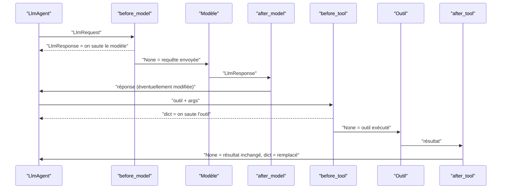

# Callbacks : garde-fous et journal

> [!NOTE]
> Dans cette leçon, vous allez poser quatre **callbacks** sur chaque `LlmAgent` du pipeline : un budget d'appels au modèle (`before_model`), un masquage des données sensibles (`after_model`), un contrôle des arguments d'outil (`before_tool`) et un journal structuré (`after_tool`).

## Le principe : intercepter sans modifier l'agent

Un **callback** est une fonction qu'ADK appelle à un moment précis du cycle d'un agent. Sa valeur de retour décide de la suite : **`None` = on laisse faire** ; un objet = on **remplace** l'étape.



| Callback | Signature (ADK 2.10) | Retour non nul |
| --- | --- | --- |
| `before_model_callback` | `(callback_context, llm_request)` | `LlmResponse` : le modèle n'est pas appelé |
| `after_model_callback` | `(callback_context, llm_response)` | `LlmResponse` : remplace la réponse |
| `before_tool_callback` | `(tool, args, tool_context)` | `dict` : l'outil n'est pas exécuté, ce dict sert de résultat |
| `after_tool_callback` | `(tool, args, tool_context, tool_response)` | `dict` : remplace le résultat |

Chaque champ accepte aussi une **liste** de fonctions, synchrones ou `async`. Il existe en plus `before/after_agent_callback` (sur tout agent), `on_model_error_callback` et `on_tool_error_callback`. Dans le code installé, `CallbackContext` et `ToolContext` sont tous deux des alias de la même classe `Context`.

## 1. Budget d'appels (before_model)

```python title="files/agent.py (extrait)"
_appels_llm: Counter[str] = Counter()  # Limite connue : compteur en mémoire par invocation, Redis/BDD si plusieurs instances

def garde_fou_budget(callback_context: CallbackContext, llm_request: LlmRequest) -> LlmResponse | None:
    """before_model : coupe le pipeline au-delà de MAX_APPELS_LLM appels pour une même demande."""
    _appels_llm[callback_context.invocation_id] += 1
    if _appels_llm[callback_context.invocation_id] > MAX_APPELS_LLM:
        log.warning("budget dépassé pour %s", callback_context.agent_name)
        return LlmResponse(content=types.Content(role="model", parts=[types.Part(
            text="[garde-fou] Budget d'appels au modèle dépassé : traitement interrompu.")]))
    return None  # None = on laisse passer la requête vers le modèle
```

Pourquoi un `Counter` Python plutôt que l'état de session ? Parce que les chercheurs tournent en parallèle : un compteur stocké dans l'état serait lu puis réécrit par trois branches, et perdrait des incréments (la condition de course vue au module 1). En `asyncio`, il n'y a pas d'`await` entre la lecture et l'écriture du `Counter` : l'incrément est sûr dans un même processus.

## 2. Masquage des données sensibles (after_model)

```python title="files/agent.py (extrait)"
MOTIFS_SENSIBLES = [
    (re.compile(r"[\w.+-]+@[\w-]+\.[\w.-]+"), "[e-mail masqué]"),
    (re.compile(r"\bFR\d{2}(?: ?[0-9A-Z]{4}){5}(?: ?[0-9A-Z]{1,3})?\b"), "[IBAN masqué]"),
]

def masquer_donnees(callback_context, llm_response):
    """after_model : masque e-mails et IBAN dans le texte produit par le modèle."""
    ...
    return llm_response if modifie else None
```

Le texte est masqué **avant** d'être enregistré dans l'historique et dans `output_key` : le rapport stocké n'en contient jamais.

## 3. Contrôle des arguments (before_tool) et 4. journal (after_tool)

```python title="files/agent.py (extrait)"
def controler_outil(tool, args, tool_context) -> dict | None:
    """before_tool : refuse un argument vide ou anormalement long (sans exécuter l'outil)."""
    if "fournisseur" in args:
        nom = str(args["fournisseur"]).strip()
        if not nom or len(nom) > 80:
            return {"erreur": "Nom de fournisseur invalide."}
    return None

def journaliser_outil(tool, args, tool_context, tool_response) -> dict | None:
    """after_tool : journalise l'appel et range la donnée brute dans l'état partagé."""
    log.info(json.dumps({"agent": tool_context.agent_name, "outil": tool.name, "args": args,
                         "erreur": isinstance(tool_response, dict) and "erreur" in tool_response},
                        ensure_ascii=False))
    if tool.name.startswith("consulter_"):
        tool_context.state["donnees_" + tool.name.removeprefix("consulter_")] = tool_response
    return None
```

Le journal est une ligne **JSON** par appel : facile à filtrer, à envoyer vers Cloud Logging et à compter. Le même callback range la donnée brute dans l'état pour le `ScoreurRisque`, une clé par outil, donc sans collision.

```quiz
question: "Un before_tool_callback renvoie {\"erreur\": \"Nom de fournisseur invalide.\"}. Que se passe-t-il ?"
options:
  - "L'outil s'exécute puis l'erreur est ajoutée au résultat"
  - "L'outil n'est pas exécuté et le modèle reçoit ce dictionnaire comme résultat de l'outil"
  - "L'agent s'arrête avec une exception"
answer: 1
explanation: "Un retour non nul d'un before_tool_callback court-circuite l'outil. Le modèle voit l'erreur et peut corriger son appel."
```

```quiz
question: "Vous voulez appliquer le même journal à tous les agents d'une application sans toucher à chaque LlmAgent. Quelle option d'ADK 2.10 convient ?"
options:
  - "Un plugin (sous-classe de BasePlugin) passé à App(plugins=[...])"
  - "Un callback sur le SequentialAgent racine uniquement"
  - "Une variable d'environnement ADK_LOG_TOOLS"
answer: 0
explanation: "Les plugins exposent les mêmes points d'accroche (before_tool_callback, after_model_callback, …) au niveau de l'application. Le lab utilise un dictionnaire CALLBACKS partagé, plus simple pour un seul pipeline."
```

> [!TIP]
> Dans le lab, `CALLBACKS = dict(before_model_callback=…, …)` est passé à chaque `LlmAgent` avec `**CALLBACKS`. C'est la version la plus courte ; passez à un plugin dès que vous avez plusieurs applications.

## Exercice : refuser les outils hors liste

Ajoutez un `before_tool_callback` qui refuse tout outil dont le nom n'est pas dans une liste blanche `OUTILS_AUTORISES`, et un test.

<details>
<summary>Voir la solution</summary>

```python title="files/agent.py (ajout)"
OUTILS_AUTORISES = {"consulter_registre", "consulter_finances", "consulter_reputation", "approuver_rapport"}

def liste_blanche(tool, args, tool_context):
    if tool.name not in OUTILS_AUTORISES:
        log.warning("outil refusé : %s", tool.name)
        return {"erreur": f"Outil non autorisé : {tool.name}"}
    return None

CALLBACKS["before_tool_callback"] = [liste_blanche, controler_outil]   # une liste est acceptée
```

```python title="files/test_pipeline.py (ajout)"
def test_outil_hors_liste_refuse():
    faux_outil = SimpleNamespace(name="supprimer_fournisseur")
    assert agent.liste_blanche(faux_outil, {}, None) == {"erreur": "Outil non autorisé : supprimer_fournisseur"}
```

Les callbacks d'une liste s'exécutent dans l'ordre ; le premier qui renvoie une valeur non nulle arrête la chaîne.

</details>

## Résultat obtenu

Journal réel (`after_tool`) de l'exécution avec la clé d'API le 2026-10-15, puis les tests des garde-fous :

```text
due_diligence {"agent": "chercheur_registre", "outil": "consulter_registre", "args": {"fournisseur": "Transports Kervalec"}, "erreur": false}
due_diligence {"agent": "chercheur_finances", "outil": "consulter_finances", "args": {"fournisseur": "Transports Kervalec"}, "erreur": false}
due_diligence {"agent": "chercheur_reputation", "outil": "consulter_reputation", "args": {"fournisseur": "Transports Kervalec"}, "erreur": false}
due_diligence {"agent": "relecteur", "outil": "approuver_rapport", "args": {}, "erreur": false}

test_pipeline.py::test_masquage_email_et_iban PASSED
test_pipeline.py::test_controle_outil_refuse_nom_vide PASSED
test_pipeline.py::test_garde_fou_budget PASSED
```

## Je sais faire

- [ ] Citer les quatre callbacks modèle/outil, leur signature et l'effet d'un retour non nul
- [ ] Écrire un budget d'appels qui résiste au parallélisme
- [ ] Masquer des données sensibles avant qu'elles n'atteignent l'état
- [ ] Produire un journal JSON des appels d'outils
