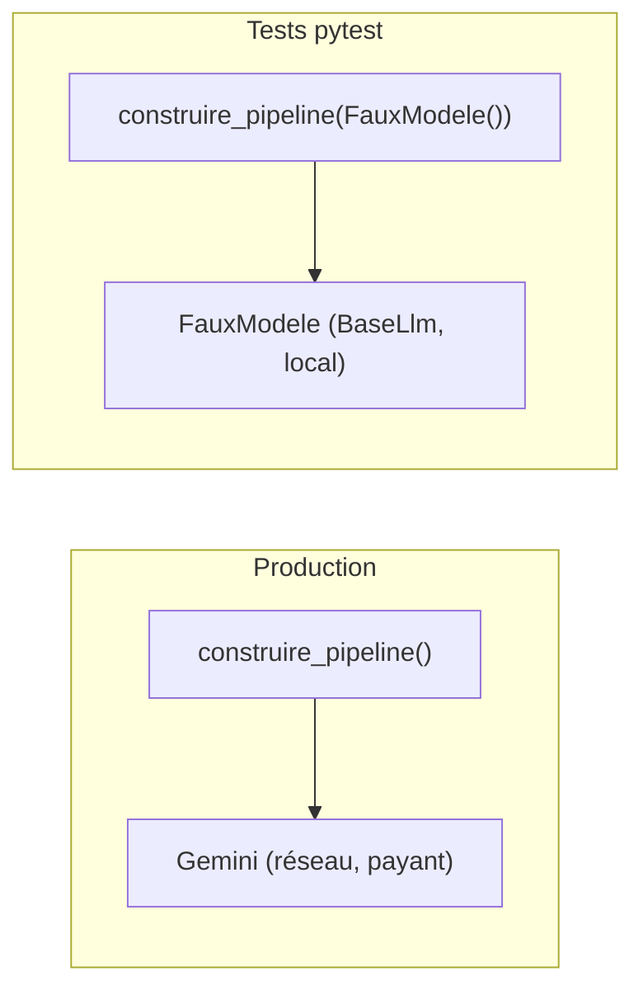

# Tester sans clé avec un faux modèle

> [!NOTE]
> Dans cette leçon, vous allez tester **tout le pipeline**, boucle et callbacks compris, sans clé d'API ni réseau : en remplaçant Gemini par un faux modèle, une sous-classe de `BaseLlm` qui renvoie des réponses scriptées. Neuf tests, moins de 2 secondes.

## Pourquoi un faux modèle ?

Un vrai modèle est lent, payant et **non déterministe** (la même question ne donne pas toujours la même réponse). Impossible d'en faire la base d'une intégration continue. Ce qu'on veut vérifier en CI, ce n'est pas la qualité du texte (c'est le rôle de l'évaluation, leçon suivante) mais la **plomberie** : les agents s'enchaînent, l'état circule, la boucle s'arrête, les garde-fous se déclenchent.



La seule condition : que le modèle soit **injectable**. C'est pourquoi `construire_pipeline(model=None)` accepte un modèle en paramètre, et que `LlmAgent(model=...)` accepte aussi bien un nom (`"gemini-3.5-flash"`) qu'un objet `BaseLlm`.

| Ce qu'on teste | Comment | Réseau ? |
| --- | --- | --- |
| Règles de score, masquage, contrôles | appel direct des fonctions pures | non |
| Callbacks | appel direct avec un faux contexte (`SimpleNamespace`) | non |
| Enchaînement, état, boucle, arrêt | pipeline complet + `FauxModele` | non |
| Qualité des rapports | `adk eval` + vrai modèle | oui |

## Le faux modèle

Il suffit d'implémenter `generate_content_async(llm_request, stream=False)`, un générateur asynchrone qui produit des `LlmResponse`. Le nôtre lit la requête pour savoir quel agent l'appelle (d'après les outils disponibles et l'instruction) :

```python title="files/test_pipeline.py (extrait)"
class FauxModele(BaseLlm):
    """Imite Gemini : appelle l'outil disponible, refuse la 1re version du rapport, approuve la 2e."""

    model: str = "faux-modele"
    relectures: int = 0
    appels: int = 0

    async def generate_content_async(self, llm_request, stream=False):
        self.appels += 1
        demande = llm_request.contents[0].parts[0].text
        fournisseur = re.search(r"fournisseur : (.+)$", demande).group(1)
        outils = list(llm_request.tools_dict)
        dernier = llm_request.contents[-1]
        if any(p.function_response for p in dernier.parts or []):
            yield _reponse(types.Part(text="- résumé factuel de l'outil"))
        elif outils and outils[0].startswith("consulter_"):
            yield _reponse(types.Part(function_call=types.FunctionCall(
                name=outils[0], args={"fournisseur": fournisseur})))
        elif "approuver_rapport" in outils:
            self.relectures += 1
            if self.relectures == 1:
                yield _reponse(types.Part(text="1. Ajouter la section ## Plan d'action."))
            else:
                yield _reponse(types.Part(function_call=types.FunctionCall(name="approuver_rapport", args={})))
        elif "Rédige" in str(llm_request.config.system_instruction):
            yield _reponse(types.Part(text=RAPPORT_COMPLET))
        else:
            yield _reponse(types.Part(text="Risque financier élevé."))
```

Le vrai ADK fait tout le reste : exécution des outils, callbacks, `output_key`, `escalate`. Le test le plus important vérifie le scénario complet :

```python title="files/test_pipeline.py (extrait)"
def test_pipeline_complet_avec_faux_modele():
    faux = FauxModele()
    r = asyncio.run(due_diligence("Composants Arvenne", faux))
    assert r["score"]["score"] == 45
    assert r["statut"] == "approuvé" and r["passages"] == 2   # la boucle a tourné 2 fois
    assert "[e-mail masqué]" in r["rapport"]                    # after_model_callback appliqué
    assert faux.appels == 3 * 2 + 1 + 2 * 2                     # 3 chercheurs, analyste, 2 tours de boucle
```

Le compte d'appels est un **test de coût** : si quelqu'un ajoute par erreur un agent ou supprime `skip_summarization`, le test casse.

```quiz
question: "Pourquoi la dernière assertion compte-t-elle les appels au faux modèle ?"
options:
  - "Pour vérifier la vitesse du test"
  - "Pour détecter toute régression qui ajouterait des appels au modèle, donc du coût et de la latence en production"
  - "Parce qu'ADK l'exige"
answer: 1
explanation: "Chaque appel au vrai modèle coûte des tokens et des secondes. Figer leur nombre attendu (11 ici) transforme le coût en propriété testée."
```

```quiz
question: "Avec ce faux modèle, le test « Cartonnerie Belval » échouerait sur le statut. Pourquoi ?"
options:
  - "Parce que le fournisseur n'existe pas"
  - "Parce que RAPPORT_COMPLET cite le score 45 alors que Belval a 0 : verifier_rapport refuse et la boucle atteint max_iterations"
  - "Parce que le faux modèle ne sait pas appeler consulter_registre"
answer: 1
explanation: "C'est la validation déterministe qui fait son travail : un rapport qui ne cite pas le bon score n'est jamais approuvé, même si le relecteur appelle approuver_rapport."
```

## Lancer les tests

```bash title="terminal"
cd due_diligence
pytest -q        # aucune variable d'environnement nécessaire
```

> [!TIP]
> Les tests construisent le pipeline avec le faux modèle, mais `agent.py` crée aussi `root_agent` avec le vrai modèle à l'import. Ce n'est pas un problème : le client Gemini n'ouvre aucune connexion tant qu'on ne lui envoie pas de requête.

## Exercice : tester le garde-fou budget en conditions réelles

Le test `test_garde_fou_budget` appelle le callback directement. Écrivez un test de bout en bout qui fixe `MAX_APPELS_LLM` à 4 et vérifie que le rapport final contient le message du garde-fou.

<details>
<summary>Voir la solution</summary>

```python title="files/test_pipeline.py (ajout)"
def test_budget_coupe_le_pipeline(monkeypatch):
    monkeypatch.setattr(agent, "MAX_APPELS_LLM", 4)
    r = asyncio.run(due_diligence("Composants Arvenne", FauxModele()))
    assert r["rapport"].startswith("[garde-fou]")
    assert r["statut"] == "non approuvé"
```

Avec 4 appels autorisés, les 3 chercheurs font leur appel d'outil (3), un seul obtient son résumé (4), puis tout le reste reçoit la réponse du garde-fou, y compris le rédacteur dont la sortie devient `rapport`. Le relecteur, lui aussi bloqué, n'appelle jamais `approuver_rapport` : la boucle fait ses 3 tours, mais sans aucun appel au modèle. Le score (45) est quand même calculé, car les trois outils avaient répondu avant la coupure.

</details>

## Résultat obtenu

`pytest -v` dans `files/`, sans aucune clé, le 2026-10-15 :

```text
test_pipeline.py::test_score_par_fournisseur PASSED                      [ 11%]
test_pipeline.py::test_score_indetermine_si_donnee_manquante PASSED      [ 22%]
test_pipeline.py::test_masquage_email_et_iban PASSED                     [ 33%]
test_pipeline.py::test_controle_outil_refuse_nom_vide PASSED             [ 44%]
test_pipeline.py::test_garde_fou_budget PASSED                           [ 55%]
test_pipeline.py::test_pipeline_complet_avec_faux_modele PASSED          [ 66%]
test_pipeline.py::test_pipeline_fournisseur_inconnu PASSED               [ 77%]
test_pipeline.py::test_verifier_rapport PASSED                           [ 88%]
test_pipeline.py::test_approbation_refusee_si_rapport_incomplet PASSED   [100%]
============================== 9 passed in 1.61s ===============================
```

## Je sais faire

- [ ] Rendre le modèle injectable dans un pipeline ADK
- [ ] Écrire un faux modèle `BaseLlm` qui scripte appels d'outils et textes
- [ ] Tester un callback avec un faux contexte
- [ ] Transformer le nombre d'appels au modèle en assertion de coût
