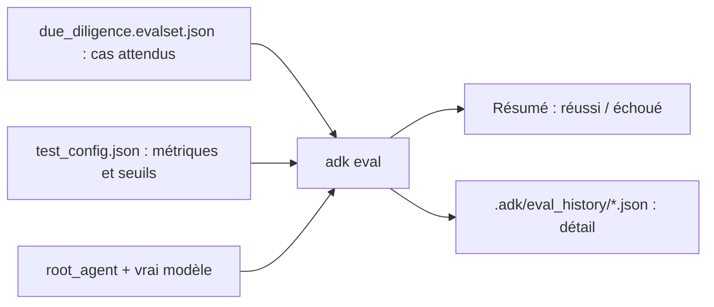

# Évaluer avec adk eval

> [!NOTE]
> Dans cette leçon, vous allez évaluer le pipeline **avec le vrai modèle** grâce à la commande `adk eval` : écrire un jeu d'évaluation (*eval set*), choisir une métrique adaptée à un pipeline parallèle, lancer l'évaluation et lire les métriques d'efficacité que fournit ADK 2.10.

## Tests et évaluation : deux questions différentes

Les tests de la leçon précédente répondent à « le code fait-il ce qu'il doit ? ». L'**évaluation** répond à « le modèle, dans ce code, se comporte-t-il correctement ? » : appelle-t-il les bons outils, avec les bons arguments, et sa réponse est-elle bonne ? Elle s'exécute sur le vrai modèle, donc elle coûte : on la lance avant une mise en production ou un changement de modèle, pas à chaque commit.



## Installer le module d'évaluation

Dans la version installée, `adk eval` refuse de démarrer sans dépendances supplémentaires :

```text
Error: Eval module is not installed, please install via `pip install "google-adk[eval]"`.
```

```bash title="terminal"
pip install "google-adk[eval]==2.10.0"
```

## Le jeu d'évaluation

Un **eval set** est un fichier JSON qui contient des **cas** (`eval_cases`). Chaque cas décrit une conversation : le message utilisateur et ce qu'on attend, ici la liste des outils que le pipeline doit appeler.

```json title="files/due_diligence.evalset.json (extrait)"
{
  "eval_set_id": "due_diligence",
  "eval_cases": [{
    "eval_id": "cartonnerie_belval",
    "conversation": [{
      "invocation_id": "inv-belval",
      "user_content": {"role": "user", "parts": [{"text": "Due diligence du fournisseur : Cartonnerie Belval"}]},
      "intermediate_data": {"tool_uses": [
        {"name": "consulter_registre", "args": {"fournisseur": "Cartonnerie Belval"}},
        {"name": "consulter_finances", "args": {"fournisseur": "Cartonnerie Belval"}},
        {"name": "consulter_reputation", "args": {"fournisseur": "Cartonnerie Belval"}},
        {"name": "approuver_rapport", "args": {}}
      ]}
    }],
    "session_input": {"app_name": "due_diligence", "user_id": "eval", "state": {}}
  }]
}
```

> [!TIP]
> Vous pouvez aussi créer un cas depuis `adk web` : faites une conversation, puis enregistrez-la comme cas d'évaluation dans l'onglet d'évaluation. La commande `adk eval_set` gère les jeux en ligne de commande.

## Choisir la métrique

Sans fichier de configuration, ADK 2.10 applique les critères par défaut `tool_trajectory_avg_score: 1.0` et `response_match_score: 0.8`. Ni l'un ni l'autre ne convient tel quel :

| Métrique | Ce qu'elle mesure | Pour notre pipeline |
| --- | --- | --- |
| `tool_trajectory_avg_score` (`EXACT`, défaut) | mêmes outils, même ordre, rien de plus | échoue au hasard : les chercheurs parallèles finissent dans un ordre variable |
| `tool_trajectory_avg_score` + `ANY_ORDER` | les outils attendus sont tous appelés, dans n'importe quel ordre, extras tolérés | adapté |
| `response_match_score` | recouvrement de mots (ROUGE) avec une réponse de référence | inadapté à un rapport de 350 mots |
| `rubric_based_final_response_quality_v1`, `hallucinations_v1` | un LLM juge selon une grille ou vérifie les affirmations | utile, mais ajoute des appels au modèle |

`ANY_ORDER` tolère aussi un `approuver_rapport` refusé puis accepté : seul compte que l'appel attendu ait eu lieu.

```json title="files/test_config.json"
{
  "criteria": {
    "tool_trajectory_avg_score": {"threshold": 1.0, "match_type": "ANY_ORDER"}
  }
}
```

Si vous ne passez pas `--config_file_path`, `adk eval` cherche `test_config.json` **dans le dossier du fichier d'eval set**.

```quiz
question: "Pourquoi le critère par défaut (correspondance EXACT de la trajectoire) est-il fragile pour ce pipeline ?"
options:
  - "Parce qu'il ignore les arguments des outils"
  - "Parce que les trois chercheurs tournent en parallèle et appellent leurs outils dans un ordre qui varie d'une exécution à l'autre"
  - "Parce qu'il ne fonctionne qu'avec Vertex AI"
answer: 1
explanation: "EXACT exige le même ordre. Avec un ParallelAgent, l'ordre dépend de la vitesse des réponses du modèle ; ANY_ORDER vérifie la présence des appels sans imposer d'ordre."
```

## Lancer l'évaluation

Depuis le dossier **parent** de l'application :

```bash title="terminal"
adk eval due_diligence due_diligence/due_diligence.evalset.json
# un seul cas d'un jeu :  due_diligence/due_diligence.evalset.json:cartonnerie_belval
# détail en console :     --print_detailed_results
```

Le premier argument est le dossier de l'agent (son nom devient `app_name`), les suivants les fichiers d'eval set. Les résultats détaillés sont écrits dans `due_diligence/.adk/eval_history/`.

```quiz
question: "Que contient la métrique inference_call_count_v1 dans un résultat d'adk eval ?"
options:
  - "Le nombre d'appels au modèle pendant le cas, à titre informatif, sans seuil de réussite"
  - "Le nombre de cas réussis"
  - "Le nombre d'outils différents"
answer: 0
explanation: "ADK 2.10 ajoute toujours quatre métriques d'efficacité informatives : tool_call_count_v1, inference_call_count_v1, token_usage_v1 et invocation_duration_v1. Elles ne font jamais échouer un cas."
```

## Exercice : un cas qui doit refuser

Ajoutez un cas `fournisseur_inconnu` pour « Société Imaginaire ». Quels outils attendez-vous, et quel piège de la métrique `ANY_ORDER` faut-il garder en tête ?

<details>
<summary>Voir la solution</summary>

On attend les trois `consulter_*` avec `{"fournisseur": "Société Imaginaire"}`, et **pas** `approuver_rapport` (le score est indéterminé, aucun rapport valable).

Le piège : `ANY_ORDER` tolère les appels **en plus**. Si le modèle appelle quand même `approuver_rapport`, le cas passe. Pour vérifier une absence, il faut soit un critère `EXACT` sur un pipeline sans parallélisme, soit un test sur l'état final (`statut_relecture` absent), soit une métrique personnalisée (`custom_metrics` dans `test_config.json`). Dans notre code, `verifier_rapport` refusera de toute façon : un rapport sans score ne peut pas citer le score.

</details>

## Résultat obtenu

`adk eval` réel avec la clé d'API (`gemini-3.5-flash`) le 2026-10-15 :

```text
Using evaluation criteria: criteria={'tool_trajectory_avg_score': BaseCriterion(threshold=1.0,
  include_intermediate_responses_in_final=False, match_type='ANY_ORDER')} …
*********************************************************************
Eval Run Summary
due_diligence:
  Tests passed: 1
  Tests failed: 0
```

Métriques lues dans `.adk/eval_history/…evalset_result.json` :

```text
cartonnerie_belval
  tool_trajectory_avg_score 1.0
  tool_call_count_v1 4.0
  inference_call_count_v1 11.0
  token_usage_v1 34089.0
  invocation_duration_v1 45.339
```

Ordre de grandeur pour un dossier : 11 appels au modèle, environ 34 000 tokens, 45 secondes.

## Je sais faire

- [ ] Installer `google-adk[eval]` et lancer `adk eval`
- [ ] Écrire un eval set avec des trajectoires d'outils attendues
- [ ] Choisir `ANY_ORDER` pour un pipeline parallèle et connaître sa limite
- [ ] Lire les métriques d'efficacité (appels, tokens, durée)
