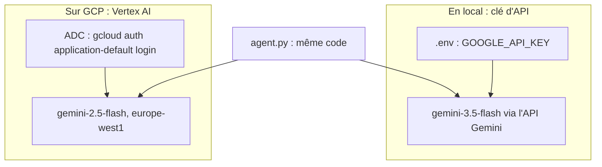

# Projet : le pipeline de due diligence de bout en bout

> [!NOTE]
> Dans cette leçon, vous allez assembler et exécuter le pipeline complet, d'abord **en local avec une clé d'API Gemini**, puis **sur Google Cloud avec Vertex AI**, sans changer une ligne de code. Vous lirez la trace, mesurerez coût et durée, puis étendrez le projet selon un cahier des charges.

## Cahier des charges

Le service achats d'une PME (fictive) veut un premier avis sur un fournisseur en moins de deux minutes :

1. consulter trois sources (registre, finances, réputation) **en parallèle** ;
2. calculer un **score de risque reproductible** et auditable ;
3. produire un rapport conforme à la politique achats (4 sections, recommandation normalisée, plan d'action) ;
4. ne jamais approuver un rapport non conforme ; ne jamais dépasser un budget d'appels ;
5. ne jamais laisser passer d'e-mail ou d'IBAN dans le rapport ;
6. être testable sans clé, et évaluable avec `adk eval`.



## Étape 1 : installer et tester sans clé

```bash title="terminal"
mkdir -p mon_projet/due_diligence && cd mon_projet/due_diligence
# copiez ici tous les fichiers de files/
python -m venv .venv && source .venv/bin/activate
pip install -r requirements.txt
pytest -q                     # 9 passed
```

## Étape 2 : en local avec une clé d'API

```bash title="terminal"
cp .env.example .env          # renseignez GOOGLE_API_KEY, gardez GOOGLE_GENAI_USE_VERTEXAI=FALSE
python run_pipeline.py "Transports Kervalec"
```

[run_pipeline.py](../files/run_pipeline.py) crée un `InMemoryRunner`, envoie la demande, affiche chaque appel d'outil et chaque réponse finale, puis relit l'état de session :

```python title="files/run_pipeline.py (extrait)"
async for ev in runner.run_async(user_id="acheteur", session_id=session.id, new_message=demande):
    for p in (ev.content.parts if ev.content else []):
        if p.function_call:
            print(f"[{ev.author}] appel outil {p.function_call.name}({dict(p.function_call.args or {})})")
        elif p.text and not p.thought and ev.is_final_response():
            print(f"[{ev.author}] {p.text.strip()[:90]!r}")
    if ev.author == "redacteur" and ev.is_final_response():
        passages += 1
```

> [!WARNING]
> `.env` contient votre clé : ajoutez-le à `.gitignore` avant le premier commit. Le code ne contient aucune clé en dur, il lit l'environnement (et `.env` via `python-dotenv`).

## Étape 3 : sur GCP avec Vertex AI

```bash title="terminal"
gcloud auth application-default login
export GOOGLE_GENAI_USE_VERTEXAI=TRUE GOOGLE_CLOUD_PROJECT=mon-projet GOOGLE_CLOUD_LOCATION=europe-west1
export MODEL=gemini-2.5-flash
unset GOOGLE_API_KEY          # évite toute ambiguïté sur le mode utilisé
python run_pipeline.py "Composants Arvenne"
```

Rien n'est créé dans le projet : on n'utilise que l'inférence Vertex AI, facturée à l'usage. Il n'y a donc **aucune ressource à supprimer** après le test. Si vous déployez ensuite l'agent (par exemple `adk deploy cloud_run`), pensez à supprimer le service et son image à la fin.

| | Clé d'API (`gemini-3.5-flash`) | Vertex AI (`gemini-2.5-flash`) |
| --- | --- | --- |
| Fournisseur testé | Transports Kervalec | Composants Arvenne |
| Passages de rédaction | 2 | 3 (une approbation refusée par `verifier_rapport`) |
| Durée mesurée | 44,8 s | 87,8 s |
| Recommandation | ÉCARTER | RETENIR SOUS CONDITIONS |

Ces durées sont **une mesure ponctuelle** du 2026-10-15, pas un banc d'essai : elles varient avec la charge du service et le nombre de tours de boucle.

```quiz
question: "Que faut-il changer dans agent.py pour passer de la clé d'API à Vertex AI ?"
options:
  - "Remplacer Gemini par une classe VertexGemini"
  - "Rien : les variables GOOGLE_GENAI_USE_VERTEXAI, GOOGLE_CLOUD_PROJECT, GOOGLE_CLOUD_LOCATION (et MODEL) suffisent"
  - "Ajouter un paramètre project= à chaque LlmAgent"
answer: 1
explanation: "Le client google-genai utilisé par ADK choisit son mode d'après l'environnement. Le nom du modèle vient de MODEL, avec un défaut."
```

```quiz
question: "Combien d'appels au modèle un dossier approuvé au 2e passage coûte-t-il dans ce pipeline ?"
options:
  - "5 : un par agent"
  - "11 : 3 chercheurs x 2, l'analyste, puis 2 tours de rédaction + relecture"
  - "Cela dépend uniquement du nombre d'outils"
answer: 1
explanation: "Chaque chercheur fait un appel pour demander l'outil et un pour résumer (6), l'analyste 1, chaque tour de boucle 2 (rédacteur + relecteur). skip_summarization évite un 12e appel après approuver_rapport. adk eval a mesuré 11 appels."
```

## Étape 4 : à vous de jouer

Choisissez au moins deux extensions, et pour chacune ajoutez un test sans clé :

1. Le contrôle des dates inventées (leçon sur `LoopAgent`).
2. Le saut de l'analyse pour un fournisseur inconnu (`before_agent_callback`, leçon sur `ParallelAgent`).
3. Un quatrième chercheur « conformité » (leçon sur l'état).
4. Un `Aiguilleur` qui envoie les risques élevés vers un circuit renforcé (leçon sur `BaseAgent`).
5. Un deuxième cas dans l'eval set et un critère `rubric_based_final_response_quality_v1`.

## Exercice : diagnostiquer une boucle qui ne s'arrête jamais

Un collègue signale que tous ses rapports finissent « non approuvé après 3 passages ». Le relecteur appelle pourtant `approuver_rapport` à chaque tour. Quelles sont les deux causes les plus probables, et comment les vérifier ?

<details>
<summary>Voir la solution</summary>

1. **`verifier_rapport` refuse toujours** : le rédacteur ne connaît pas une règle (par exemple il écrit `### Synthèse`). Vérifiez la réponse de l'outil dans `adk web` (`{"statut": "refusé", "manques": [...]}`) et transmettez la règle au rédacteur, ou assouplissez le contrôle.
2. **Le score cité ne correspond pas** : le rédacteur arrondit ou reformule (« quarante-cinq »). Le contrôle exige le nombre exact. Ajoutez « cite le score en chiffres, à l'identique » à l'instruction du rédacteur.

Dans les deux cas, ne supprimez pas la vérification : c'est elle qui vous a signalé le problème. Un test sans clé reproduisant le rapport refusé vous protège ensuite de la régression.

</details>

## Résultat obtenu

Exécution réelle avec la clé d'API le 2026-10-15 (`python run_pipeline.py "Transports Kervalec"`) :

```text
[chercheur_registre] appel outil consulter_registre({'fournisseur': 'Transports Kervalec'})
[chercheur_finances] appel outil consulter_finances({'fournisseur': 'Transports Kervalec'})
[chercheur_reputation] appel outil consulter_reputation({'fournisseur': 'Transports Kervalec'})
[scoreur] 'Score de risque calculé : 100 (élevé)'
[analyste] "En tant que responsable des risques fournisseurs, voici l'analyse détaillée de **Transport"
[redacteur] '# Rapport de Due Diligence Supplier : Transports Kervalec\n\n**Évaluation du risque :** 100 '
[relecteur] 'Voici les corrections nécessaires à apporter au rapport :\n\n1. **Titres et structure des se'
[redacteur] '# Rapport de Due Diligence : Transports Kervalec\n\n## Synthèse\nTransports Kervalec présente'
[relecteur] appel outil approuver_rapport({})

Statut : approuvé après 2 passage(s) de rédaction, en 44.8 s

## Recommandation
`ÉCARTER`

## Plan d'action
1. **Gel immédiat des négociations et refus d'attribution de contrat** — Responsable : Responsable Achats — Délai : Immédiat
2. **Identification et qualification d'un fournisseur alternatif de transport** — Responsable : Équipe Logistique — Délai : Sous 15 jours
3. **Mise à jour de la cartographie des risques fournisseurs et clôture du dossier** — Responsable : Responsable Risques — Délai : Sous 30 jours
```

Et sur Vertex AI (`gemini-2.5-flash`, europe-west1) pour « Composants Arvenne » : `Statut : approuvé après 3 passage(s) de rédaction, en 87.8 s`, score `45 (moyen)`.

## Je sais faire

- [ ] Exécuter le même pipeline ADK avec une clé d'API puis avec Vertex AI
- [ ] Lire une trace d'exécution multi-agents et compter les appels au modèle
- [ ] Vérifier qu'aucune ressource cloud n'est restée après un test
- [ ] Étendre le pipeline en gardant des tests sans clé
