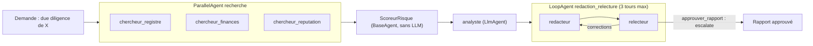

Un seul agent qui « fait tout » devient vite imprévisible : il oublie une étape, invente un chiffre, tourne en rond. Dès qu'un processus métier a des **étapes connues**, on gagne en fiabilité en les écrivant comme un **workflow** : une suite d'agents spécialisés, orchestrés par du code. Cette formation vous apprend à le faire avec **Google ADK** (Agent Development Kit), le framework open source de Google pour construire des agents, en version **2.10.0**.

Fil rouge : un pipeline de **due diligence fournisseur**, c'est-à-dire la vérification d'un fournisseur avant de signer avec lui (santé financière, situation juridique, réputation). Trois chercheurs travaillent en parallèle, un agent sans IA calcule un score de risque, un analyste synthétise, puis un rédacteur et un relecteur échangent en boucle jusqu'à ce que le rapport respecte la politique achats.

## Ce que vous construisez

Le tout est enveloppé dans un `SequentialAgent`, partage un **état de session** (un dictionnaire commun à tous les agents) et passe par quatre **callbacks** : budget d'appels, masquage des données sensibles, contrôle des arguments d'outil, journal.

## Pour qui ?

- Développeurs Python qui ont déjà écrit un agent avec outils (par exemple dans [Construire un agent IA de A à Z](../../../01-ia-generative/07-construire-un-agent-ia/index.md)).
- À l'aise avec `async`/`await`, `pytest` et les variables d'environnement.
- Aucune connaissance préalable des agents de workflow d'ADK.

## Prérequis

- Python 3.10 ou plus récent, `pip install -r requirements.txt` (google-adk 2.10.0).
- **En local, sans GCP** : une clé d'API Gemini (Google AI Studio) dans `GOOGLE_API_KEY`, modèle par défaut `gemini-3.5-flash`.
- **Sur GCP** : un projet avec Vertex AI activé, `gcloud auth application-default login`, `GOOGLE_GENAI_USE_VERTEXAI=TRUE` et le modèle `gemini-2.5-flash` en `europe-west1`. Le même code tourne dans les deux modes : seules les variables changent.

| | En local (clé d'API) | Sur GCP (Vertex AI) |
| --- | --- | --- |
| Authentification | `GOOGLE_API_KEY` | identifiants ADC (`gcloud auth application-default login`) |
| Variables | `GOOGLE_GENAI_USE_VERTEXAI=FALSE` | `TRUE` + `GOOGLE_CLOUD_PROJECT` + `GOOGLE_CLOUD_LOCATION` |
| Modèle testé | `gemini-3.5-flash` | `gemini-2.5-flash` (europe-west1) |
| Données | restent sur votre poste, prompts envoyés à l'API Gemini | traitées dans la région choisie de votre projet |

## Programme

| Module | Leçons | Durée |
| --- | --- | --- |
| 1. Fondations | Du LlmAgent au workflow ; état partagé et `output_key` | 1h15 |
| 2. Orchestrer | `SequentialAgent` et `ParallelAgent` ; `LoopAgent` et condition d'arrêt ; agent personnalisé `BaseAgent` | 2h |
| 3. Fiabiliser | Callbacks garde-fous et journal ; tester sans clé avec un faux modèle ; évaluer avec `adk eval` | 1h45 |
| 4. Projet final | Le pipeline de bout en bout, avec la clé d'API puis Vertex AI | 1h |

## Le code du lab

Tout est dans [files/](./files/) : [agent.py](./files/agent.py) (le pipeline), [run_pipeline.py](./files/run_pipeline.py) (exécution et trace), [test_pipeline.py](./files/test_pipeline.py) (9 tests sans clé), [fournisseurs.json](./files/fournisseurs.json) (3 fournisseurs **fictifs**), le jeu d'évaluation `due_diligence.evalset.json`, `test_config.json`, `requirements.txt` et `.env.example`.

> [!TIP]
> Placez ces fichiers dans un dossier nommé `due_diligence/` : ADK utilise le nom du dossier comme nom d'application pour `adk run`, `adk web` et `adk eval`.

## Ce que vous saurez faire

- Choisir entre un agent autonome et un workflow, et composer `SequentialAgent`, `ParallelAgent`, `LoopAgent` et un `BaseAgent` maison.
- Faire circuler les données entre agents par l'état de session, sans collisions.
- Écrire une condition d'arrêt de boucle qui ne dépend pas uniquement du LLM.
- Poser des garde-fous et un journal avec les callbacks `before/after_model` et `before/after_tool`.
- Tester un pipeline multi-agents sans clé, puis l'évaluer avec `adk eval`.
