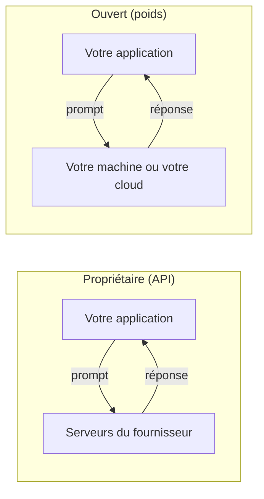

# Ouvert ou propriétaire : licence, confidentialité, coûts

> [!NOTE]
> Dans cette leçon, vous allez comparer un modèle **ouvert** (Gemma) et un modèle **propriétaire** servi par API (Gemini) selon trois critères qui décident en pratique : la licence, la confidentialité des données et le coût. Vous repartirez avec une grille de décision.

## Deux modèles de distribution

- Un **modèle propriétaire** (Gemini, par exemple) n'est accessible que par une API : vous envoyez un texte, le fournisseur exécute le modèle sur ses machines et vous renvoie la réponse. Vous ne voyez jamais les poids.
- Un **modèle ouvert** (*open weights*) publie ses **poids**, c'est-à-dire les milliards de nombres appris pendant l'entraînement. Vous les téléchargez et vous exécutez le modèle où vous voulez.

« Ouvert » ne veut pas forcément dire « open source » au sens strict : les données et le code d'entraînement ne sont généralement pas publiés. Ce qui compte pour vous, c'est **la licence des poids**.



## 1. La licence

| Modèle | Licence | Ce qu'elle implique |
| --- | --- | --- |
| Gemma 4 | Apache 2.0 | licence permissive standard : usage commercial, modification, redistribution, avec mention de la licence |
| Gemma 1, 2, 3 (et 3n, PaliGemma, ShieldGemma…) | Gemma Terms of Use | licence propre à Google : usage commercial permis, mais soumis à une **politique d'usages interdits** (*Prohibited Use Policy*) qui suit le modèle et ses dérivés |
| Gemini | Conditions du service (API) | pas de poids : vous achetez un service, régi par les conditions de l'API |

> [!WARNING]
> La licence s'attache à **chaque version**. Avant de mettre un modèle en production, lisez la page de licence de la version exacte que vous utilisez, y compris pour un modèle dérivé (affiné par un tiers sur Hugging Face).

```quiz
question: "Vous intégrez Gemma 3 dans un produit commercial. Que devez-vous vérifier en particulier ?"
options:
  - "Rien : tous les modèles Gemma sont sous Apache 2.0"
  - "Le respect des Gemma Terms of Use, notamment la politique d'usages interdits, qui s'applique aussi aux dérivés"
  - "Que vous avez acheté une licence par utilisateur"
answer: 1
explanation: "Seul Gemma 4 est publié sous Apache 2.0. Gemma 1 à 3 relèvent des Gemma Terms of Use, qui autorisent l'usage commercial avec des restrictions d'usage."
```

## 2. La confidentialité

Avec un modèle exécuté **chez vous**, les prompts et les réponses ne sortent pas de votre machine ou de votre réseau. C'est l'argument décisif pour des données très sensibles (santé, RH, défense, secrets industriels) ou un poste sans connexion.

Avec une API, vos données transitent chez le fournisseur. Les offres professionnelles (comme Vertex AI) encadrent ce traitement par contrat : région de traitement, non-utilisation des données pour l'entraînement, journalisation contrôlée. Pour beaucoup d'entreprises, c'est suffisant ; pour certaines, non.

> [!TIP]
> Gemma servi **par l'API Gemini**, comme dans ce lab, n'apporte pas l'avantage de confidentialité : les données partent chez Google comme pour Gemini. C'est un moyen pratique de **tester** Gemma sans GPU, pas un mode de déploiement confidentiel.

## 3. Les coûts

Les deux modèles économiques sont opposés :

| | API (Gemini) | Auto-hébergé (Gemma) |
| --- | --- | --- |
| Coût fixe | aucun | machine ou GPU, même inactifs (sauf mise à l'échelle à zéro) |
| Coût variable | au token (entrée + sortie) | quasi nul par requête |
| Exploitation | assurée par le fournisseur | mises à jour, supervision, sécurité à votre charge |
| Point fort | petit volume, pics imprévisibles | gros volume régulier, données sensibles |

Le calcul se fait toujours de la même façon : **volume mensuel de tokens × prix au token** d'un côté, **coût mensuel de l'infrastructure + temps d'exploitation** de l'autre. Prenez les prix sur les pages tarifaires officielles au moment du calcul : ils changent souvent.

```quiz
question: "Quel scénario favorise le plus l'auto-hébergement de Gemma ?"
options:
  - "Un prototype utilisé 20 fois par jour"
  - "Un traitement régulier de millions de documents confidentiels qui ne doivent pas quitter le réseau interne"
  - "Un chatbot public avec des pics de trafic imprévisibles"
answer: 1
explanation: "Un gros volume régulier amortit l'infrastructure, et l'exigence de confidentialité impose de garder les données chez soi. Les deux autres cas profitent de la facturation à l'usage d'une API."
```

## Exercice : la grille de décision

Pour chacun des trois besoins, choisissez Gemma en local, Gemma sur votre cloud, ou Gemini par API, et justifiez en une phrase : (a) un assistant qui résume les comptes rendus du comité de direction ; (b) un outil de traduction pour le site public, 500 requêtes par jour ; (c) une application de terrain pour des techniciens souvent sans réseau.

<details>
<summary>Voir la solution</summary>

- (a) **Gemma en local ou sur votre cloud** si la politique interne interdit l'envoi de ces documents à un tiers ; sinon Gemini sur Vertex AI avec les garanties contractuelles suffit. La décision vient de la politique de sécurité, pas de la technique.
- (b) **Gemini par API** : faible volume, aucun besoin de confidentialité particulier, aucune infrastructure à maintenir.
- (c) **Gemma en local** (sur l'appareil, par exemple Gemma 4 E2B quantifié) : c'est le seul choix qui fonctionne sans réseau.

</details>

## Résultat obtenu

Liste des modèles Gemma accessibles avec une clé d'API Gemini, obtenue le 2026-10-15 par `python client_llm.py` (point d'accès `/models` compatible OpenAI) :

```text
['models/gemma-4-26b-a4b-it', 'models/gemma-4-31b-it']
```

## Je sais faire

- [ ] Distinguer modèle ouvert, open source et propriétaire
- [ ] Identifier la licence d'une version de Gemma et ses contraintes
- [ ] Expliquer quand le local apporte une vraie confidentialité, et quand non
- [ ] Poser le calcul de coût API contre auto-hébergement
